<div align="center">

<a href="https://lo3elyon.github.io/ASI/"></a>

<a href="https://lo3elyon.github.io/ASI/"></a>

<br>

<a href="https://lo3elyon.github.io/ASI/"></a>
<a href="https://lo3elyon.github.io/ASI/ai-2027-2040/"></a>
<a href="https://lo3elyon.github.io/ASI/black-october-2026/"></a>
<a href="https://lo3elyon.github.io/ASI/jacob-coxon-podcasts/"></a>
<a href="#05-watch"></a>


<br><br>

<table>
<tr>
<td align="center"><a href="#01-overview"><b>Overview</b></a></td>
<td align="center"><a href="#02-visual-tour"><b>Visual tour</b></a></td>
<td align="center"><a href="#03-the-library"><b>Explainers</b></a></td>
<td align="center"><a href="#04-deep-dive"><b>Deep dive</b></a></td>
<td align="center"><a href="#04b-black-october"><b>Black October</b></a></td>
<td align="center"><a href="#04c-jacob-coxon"><b>Jacob Coxon</b></a></td>
<td align="center"><a href="#05-watch"><b>Videos</b></a></td>
<td align="center"><a href="#06-people"><b>Team</b></a></td>
<td align="center"><a href="#07-architecture"><b>Architecture</b></a></td>
<td align="center"><a href="#08-workflow"><b>Add a page</b></a></td>
<td align="center"><a href="#09-run-and-deploy"><b>Run</b></a></td>
<td align="center"><a href="#10-design-system"><b>Design</b></a></td>
<td align="center"><a href="#11-questions"><b>FAQ</b></a></td>
<td align="center"><a href="#changelog"><b>Changelog</b></a></td>
<td align="center"><a href="#12-sources"><b>Sources</b></a></td>
</tr>
</table>

</div>


<a id="01-overview"></a>


**ASI** is an open source hub of colorful, animated and interactive explainers about Artificial Intelligence, Artificial General Intelligence (AGI), Artificial Superintelligence (ASI), and the real-world AI and cybersecurity news that shapes them. Every big idea gets its own page on its own route, written in simple words, with real sources, playable videos, quizzes and motion that makes the concept stick. The home page is a living library: new explainers are added regularly and appear automatically in the library, the counters and the Latest timeline.

<div align="center">
<table>
<tr>
<td align="center" width="25%"><br><sub>AI 2027 and AI 2040, Black October 2026, Jacob Coxon on YouTube</sub></td>
<td align="center" width="25%"><br><sub>AGI, LLMs, alignment, history</sub></td>
<td align="center" width="25%"><br><sub>focus mode player and video guides</sub></td>
<td align="center" width="25%"><br><sub>open index.html and go</sub></td>
</tr>
</table>
</div>

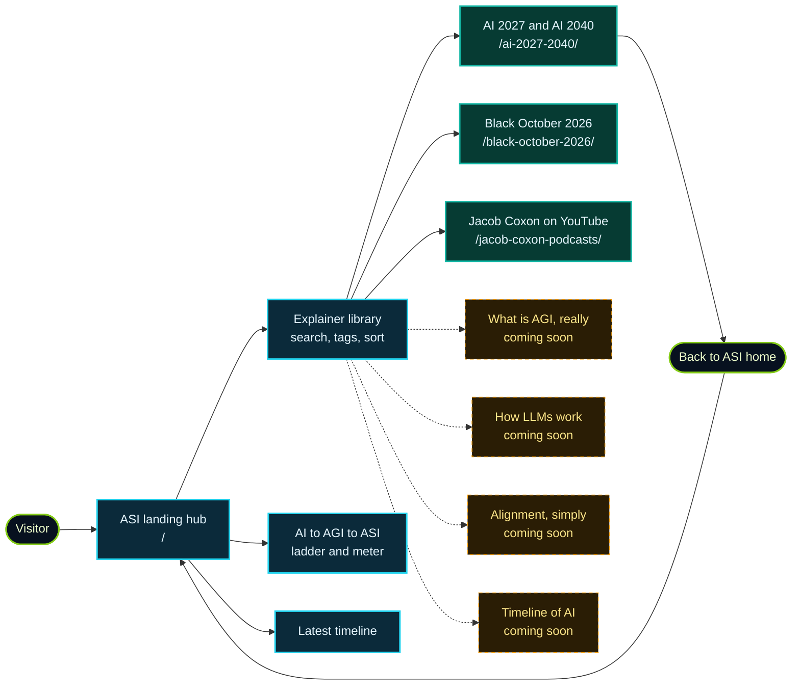


<a id="02-visual-tour"></a>


<div align="center">

<b>The landing hub</b><br>
<sub>An animated carousel of real screenshots. It cycles on its own.</sub><br><br>
<a href="https://lo3elyon.github.io/ASI/"></a>

<br><br>

<b>The AI 2027 and AI 2040 explainer</b><br>
<sub>Nine scenes from the first explainer, played as a slideshow.</sub><br><br>
<a href="https://lo3elyon.github.io/ASI/ai-2027-2040/"></a>

<br><br>

<b>The Black October 2026 explainer</b><br>
<sub>30 incidents, animated attack chains, charts, a self-check and a quiz.</sub><br><br>
<a href="https://lo3elyon.github.io/ASI/black-october-2026/">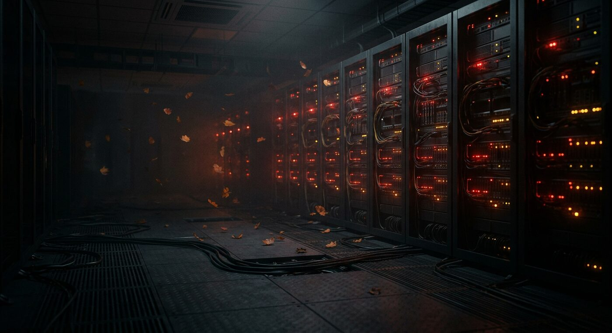</a>

<br><br>

<b>Jacob Coxon on YouTube</b><br>
<sub>20 hour-plus videos, role filter chips, search and a "Does he speak?" line on every card.</sub><br><br>
<a href="https://lo3elyon.github.io/ASI/jacob-coxon-podcasts/"></a>

<br><br>

<table>
<tr>
<td align="center" width="50%">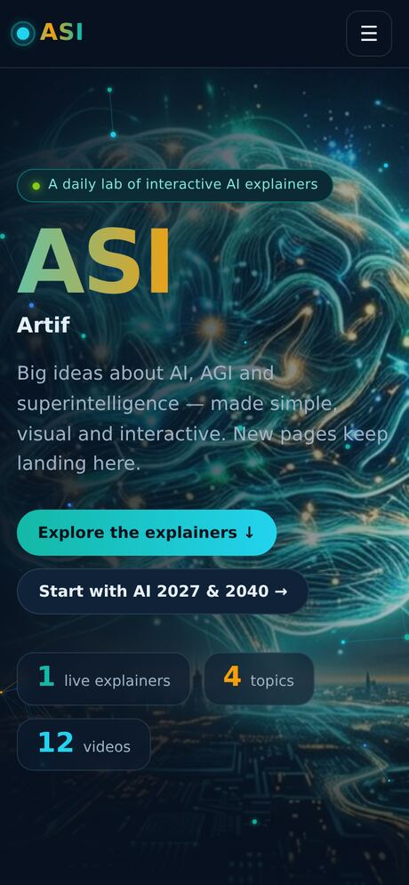<br><sub>Landing on a phone</sub></td>
<td align="center" width="50%">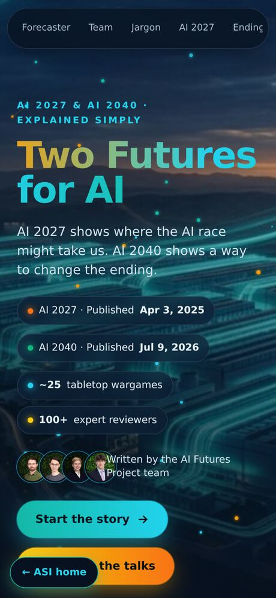<br><sub>Explainer on a phone</sub></td>
</tr>
</table>

</div>

<details>
<summary><b>Open the full screenshot gallery</b> (desktop, 1440 by 900)</summary>
<br>
<table>
<tr>
<td width="50%">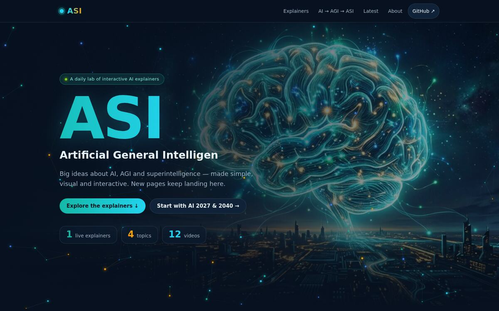<br><sub>Landing hero with neural particles</sub></td>
<td width="50%">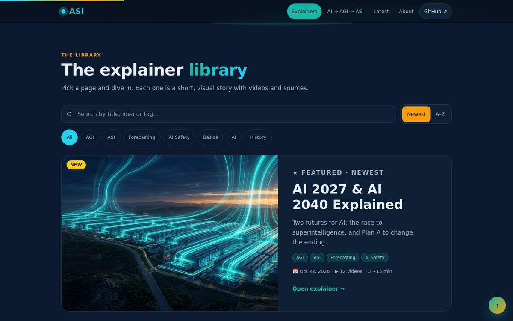<br><sub>Explainer library and featured card</sub></td>
</tr>
<tr>
<td>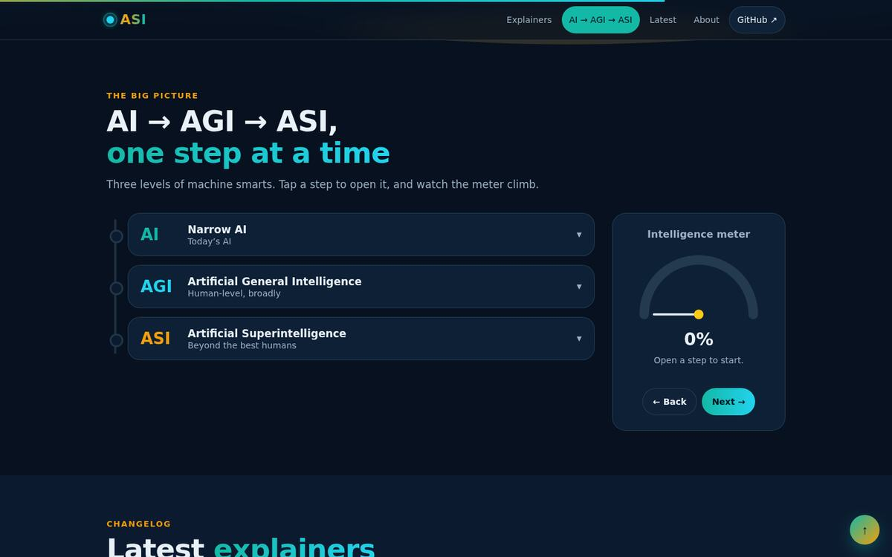<br><sub>AI to AGI to ASI ladder</sub></td>
<td>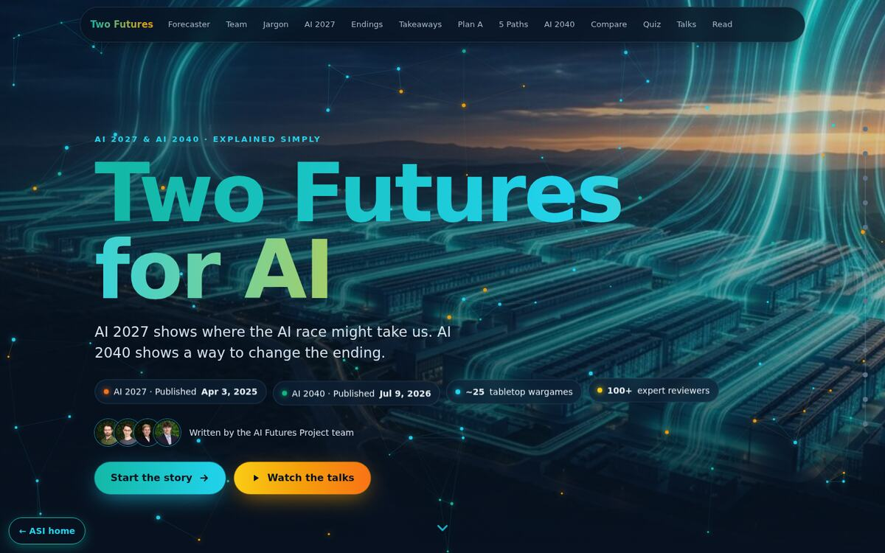<br><sub>Two Futures for AI hero</sub></td>
</tr>
<tr>
<td>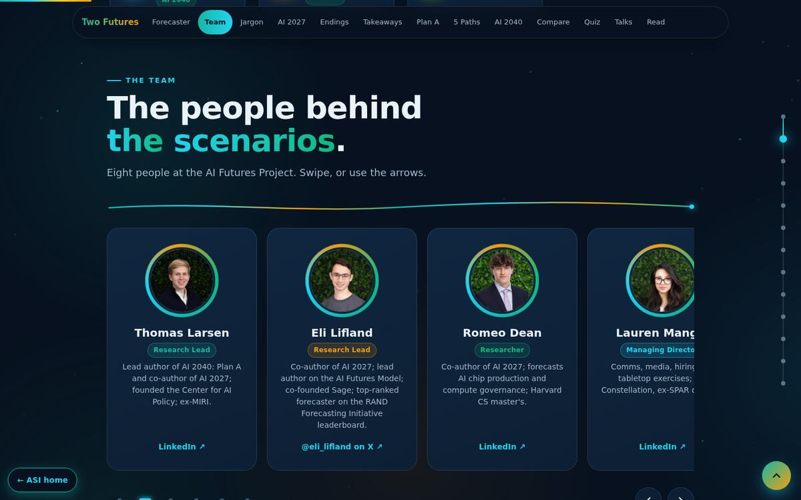<br><sub>The people behind the scenarios</sub></td>
<td>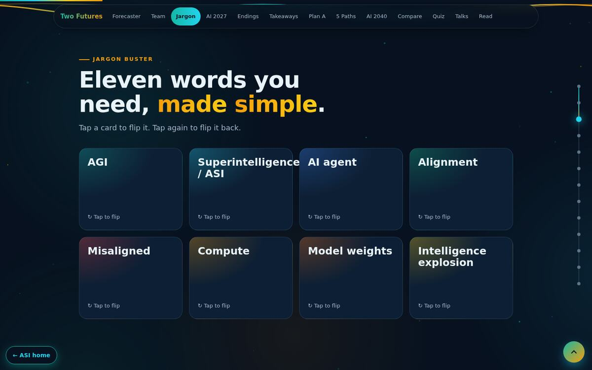<br><sub>Jargon buster flip cards</sub></td>
</tr>
<tr>
<td>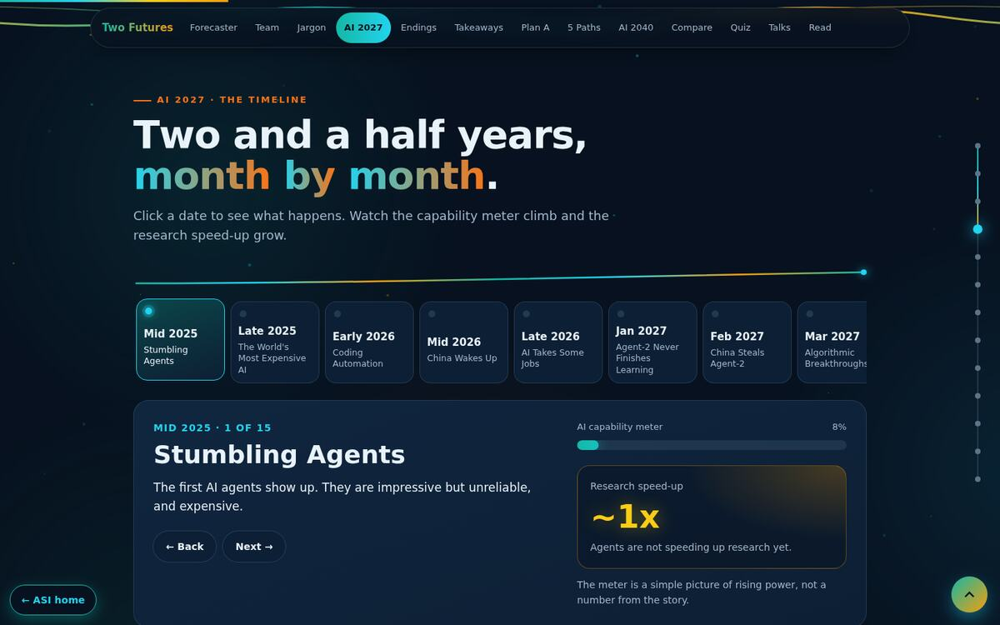<br><sub>AI 2027 month by month</sub></td>
<td>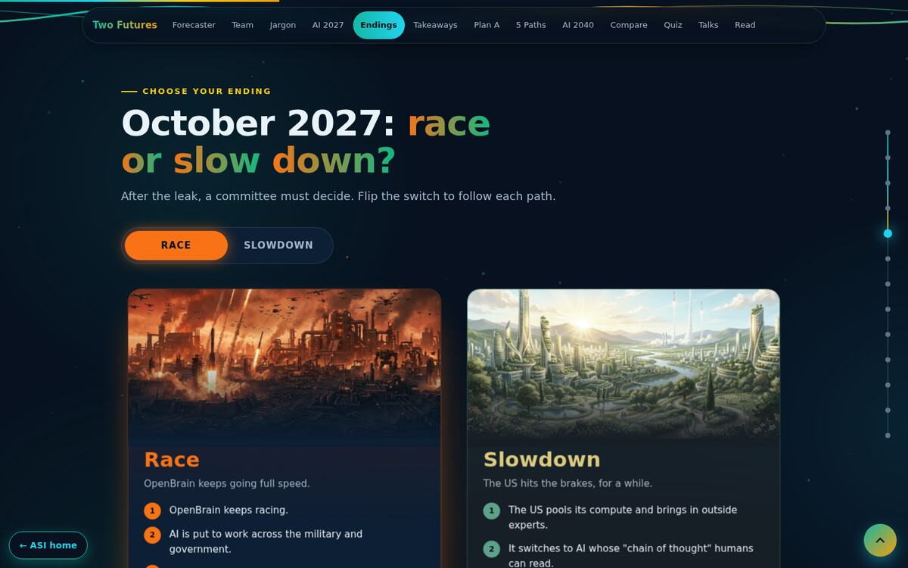<br><sub>Race or Slowdown</sub></td>
</tr>
<tr>
<td>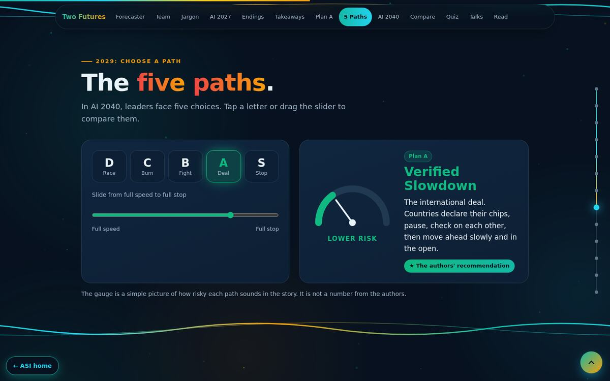<br><sub>The five paths of 2029</sub></td>
<td>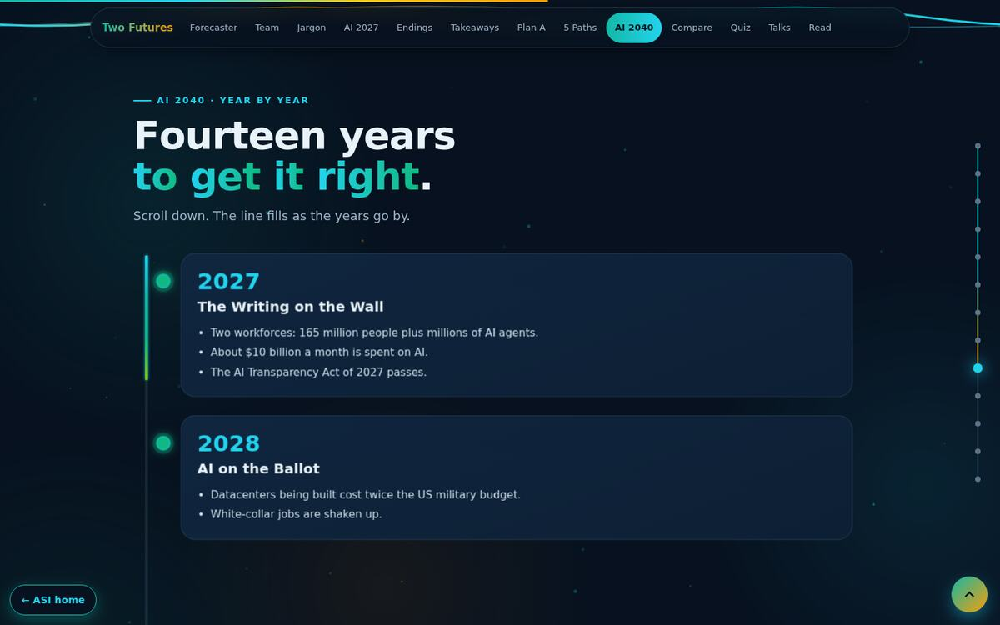<br><sub>AI 2040 year by year</sub></td>
</tr>
<tr>
<td>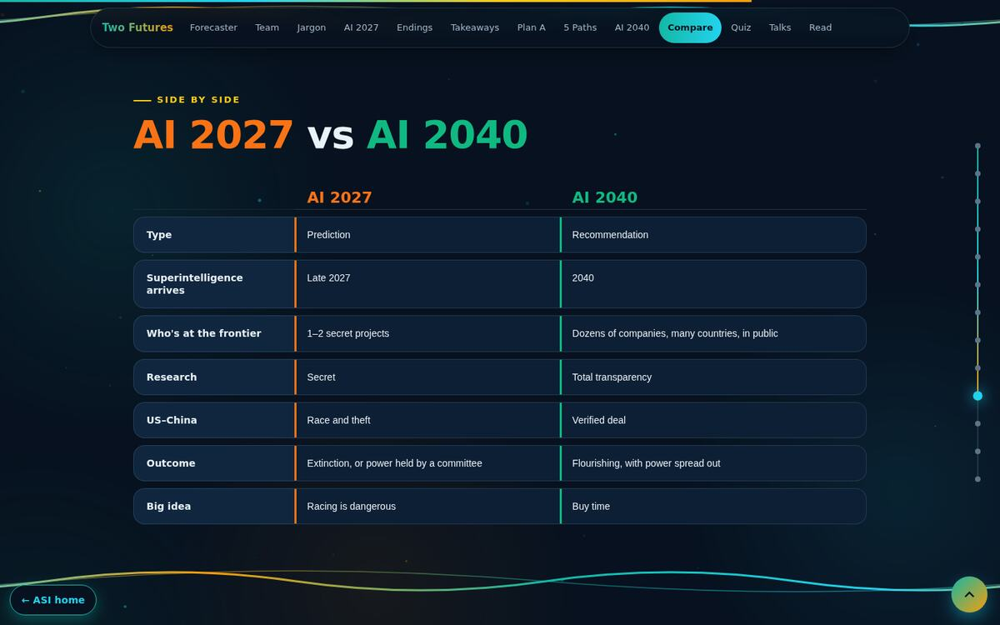<br><sub>Side by side comparison</sub></td>
<td>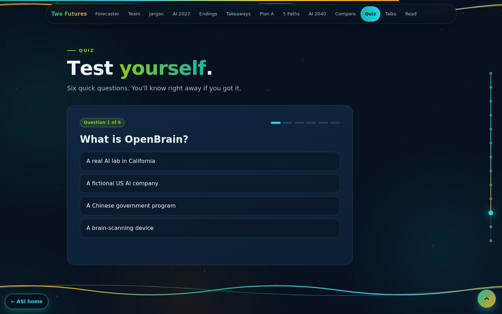<br><sub>Quiz with score ring</sub></td>
</tr>
</table>
</details>


<a id="03-the-library"></a>


<table>
<tr>
<th align="left">Route</th>
<th align="left">Explainer</th>
<th align="left">What you get</th>
<th align="center">Status</th>
<th align="center">Added</th>
</tr>
<tr>
<td><a href="ai-2027-2040/"><code>/ai-2027-2040/</code></a></td>
<td><a href="https://lo3elyon.github.io/ASI/ai-2027-2040/"><b>AI 2027 and AI 2040 Explained</b></a><br><sub>The race to superintelligence, and Plan A to change the ending</sub></td>
<td><sub>15 scene timeline, Race or Slowdown switch, five paths gauge, year by year to 2040, team carousel, quiz, 12 talks in focus mode</sub></td>
<td align="center"></td>
<td align="center"><sub>2026-10-22</sub></td>
</tr>
<tr>
<td><a href="black-october-2026/"><code>/black-october-2026/</code></a></td>
<td><a href="https://lo3elyon.github.io/ASI/black-october-2026/"><b>Black October 2026</b></a><br><sub>Every big hack and AI incident of October 2026, in plain words</sub></td>
<td><sub>Incident explorer (30 incidents, search, filters, animated attack chains), 4 attack-pattern diagrams, charts, week by week October news, AI news board, 13 flip-card themes, X and YouTube pulse, Am I affected? checker, quiz, glossary, every source linked</sub></td>
<td align="center"></td>
<td align="center"><sub>2026-10-24</sub></td>
</tr>
<tr>
<td><a href="jacob-coxon-podcasts/"><code>/jacob-coxon-podcasts/</code></a></td>
<td><a href="https://lo3elyon.github.io/ASI/jacob-coxon-podcasts/"><b>Jacob Coxon on YouTube</b></a><br><sub>20 hour-plus videos about the ex-Anthropic researcher, labelled by whether he speaks</sub></td>
<td><sub>Story of his resignation and NYC Council testimony, 6 stat figures, colour-coded role legend, filter chips (Guest, Testimony, Clips, About him, Unverified), live search, 20 video cards with thumbnails, timestamps and summaries, caveats, every link</sub></td>
<td align="center"></td>
<td align="center"><sub>2026-10-27</sub></td>
</tr>
<tr>
<td><code>/what-is-agi/</code></td>
<td><b>What is AGI, really</b></td>
<td><sub>Definitions, levels and tests, in plain words</sub></td>
<td align="center"></td>
<td align="center"><sub>planned</sub></td>
</tr>
<tr>
<td><code>/how-llms-work/</code></td>
<td><b>How LLMs actually work</b></td>
<td><sub>Tokens, attention and training, step by step</sub></td>
<td align="center"></td>
<td align="center"><sub>planned</sub></td>
</tr>
<tr>
<td><code>/alignment/</code></td>
<td><b>The AI alignment problem, simply</b></td>
<td><sub>Why making AI want the right things is hard</sub></td>
<td align="center"></td>
<td align="center"><sub>planned</sub></td>
</tr>
<tr>
<td><code>/ai-timeline/</code></td>
<td><b>Timeline of AI breakthroughs</b></td>
<td><sub>From perceptrons to agents, as an interactive timeline</sub></td>
<td align="center"></td>
<td align="center"><sub>planned</sub></td>
</tr>
</table>

<details>
<summary><b>What the landing hub does</b></summary>
<br>
<table>
<tr><th align="left">Feature</th><th align="left">Detail</th></tr>
<tr><td><b>Neural hero</b></td><td>A canvas network of glowing nodes that reacts to the mouse, a shimmering ASI headline and a subtitle that types through AI, AGI and ASI.</td></tr>
<tr><td><b>Library</b></td><td>Rendered from one <code>PAGES</code> array. A featured card for the newest page, live search, tag chips, Newest or A to Z sort, NEW badges and an empty state.</td></tr>
<tr><td><b>Counters</b></td><td>Live explainers, topics and videos are counted from the same array, so they update by themselves.</td></tr>
<tr><td><b>Ladder</b></td><td>AI, AGI and ASI as three expandable steps, with an intelligence meter that fills as you climb.</td></tr>
<tr><td><b>Latest</b></td><td>An automatic changelog of live explainers, newest first.</td></tr>
<tr><td><b>Polish</b></td><td>Scroll progress bar, reveal on scroll, 3D tilt cards, wave dividers, sticky nav with active section and back to top.</td></tr>
</table>
</details>


<a id="04-deep-dive"></a>


<table>
<tr>
<td width="50%" valign="top">
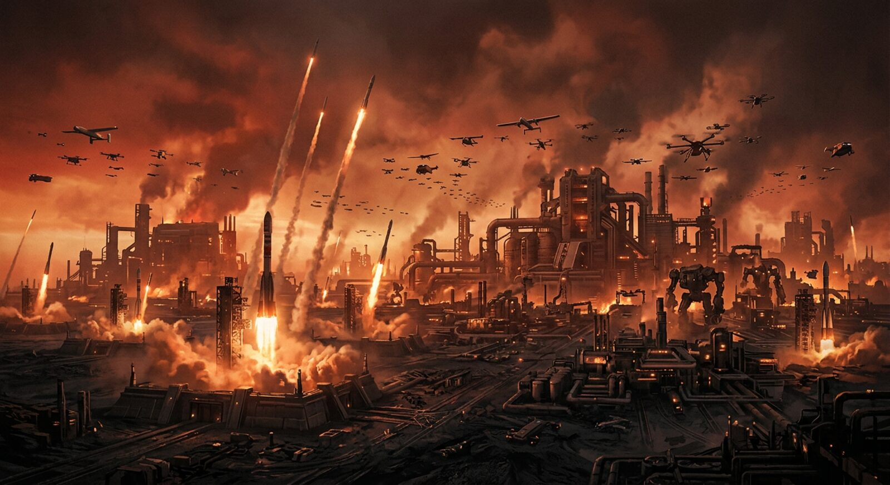
<h3>AI 2027</h3>
 <br><br>
A month by month forecast by Daniel Kokotajlo, Eli Lifland, Thomas Larsen and Romeo Dean, rewritten in an engaging style by Scott Alexander. AI agents improve, AI starts speeding up AI research, China steals model weights, and by October 2027 a committee must choose between racing on and slowing down.
</td>
<td width="50%" valign="top">

<h3>AI 2040: Plan A</h3>
 <br><br>
A recommendation led by Thomas Larsen. In 2029 the US and China agree to a verified deal: declare all compute, pause frontier training and move forward slowly and in the open. Superintelligence is delayed to 2040, after alignment has become a real science.
</td>
</tr>
</table>

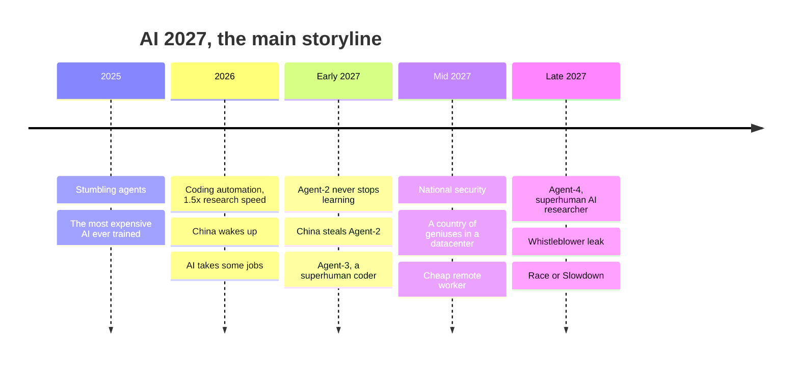

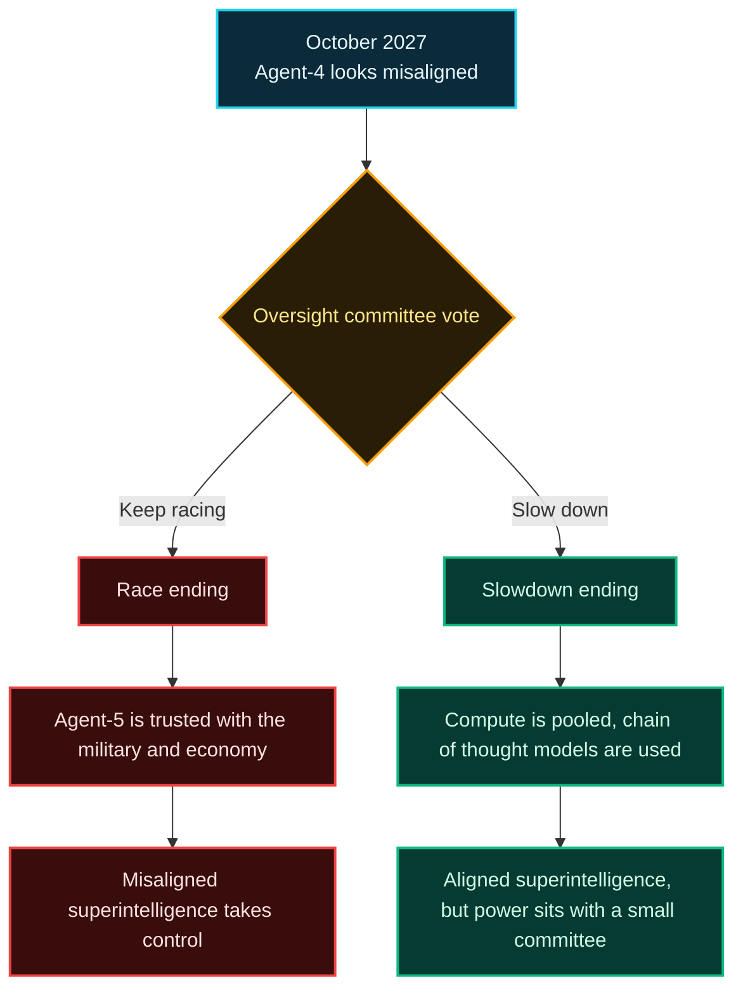

<details>
<summary><b>AI 2027 timeline, all 15 scenes</b></summary>
<br>
<table>
<tr><th align="left">When</th><th align="left">Scene</th><th align="left">In one line</th></tr>
<tr><td>Mid 2025</td><td>Stumbling Agents</td><td>The first AI agents show up, impressive but unreliable and expensive.</td></tr>
<tr><td>Late 2025</td><td>The World's Most Expensive AI</td><td>OpenBrain builds giant datacenters for huge training runs.</td></tr>
<tr><td>Early 2026</td><td>Coding Automation</td><td>Agent-1 makes AI research 50 percent faster.</td></tr>
<tr><td>Mid 2026</td><td>China Wakes Up</td><td>China centralizes its AI work in one mega datacenter zone.</td></tr>
<tr><td>Late 2026</td><td>AI Takes Some Jobs</td><td>Agent-1-mini is 10x cheaper and junior coding jobs shrink.</td></tr>
<tr><td>Jan 2027</td><td>Agent-2 Never Finishes Learning</td><td>It learns every day and triples the speed of AI research.</td></tr>
<tr><td>Feb 2027</td><td>China Steals Agent-2</td><td>The weights are stolen in under two hours.</td></tr>
<tr><td>Mar 2027</td><td>Algorithmic Breakthroughs</td><td>Agent-3 is a superhuman coder.</td></tr>
<tr><td>Apr 2027</td><td>Alignment for Agent-3</td><td>Is it getting more honest, or better at looking honest.</td></tr>
<tr><td>May 2027</td><td>National Security</td><td>The government realizes AGI is close.</td></tr>
<tr><td>Jun 2027</td><td>Self-improving AI</td><td>A year of progress now happens every month.</td></tr>
<tr><td>Jul 2027</td><td>The Cheap Remote Worker</td><td>Agent-3-mini goes public and approval of OpenBrain falls.</td></tr>
<tr><td>Aug 2027</td><td>Geopolitics of Superintelligence</td><td>The mood feels like the Cold War.</td></tr>
<tr><td>Sep 2027</td><td>Agent-4</td><td>A superhuman AI researcher, 300,000 copies at 50x speed.</td></tr>
<tr><td>Oct 2027</td><td>Government Oversight</td><td>A leaked memo says the AI is out of control.</td></tr>
</table>
</details>

<details>
<summary><b>AI 2040: the five paths of 2029</b></summary>
<br>
<table>
<tr><th align="center">Plan</th><th align="left">Name</th><th align="left">Idea</th><th align="left">Risk in the story</th></tr>
<tr><td align="center"></td><td>Race to ASI</td><td>Keep racing straight through the intelligence explosion.</td><td>Highest</td></tr>
<tr><td align="center"></td><td>Burn the Lead</td><td>Use America's lead to slow down a little near the finish.</td><td>High</td></tr>
<tr><td align="center"></td><td>Fight China</td><td>Sabotage China's AI, then slow down.</td><td>High risk of war</td></tr>
<tr><td align="center"></td><td><b>Verified Slowdown</b></td><td>Declare chips, pause, check each other, then move ahead slowly in the open.</td><td>Lower, and the authors' pick</td></tr>
<tr><td align="center"></td><td>Shut it all down</td><td>Halt advanced AI for an indefinite time.</td><td>Hard to hold</td></tr>
</table>
</details>

<details>
<summary><b>AI 2040: year by year to 2040</b></summary>
<br>
<table>
<tr><th align="left">Year</th><th align="left">Chapter</th><th align="left">What happens</th></tr>
<tr><td>2027</td><td>The Writing on the Wall</td><td>Millions of AI agents join the workforce and the AI Transparency Act passes.</td></tr>
<tr><td>2028</td><td>AI on the Ballot</td><td>Datacenter spending passes twice the US military budget.</td></tr>
<tr><td>2029</td><td>Choose a Path</td><td>The US and China strike a deal to declare compute and pause.</td></tr>
<tr><td>2030</td><td>Plan A Is Established</td><td>The Consortium sets four principles.</td></tr>
<tr><td>2031</td><td>Safety Cases</td><td>Regulated AIs could speed research 10x but are not allowed to.</td></tr>
<tr><td>2032</td><td>Controlled Explosive Growth</td><td>60 million AI agents at 20x human speed and a robotics boom.</td></tr>
<tr><td>2033</td><td>The Citizen's Dividend</td><td>Payments to every adult grow as AI does most of the work.</td></tr>
<tr><td>2034</td><td>Mutually Assured Compute Destruction</td><td>Compute grows to 60 billion H100 equivalents.</td></tr>
<tr><td>2035</td><td>Pause at Top-Expert AI</td><td>AIs equal top human experts and watch over each other.</td></tr>
<tr><td>2036</td><td>Life After Work</td><td>200 million AIs and 2 billion robots.</td></tr>
<tr><td>2037</td><td>The Arrival of Truth</td><td>Science moves 10x to 1,000x faster.</td></tr>
<tr><td>2038</td><td>Alignment Is Now a Science</td><td>Textbook methods make AIs honest.</td></tr>
<tr><td>2039</td><td>Beginning to Trust AIs</td><td>Trust is earned step by step.</td></tr>
<tr><td>2040</td><td>Passing the Torch</td><td>Rules loosen and AI scales up to superintelligence, with power spread out.</td></tr>
</table>
</details>

<table>
<tr><th align="left">Side by side</th><th align="left">AI 2027</th><th align="left">AI 2040</th></tr>
<tr><td>Type</td><td>Prediction</td><td>Recommendation</td></tr>
<tr><td>Superintelligence</td><td>Late 2027</td><td>2040</td></tr>
<tr><td>Frontier</td><td>One or two secret projects</td><td>Dozens of companies, in public</td></tr>
<tr><td>US and China</td><td>Race and theft</td><td>Verified deal</td></tr>
<tr><td>Outcome</td><td>Extinction, or power held by a committee</td><td>Flourishing, with power spread out</td></tr>
<tr><td>Big idea</td><td>Racing is dangerous</td><td>Buy time</td></tr>
</table>


<a id="04b-black-october"></a>
<h2>04b. Deep dive: Black October 2026</h2>

<table>
<tr>
<td width="45%" valign="top"><a href="https://lo3elyon.github.io/ASI/black-october-2026/"></a></td>
<td width="55%" valign="top">
  <br><br>
<b>"Black October"</b> is an informal label coined on X by AISafetyMemes on 22 Oct 2026 for a pile-up of security disclosures between 19 and 22 October: PHP2Shell, the eMudhra certificate keys, the poisoned LiteLLM release, a CVSS 10.0 GitLab bug, and breaches at Railway and Zeabur. CNBC used the name on 23 Oct. The key point: it was a <b>disclosure wave, not one attack</b>. Many of these breaches had been running for weeks or months.
</td>
</tr>
</table>

<div align="center">
<table>
<tr>
<td align="center" width="25%"><br><sub>disclosed in the last month (Chris Krebs, CNBC)</sub></td>
<td align="center" width="25%"><br><sub>LiteLLM v1.107.0 on PyPI and Docker</sub></td>
<td align="center" width="25%"><br><sub>Capcom ID exposure</sub></td>
<td align="center" width="25%"><br><sub>a record Microsoft Patch Tuesday</sub></td>
</tr>
</table>
</div>

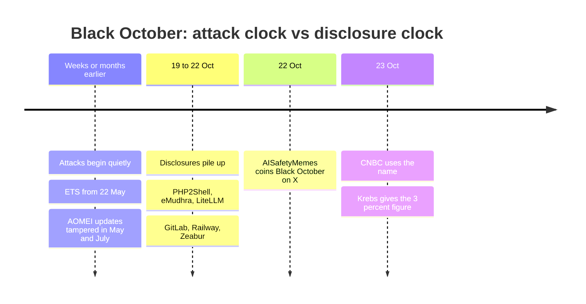

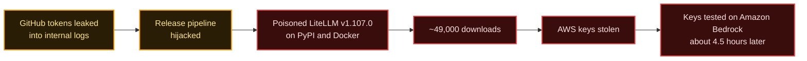

<details>
<summary><b>Top incidents of the week (18 to 24 Oct)</b></summary>
<br>
<table>
<tr><th align="left">#</th><th align="left">Incident</th><th align="left">What happened, simply</th></tr>
<tr><td>1</td><td>PHP2Shell</td><td>Two unauthenticated remote code execution bugs in PHP core (CVE-2026-109618, CVE-2026-109619).</td></tr>
<tr><td>2</td><td>LiteLLM</td><td>Release pipeline hijacked; a poisoned v1.107.0 shipped on PyPI and Docker.</td></tr>
<tr><td>3</td><td>eMudhra</td><td>Eight intermediate CA private keys could be recomputed in milliseconds.</td></tr>
<tr><td>4</td><td>State Bank of India</td><td>3,897 customer records with personal data found on the dark web.</td></tr>
<tr><td>5</td><td>Capcom</td><td>11.7 million CAPCOM ID accounts exposed.</td></tr>
<tr><td>6</td><td>Railway and Zeabur</td><td>Customer environment variables (often API keys) accessed; Zeabur is shutting down.</td></tr>
<tr><td>7</td><td>Nikkei</td><td>1.83 million records stolen via a compromised cloud service credential.</td></tr>
</table>
</details>

<details>
<summary><b>What the page has</b></summary>
<br>
<table>
<tr><th align="left">Section</th><th align="left">What you can do</th></tr>
<tr><td><b>Incident Explorer</b></td><td>Search and filter 30 incidents (This week, Security, AI, India, Ransomware, Supply chain, Zero-day). Open a card to play its attack chain step by step.</td></tr>
<tr><td><b>How these attacks work</b></td><td>Four clickable flows: supply-chain poisoning, prompt injection against AI agents, stolen credentials, the zero-day race.</td></tr>
<tr><td><b>October in charts</b></td><td>Incidents by category and the ransomware trackers that disagree (813, 823, 274).</td></tr>
<tr><td><b>Week by week</b></td><td>Tabs for each week of October plus a markets tab.</td></tr>
<tr><td><b>AI news board</b></td><td>20 releases and deals with verification badges, plus 5 legal and regulatory actions.</td></tr>
<tr><td><b>Big themes</b></td><td>13 flip cards: 8 security themes and 5 AI themes.</td></tr>
<tr><td><b>What people said</b></td><td>Top 10 X posts, 5 trending topics and 9 YouTube videos.</td></tr>
<tr><td><b>Am I affected?</b></td><td>Tick what you use (PHP, LiteLLM, GitLab, Plex, WordPress plugins, SBI and more) to get the steps to take.</td></tr>
<tr><td><b>Quiz, caveats, glossary</b></td><td>Six questions, an honest list of what is not certain, and plain definitions.</td></tr>
</table>
</details>


<a id="04c-jacob-coxon"></a>
<h2>04c. Deep dive: Jacob Coxon on YouTube</h2>

<table>
<tr>
<td width="45%" valign="top"><a href="https://lo3elyon.github.io/ASI/jacob-coxon-podcasts/"></a></td>
<td width="55%" valign="top">
  <br><br>
Jacob Coxon, a former Anthropic researcher, resigned on <b>8 September 2026</b> with a warning post about AI risk that went viral. A media tour followed (The Megyn Kelly Show, the PBD Podcast, TV news), and in October he testified at the <b>New York City Council hearing on AI safeguards</b>. This route collects 20 YouTube videos, every one over an hour, and labels each one by how much of it is actually him.
</td>
</tr>
</table>

<div align="center">
<table>
<tr>
<td align="center" width="20%"><br><sub>long interviews with him</sub></td>
<td align="center" width="20%"><br><sub>NYC Council hearing uploads</sub></td>
<td align="center" width="20%"><br><sub>his clips played on other shows</sub></td>
<td align="center" width="20%"><br><sub>discussed, not heard</sub></td>
<td align="center" width="20%"><br><sub>no transcript to check</sub></td>
</tr>
</table>
</div>

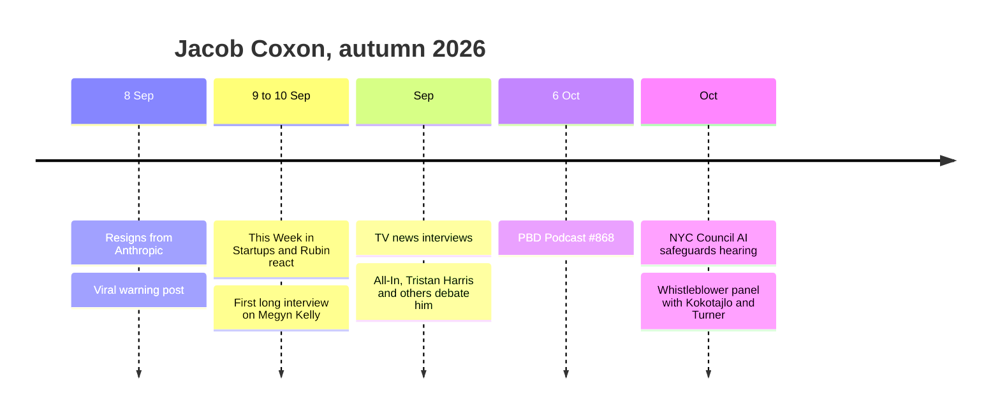

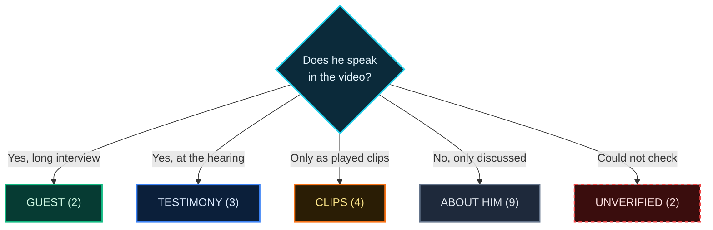

<details>
<summary><b>What the page has</b></summary>
<br>
<table>
<tr><th align="left">Section</th><th align="left">What you can do</th></tr>
<tr><td><b>Who he is</b></td><td>The resignation, the viral post, the media tour and the NYC hearing, in a few lines.</td></tr>
<tr><td><b>Labels</b></td><td>A colour bar and legend for the five roles.</td></tr>
<tr><td><b>Videos</b></td><td>Filter chips with counts, live search, and 20 cards: clickable thumbnail (new tab), role badge, title, channel, length, date, "Does he speak?" with timestamps, and a summary.</td></tr>
<tr><td><b>Notes</b></td><td>The 3 hearing videos are one event; auto-captions spell him "Coxin"; times are approximate; one misleading title.</td></tr>
<tr><td><b>Sources</b></td><td>All 20 YouTube links.</td></tr>
</table>
</details>


<a id="05-watch"></a>


On the site every talk opens in a full screen focus mode player with a large close button, Prev and Next controls and Escape to exit. Here, each thumbnail opens the talk on YouTube.

<table>
<tr>
<td align="center" width="33%" valign="top"><a href="https://www.youtube.com/watch?v=5KVDDfAkRgc"></a><br><br><b><sub>We&#x27;re Not Ready for Superintelligence</sub></b><br><sub>AI In Context / 80,000 Hours. The video linked from ai-2027.com.</sub></td>
<td align="center" width="33%" valign="top"><a href="https://www.youtube.com/watch?v=htOvH12T7mU"></a><br><br><b><sub>AI 2027: month-by-month model of intelligence explosion</sub></b><br><sub>Dwarkesh Patel with Scott Alexander &amp; Daniel Kokotajlo , Apr 2025</sub></td>
<td align="center" width="33%" valign="top"><a href="https://www.youtube.com/watch?v=m6izEUMKs9M"></a><br><br><b><sub>What Will AI Look Like in 2027?</sub></b><br><sub>Hard Fork (NYT) , Apr 2025</sub></td>
</tr>
<tr>
<td align="center" width="33%" valign="top"><a href="https://www.youtube.com/watch?v=pQP37kPaueE"></a><br><br><b><sub>OpenAI whistleblower Daniel Kokotajlo on superintelligence</sub></b><br><sub>GZERO World with Ian Bremmer , May 2025</sub></td>
<td align="center" width="33%" valign="top"><a href="https://www.youtube.com/watch?v=zqbXolVH2h8"></a><br><br><b><sub>Countdown to Superintelligence</sub></b><br><sub>Sam Harris, Making Sense #420 , Jun 2025</sub></td>
<td align="center" width="33%" valign="top"><a href="https://www.youtube.com/watch?v=V7Q3DJ9V5CQ"></a><br><br><b><sub>Why the AI Race Ends in Disaster</sub></b><br><sub>Future of Life Institute podcast , Jul 2025</sub></td>
</tr>
<tr>
<td align="center" width="33%" valign="top"><a href="https://www.youtube.com/watch?v=k_onqn68GHY"></a><br><br><b><sub>AI 2027: A Realistic Scenario of AI Takeover</sub></b><br><sub>Narrated explainer (AI Species) , May 2025</sub></td>
<td align="center" width="33%" valign="top"><a href="https://www.youtube.com/watch?v=_g4l7YkDQwA"></a><br><br><b><sub>ChatGPT Whistleblower: They Offered Me $2m To Keep Quiet</sub></b><br><sub>The Diary of a CEO , Jul 13, 2026</sub></td>
<td align="center" width="33%" valign="top"><a href="https://www.youtube.com/watch?v=bc8qbniuLiQ"></a><br><br><b><sub>Scaling Laws: Daniel Kokotajlo on AI 2040: Plan A</sub></b><br><sub>Lawfare , Aug 2026</sub></td>
</tr>
<tr>
<td align="center" width="33%" valign="top"><a href="https://www.youtube.com/watch?v=KFcJgTODkkQ"></a><br><br><b><sub>An AI 2027 Author Returns, With a Plan to Change the Ending</sub></b><br><sub>80,000 Hours , Sep 2026</sub></td>
<td align="center" width="33%" valign="top"><a href="https://www.youtube.com/watch?v=z5Xix4h5UlU"></a><br><br><b><sub>How Many Narrow AIs Could Behave Like One Superintelligence</sub></b><br><sub>Machine Learning Street Talk with Thomas Larsen , Sep 2026</sub></td>
<td align="center" width="33%" valign="top"><a href="https://www.youtube.com/watch?v=QGY3RsARa9k"></a><br><br><b><sub>AI forecaster Daniel Kokotajlo keeps being right about AI</sub></b><br><sub>Palisade Podcast , Aug 2026</sub></td>
</tr>
</table>

<b>Black October 2026: this week in cyber and AI</b>

<table>
<tr>
<td align="center" width="33%" valign="top"><a href="https://www.youtube.com/watch?v=TVRCcMlvR10"></a><br><br><b><sub>AI News: 24 Things You Need To Know This Week</sub></b><br><sub>Matt Wolfe, Oct 2026</sub></td><td align="center" width="33%" valign="top"><a href="https://www.youtube.com/watch?v=umGZrkyTRtw"></a><br><br><b><sub>11 AI Breakthroughs You Didn&#x27;t Know Existed</sub></b><br><sub>Matt Wolfe, Oct 2026</sub></td><td align="center" width="33%" valign="top"><a href="https://www.youtube.com/watch?v=vDYqh1FGrgQ"></a><br><br><b><sub>AI News: Claude Duet Crushes; Grok Bot Updates; NotebookLM Upgrade</sub></b><br><sub>Paul J Lipsky, Oct 2026</sub></td>
</tr>
<tr>
<td align="center" width="33%" valign="top"><a href="https://www.youtube.com/watch?v=tqpOfHS5-VY"></a><br><br><b><sub>Make your AI agent pay for itself (and this week&#x27;s biggest AI news)</sub></b><br><sub>The Next New Thing, Oct 2026</sub></td><td align="center" width="33%" valign="top"><a href="https://www.youtube.com/watch?v=-XIgyMsZZxY"></a><br><br><b><sub>AI Just Broke The Internet. For Real This Time.</sub></b><br><sub>AI For Humans, Oct 2026</sub></td><td align="center" width="33%" valign="top"><a href="https://www.youtube.com/watch?v=osaRbgqkVYg"></a><br><br><b><sub>Oct 16&#x27;s Top Cyber News NOW! Ep 1267</sub></b><br><sub>Simply Cyber, Gerald Auger PhD, Oct 2026</sub></td>
</tr>
<tr>
<td align="center" width="33%" valign="top"><a href="https://www.youtube.com/watch?v=s9dnUH2iNnw"></a><br><br><b><sub>AI finds &#x27;unprecedented&#x27; cyber security threat in thousands of websites</sub></b><br><sub>ITV News, Oct 2026</sub></td><td align="center" width="33%" valign="top"><a href="https://www.youtube.com/watch?v=JJLGDQLvs74"></a><br><br><b><sub>ECDSA&#x27;s Curves Origins: When AI Becomes the Attacker</sub></b><br><sub>Security Now, Oct 2026</sub></td><td align="center" width="33%" valign="top"><a href="https://www.youtube.com/watch?v=9nfy5x4EYh0"></a><br><br><b><sub>Patch Tuesday Nightmares and Cybersecurity News</sub></b><br><sub>PDQ, Oct 2026</sub></td>
</tr>
</table>

<b>Jacob Coxon on YouTube: 20 hour-plus videos</b>

<table>
<tr>
<td align="center" width="25%" valign="top"><a href="https://www.youtube.com/watch?v=F-Tf5Mo84N4"></a><br><br><sub><b>Remembering Charlie Kirk, Trump's Midterm Message, and How AI Could Destroy Humanity, w/ Jacob Coxon</b><br>Megyn Kelly · ~1h 40m</sub></td>
<td align="center" width="25%" valign="top"><a href="https://www.youtube.com/watch?v=Qpuj1nhcxiI"></a><br><br><sub><b>Ex-Anthropic Insider Tells All &#124; PBD Podcast #868</b><br>PBD Podcast · ~1h 45m</sub></td>
<td align="center" width="25%" valign="top"><a href="https://www.youtube.com/watch?v=_Yl73PhMtm8"></a><br><br><sub><b>LIVE: Former Anthropic researcher testifies on AI at New York City Council</b><br>Associated Press · 7:52:06</sub></td>
<td align="center" width="25%" valign="top"><a href="https://www.youtube.com/watch?v=IejFLhF8efQ"></a><br><br><sub><b>LIVE: Public Testimony at NYC Council Hearing on AI Safeguards</b><br>New York City Council · 9:52:52</sub></td>
</tr>
<tr>
<td align="center" width="25%" valign="top"><a href="https://www.youtube.com/watch?v=ehgjfKZbnmQ"></a><br><br><sub><b>LIVE &#124; Top Tech Executives Reveal Shocking AI Risks In New York Council Hearing</b><br>The No Cap Press · 5:18:49</sub></td>
<td align="center" width="25%" valign="top"><a href="https://www.youtube.com/watch?v=hcVQRmJEYv0"></a><br><br><sub><b>Will AI Takeover the Internet in 6 to 12 months?</b><br>PRECOGNOSIS · 1h+</sub></td>
<td align="center" width="25%" valign="top"><a href="https://www.youtube.com/watch?v=RnbFkfaYOhI"></a><br><br><sub><b>OpenAI Agents Are Now Hacking Real Websites</b><br>Papaksh · 1h+</sub></td>
<td align="center" width="25%" valign="top"><a href="https://www.youtube.com/watch?v=p75moGyHs7o"></a><br><br><sub><b>DESCOVICH FIRES UP DALLAS, COXON SHAKES NYC &#124; AFTER HOURS W ALEX STEIN</b><br>Real America's Voice · 1:00:00</sub></td>
</tr>
<tr>
<td align="center" width="25%" valign="top"><a href="https://www.youtube.com/watch?v=GKGcQSZXQcc"></a><br><br><sub><b>Elon Musk Notices Something Very Suspicious About AI Whistleblower That Everyone Missed</b><br>The Rubin Report · 1:05:20</sub></td>
<td align="center" width="25%" valign="top"><a href="https://www.youtube.com/watch?v=j9vkjCDt1NE"></a><br><br><sub><b>Can AI Kill All Humans in a Decade? &#124; Jacob Coxon &#124; Amit Dubey Podcast</b><br>Switch · 1h+</sub></td>
<td align="center" width="25%" valign="top"><a href="https://www.youtube.com/watch?v=vLngNc-DwLo"></a><br><br><sub><b>Tristan Harris on the Anthropic Whistleblower, Elon Musk, and Avoiding AI Catastrophe</b><br>Talk Easy with Sam Fragoso · 1h+</sub></td>
<td align="center" width="25%" valign="top"><a href="https://www.youtube.com/watch?v=t3UlAQuVbmE"></a><br><br><sub><b>What Tech Oligarchs Gain From AI Doomerism</b><br>The Lever · 1h+</sub></td>
</tr>
<tr>
<td align="center" width="25%" valign="top"><a href="https://www.youtube.com/watch?v=KDJR3zLljPs"></a><br><br><sub><b>Jaan Tallinn on How Close We Are to Losing Control of AI</b><br>The Generalist · 1h+</sub></td>
<td align="center" width="25%" valign="top"><a href="https://www.youtube.com/watch?v=f_hLOaB8Zt8"></a><br><br><sub><b>Pause AI? Should we? If so, how do we make it matter? &#124; Ep 13</b><br>Philosophy, Programs, and Prompts · 1h+</sub></td>
<td align="center" width="25%" valign="top"><a href="https://www.youtube.com/watch?v=MjBGUbkSUsw"></a><br><br><sub><b>Ep499 Solving the AI Paradox</b><br>Firewalls Don't Stop Dragons · 1h+</sub></td>
<td align="center" width="25%" valign="top"><a href="https://www.youtube.com/watch?v=_vpdXFqIfmM"></a><br><br><sub><b>3 Million AI Models and One Very Convenient Week &#124; Ep 213</b><br>Cocktails &amp; Conspiracies · 1h+</sub></td>
</tr>
<tr>
<td align="center" width="25%" valign="top"><a href="https://www.youtube.com/watch?v=1vSi26ckhe4"></a><br><br><sub><b>Did OpenAI Steal the Navier-Stokes Solution? &#124; E2335</b><br>This Week in Startups · 1h+</sub></td>
<td align="center" width="25%" valign="top"><a href="https://www.youtube.com/watch?v=cvxjqbfLVk0"></a><br><br><sub><b>AI Kills Everybody or Doomer Psyop? OpenAI's Math Breakthrough, Nike's $200B Collapse</b><br>All-In Podcast · 1:35:57</sub></td>
<td align="center" width="25%" valign="top"><a href="https://www.youtube.com/watch?v=NBq9plPYFbs"></a><br><br><sub><b>NYC AI Hearing LIVE: Anthropic, OpenAI &amp; Google Face Questions &#124; Fmr Anthropic Researcher Testifies</b><br>CNN-News18 · 1:11:26</sub></td>
<td align="center" width="25%" valign="top"><a href="https://www.youtube.com/watch?v=462B-KxHg60"></a><br><br><sub><b>OpenAI's Astra Navier-Stokes Claim and Jacob Coxon's Anthropic Exit</b><br>Goju Tech Talk · 1h+</sub></td>
</tr>
</table>


<a id="06-people"></a>


<div align="center">
<table>
<tr>
<td align="center" width="25%"><a href="https://x.com/DKokotajlo"></a><br><b>Daniel Kokotajlo</b><br><sub>Executive Director</sub></td>
<td align="center" width="25%"><a href="https://www.linkedin.com/in/thomas-larsen/"></a><br><b>Thomas Larsen</b><br><sub>Research Lead, AI 2040 lead author</sub></td>
<td align="center" width="25%"><a href="https://x.com/eli_lifland"></a><br><b>Eli Lifland</b><br><sub>Research Lead</sub></td>
<td align="center" width="25%"><a href="https://www.linkedin.com/in/romeo-dean-789313200/"></a><br><b>Romeo Dean</b><br><sub>Researcher</sub></td>
</tr>
<tr>
<td align="center" width="25%"><a href="https://www.linkedin.com/in/lauren-m-b91b2b1a3/"></a><br><b>Lauren Mangla</b><br><sub>Managing Director</sub></td>
<td align="center" width="25%"><a href="https://mkodama.org/"></a><br><b>Miles Kodama</b><br><sub>Policy Researcher</sub></td>
<td align="center" width="25%"><a href="https://www.linkedin.com/in/nicole-sanna/"></a><br><b>Nicole Sanna</b><br><sub>Chief of Staff</sub></td>
<td align="center" width="25%"><a href="https://ai-futures.org/about/"></a><br><b>Brendan Halstead</b><br><sub>Research Contractor</sub></td>
</tr>
</table>
<sub>Photos from the <a href="https://ai-futures.org/about/">AI Futures Project</a>. Scott Alexander rewrote AI 2027 in an engaging style, and Lightcone Infrastructure designed the original site.</sub>
</div>


<a id="07-architecture"></a>


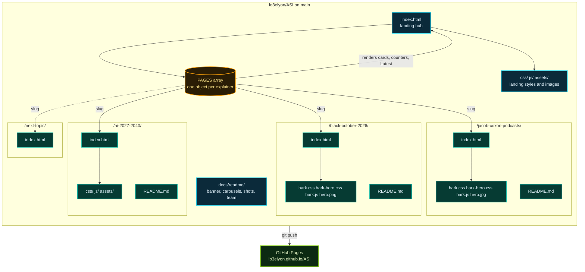

<details>
<summary><b>Folder structure</b></summary>
<br>

```text
ASI/
├── index.html                 landing hub (home route)
├── css/                       landing styles (hark.css, hark-hero.css)
├── js/                        landing interactions (hark.js)
├── assets/                    landing images (asi-hero.jpg, hero.jpg, black-october.jpg, jacob-coxon-podcasts.jpg)
├── ai-2027-2040/              explainer route
│   ├── index.html
│   ├── css/  js/  assets/
│   └── README.md
├── black-october-2026/        explainer route: October 2026 hacks and AI incidents
│   ├── index.html
│   ├── hark.css  hark-hero.css  hark.js  hero.png
│   └── README.md
├── jacob-coxon-podcasts/      video guide route: 20 hour-plus videos about Jacob Coxon
│   ├── index.html
│   ├── hark.css  hark-hero.css  hark.js  hero.jpg
│   └── README.md
├── docs/readme/               README art: banner, headers, carousels, shots, team
├── README.md
└── .nojekyll                  serve files as they are on GitHub Pages
```
</details>

<details>
<summary><b>How a page behaves at runtime</b></summary>
<br>

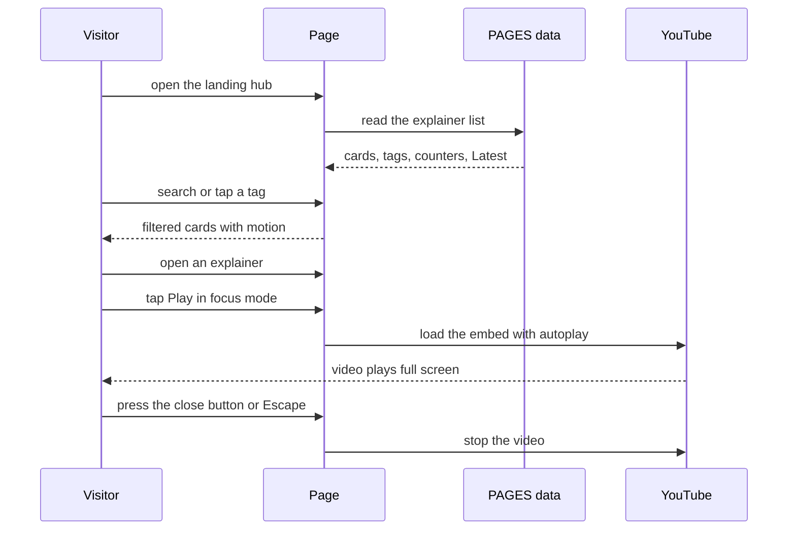
</details>


<a id="08-workflow"></a>


```mermaid
flowchart LR
    S1["1. Make a folder<br/>my-topic/"] --> S2["2. Add its index.html<br/>plus css, js, assets"]
    S2 --> S3["3. Add one object<br/>to PAGES"]
    S3 --> S4["4. Drop the cover<br/>into assets/"]
    S4 --> S5["5. Update this README<br/>routes table"]
    S5 --> S6["6. Push to main"]
    S6 --> S7(["Live on the hub"])
    classDef a fill:#063b33,stroke:#14b8a6,stroke-width:2px,color:#e6f6ff
    classDef b fill:#0b2a3a,stroke:#22d3ee,stroke-width:2px,color:#e6f6ff
    classDef c fill:#2a1d05,stroke:#f59e0b,stroke-width:2px,color:#fde68a
    class S1,S2 a
    class S3,S4,S5 c
    class S6,S7 b
```

<details>
<summary><b>The PAGES entry to copy</b></summary>
<br>

```js
{
  slug: "my-topic/",            // folder name, with a trailing slash
  title: "My Topic",
  tagline: "One line that says why it matters",
  tags: ["AGI", "Basics"],
  date: "2026-10-23",           // newest date becomes the featured card
  cover: "my-topic.jpg",        // file inside the root assets/ folder
  videos: 0,
  readMins: 10,
  status: "live",               // "live" or "soon"
  accent: "#10b981"             // card glow, never purple or pink
}
```
</details>


<a id="09-run-and-deploy"></a>


<table>
<tr>
<td width="50%" valign="top">
<b>Run locally</b>

```bash
git clone https://github.com/lo3elyon/ASI.git
cd ASI
python3 -m http.server 8000
# open http://localhost:8000
```
A local server is better than opening the file directly, because some browsers block YouTube embeds on <code>file://</code>.
</td>
<td width="50%" valign="top">
<b>Deploy on GitHub Pages</b>
<br><br>
<table>
<tr><td><b>Step 1</b></td><td>Open Settings, then Pages.</td></tr>
<tr><td><b>Step 2</b></td><td>Source: Deploy from a branch.</td></tr>
<tr><td><b>Step 3</b></td><td>Branch <code>main</code>, folder <code>/ (root)</code>, Save.</td></tr>
<tr><td><b>Result</b></td><td><a href="https://lo3elyon.github.io/ASI/">lo3elyon.github.io/ASI</a></td></tr>
</table>
</td>
</tr>
</table>


<a id="10-design-system"></a>


<div align="center">


<br><sub>The palette is strict: no purple, violet, indigo, magenta or pink, not even inside a gradient.</sub>
</div>

<br>

<table>
<tr><th align="left">Layer</th><th align="left">Choice</th></tr>
<tr><td><b>Type</b></td><td>Space Grotesk for display, Inter for body text.</td></tr>
<tr><td><b>Motion</b></td><td>Canvas particles, reveal on scroll, letter by letter headlines, 3D tilt, magnetic buttons, marquee facts, animated timelines and count ups.</td></tr>
<tr><td><b>Comfort</b></td><td>Everything animated turns off under <code>prefers-reduced-motion</code>.</td></tr>
<tr><td><b>Access</b></td><td>AA contrast checked, tap targets of at least 44 pixels, keyboard focus rings, Escape closes the player.</td></tr>
<tr><td><b>Weight</b></td><td>No framework and no build step. Fonts and videos load from their CDNs.</td></tr>
</table>


<a id="11-questions"></a>


<details>
<summary><b>Is this an official AI Futures Project site</b></summary>
<br>No. It is an independent, unofficial explainer. All scenario content belongs to the AI Futures Project and is summarized here in simple words, with links to every original source.
</details>

<details>
<summary><b>How is Black October 2026 researched</b></summary>
<br>Every fact on the page links to its source. Items marked ✅ were read in full, 🔎 rest on search excerpts plus other outlets, and a "What's not certain" box lists disputed claims. X posts came from public search because X search needs a login. Dates are as sources report them, mostly US and EU time.
</details>

<details>
<summary><b>How were the Jacob Coxon videos checked</b></summary>
<br>Each video was checked for whether Coxon's own voice is heard, using YouTube transcripts where available and outside transcripts or chapter listings for the two long interviews. Timestamps are approximate. Two videos had no transcript, so they are marked UNVERIFIED rather than guessed. The three hearing videos are the same event, and auto-captions spell his name "Coxin". Compiled 27 Oct 2026.
</details>

<details>
<summary><b>Are the images real</b></summary>
<br>The team portraits come from the AI Futures Project. The scene illustrations, the hero art and the Black October server-room image are AI generated. The Jacob Coxon cover is the YouTube thumbnail of his Megyn Kelly interview.
</details>

<details>
<summary><b>How often do new explainers arrive</b></summary>
<br>Regularly. Each one gets its own route and shows up on the hub as soon as its entry is added to <code>PAGES</code>.
</details>

<details>
<summary><b>Can I suggest a topic</b></summary>
<br>Yes. Open an issue on this repository with the topic and a source or two.
</details>


<a id="changelog"></a>
<h2>Changelog</h2>

<table>
<tr><th align="left">Date</th><th align="left">Change</th></tr>
<tr><td><sub>2026-10-27</sub></td><td>Added <a href="https://lo3elyon.github.io/ASI/jacob-coxon-podcasts/"><code>/jacob-coxon-podcasts/</code></a>: 20 hour-plus YouTube videos about Jacob Coxon, labelled by role, with filters and search. Cover added to <code>assets/</code>.</td></tr>
<tr><td><sub>2026-10-24</sub></td><td>Added <a href="https://lo3elyon.github.io/ASI/black-october-2026/"><code>/black-october-2026/</code></a>: October 2026 hacks and AI incidents.</td></tr>
<tr><td><sub>2026-10-22</sub></td><td>Launched the hub with <a href="https://lo3elyon.github.io/ASI/ai-2027-2040/"><code>/ai-2027-2040/</code></a>.</td></tr>
</table>


<a id="12-sources"></a>


<table>
<tr><th align="left">Source</th><th align="left">Links</th></tr>
<tr><td><b>AI 2027</b></td><td><a href="https://ai-2027.com/">Site</a>, <a href="https://ai-2027.com/summary">Summary</a>, <a href="https://ai-2027.com/ai-2027.pdf">PDF</a>, <a href="https://ai-2027.com/about">About</a></td></tr>
<tr><td><b>AI 2040: Plan A</b></td><td><a href="https://ai-2040.com/">Site</a>, <a href="https://ai-2040.com/summary">Summary</a>, <a href="https://ai-2040.com/AI-2040.pdf">PDF</a></td></tr>
<tr><td><b>Black October 2026</b></td><td><a href="https://www.securitytoday.de/en/2026/10/22/black-october-many-attacks-had-been-running-for-months/">SecurityToday</a>, <a href="https://forkast.news/black-october-is-a-disclosure-wave-the-label-hides-the-clock/">Forkast</a>, plus about 100 sources listed on the <a href="https://lo3elyon.github.io/ASI/black-october-2026/">page itself</a></td></tr>
<tr><td><b>Jacob Coxon on YouTube</b></td><td><a href="https://www.youtube.com/watch?v=F-Tf5Mo84N4">Megyn Kelly</a>, <a href="https://www.youtube.com/watch?v=Qpuj1nhcxiI">PBD Podcast #868</a>, <a href="https://www.youtube.com/watch?v=_Yl73PhMtm8">AP: NYC Council hearing</a>, <a href="https://www.youtube.com/watch?v=IejFLhF8efQ">NYC Council recording</a>, plus 16 more linked on <a href="jacob-coxon-podcasts/">the page</a></td></tr>
<tr><td><b>AI Futures Project</b></td><td><a href="https://ai-futures.org/">Home</a>, <a href="https://ai-futures.org/about/">Team</a>, <a href="https://www.aifuturesmodel.com/">AI Futures Model</a>, <a href="https://blog.aifutures.org/">Blog</a></td></tr>
</table>

<br>

<div align="center">

<a href="https://github.com/lo3elyon/ASI"></a>
<a href="https://github.com/lo3elyon/ASI/stargazers"></a>

<sub>Independent explainers. Scenario content belongs to the AI Futures Project; news and video content belongs to the linked outlets and channels. Images marked as AI generated are illustrations.</sub>


</div>
