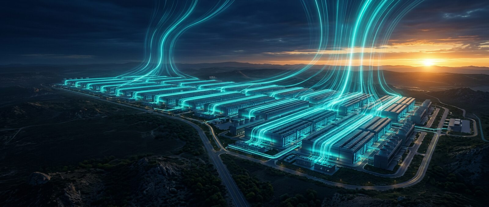

<div align="center">

<a href="https://lo3elyon.github.io/ASI/ai-2027-2040/"></a>

<h1>Two Futures for AI: AI 2027 and AI 2040, Explained Simply</h1>

<a href="https://lo3elyon.github.io/ASI/ai-2027-2040/"></a>
<a href="../"></a>


</div>

An interactive, animated explainer of the two scenarios from the AI Futures Project. <b>AI 2027</b> (published Apr 3, 2025) is a prediction of where the AI race might lead, with a Race ending and a Slowdown ending. <b>AI 2040: Plan A</b> (published Jul 9, 2026) is a recommendation: a verified international deal that delays superintelligence to 2040.

<table>
<tr><th align="left">Section</th><th align="left">What it does</th></tr>
<tr><td><b>Hero</b></td><td>Particle network, author avatar stack, stat chips and magnetic buttons.</td></tr>
<tr><td><b>Team</b></td><td>Auto advancing carousel of the eight AI Futures Project people, with animated rings.</td></tr>
<tr><td><b>Jargon buster</b></td><td>Flip cards for AGI, ASI, alignment, compute, weights and neuralese.</td></tr>
<tr><td><b>AI 2027 timeline</b></td><td>Fifteen scenes from Mid 2025 to Oct 2027 with a capability meter.</td></tr>
<tr><td><b>Choose your ending</b></td><td>A Race or Slowdown switch.</td></tr>
<tr><td><b>Plan A</b></td><td>Four principles, three steps and the five paths gauge.</td></tr>
<tr><td><b>AI 2040 timeline</b></td><td>Year by year from 2027 to 2040, plus the alignment track.</td></tr>
<tr><td><b>Compare</b></td><td>AI 2027 and AI 2040 side by side.</td></tr>
<tr><td><b>Quiz</b></td><td>Six questions with a score ring and confetti.</td></tr>
<tr><td><b>Talks</b></td><td>Twelve talks that open in a full screen focus mode player with a large close button, Prev and Next, and Escape to exit.</td></tr>
<tr><td><b>Sources</b></td><td>Links to the sites, summaries and PDFs.</td></tr>
</table>

<details>
<summary><b>Folder structure</b></summary>
<br>

```text
ai-2027-2040/
├── index.html      the whole page
├── css/            design system and hero styles
├── js/             base interactions
└── assets/         scene illustrations and team portraits
```
</details>

<table>
<tr><th align="left">Source</th><th align="left">Links</th></tr>
<tr><td>AI 2027</td><td><a href="https://ai-2027.com/">Site</a>, <a href="https://ai-2027.com/summary">Summary</a>, <a href="https://ai-2027.com/ai-2027.pdf">PDF</a></td></tr>
<tr><td>AI 2040: Plan A</td><td><a href="https://ai-2040.com/">Site</a>, <a href="https://ai-2040.com/summary">Summary</a>, <a href="https://ai-2040.com/AI-2040.pdf">PDF</a></td></tr>
<tr><td>AI Futures Project</td><td><a href="https://ai-futures.org/about/">Team</a>, <a href="https://www.aifuturesmodel.com/">Model</a>, <a href="https://blog.aifutures.org/">Blog</a></td></tr>
</table>

<sub>Independent, unofficial explainer. Scenario content belongs to the AI Futures Project. Team portraits come from the AI Futures Project, and scene illustrations are AI generated.</sub>
