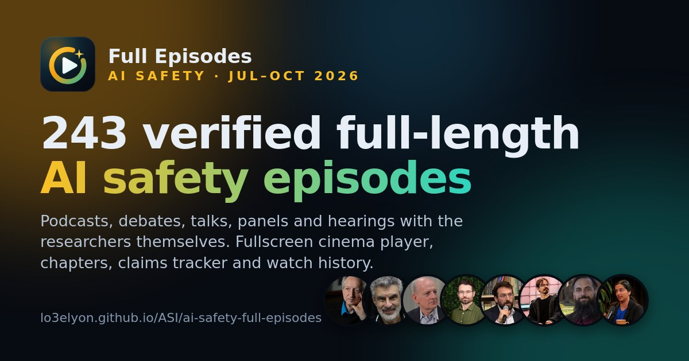
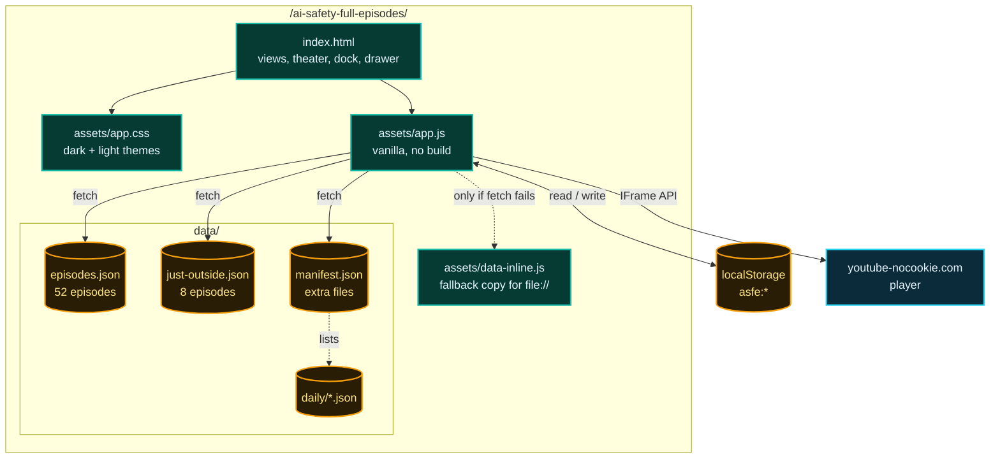
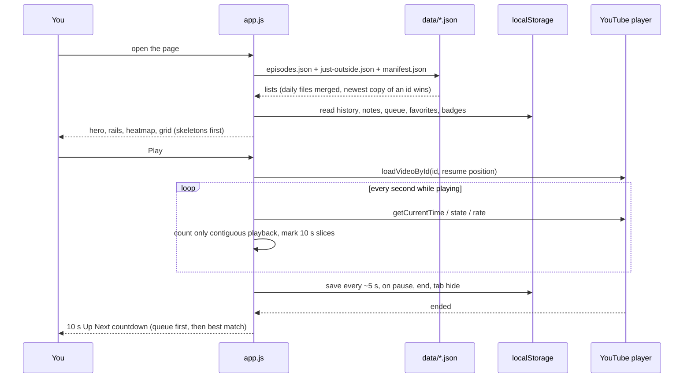
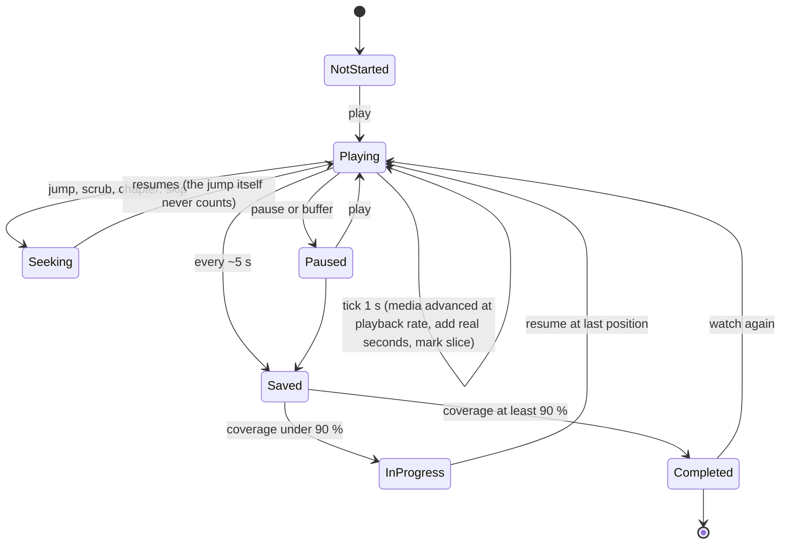
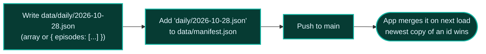

<div align="center">

<a href="https://lo3elyon.github.io/ASI/ai-safety-full-episodes/"></a>

# AI Safety Full Episodes · October 2026

**A personal streaming app for every verified full-length AI safety episode of October 2026: an embedded player, chapters, strict watch history, Up Next, a queue, notes and achievements.**

<a href="https://lo3elyon.github.io/ASI/ai-safety-full-episodes/"></a>
<br>


<br>


</div>

---

## Contents

[What it is](#what-it-is) · [Screenshots](#screenshots) · [Features](#features) · [Architecture](#architecture) · [Watch history](#strict-watch-history) · [Levels & badges](#levels-and-badges) · [Shortcuts](#keyboard-shortcuts) · [Data schema](#data-schema) · [Add daily JSON](#adding-new-episodes-daily-json--manifest) · [Files](#files) · [Privacy](#privacy) · [Method](#method) · [Changelog](#changelog)

## What it is

October 2026 produced a flood of long-form AI safety conversations: ex-lab insiders on the podcast circuit, MIRI and ControlAI on every show that would have them, a New York City Council hearing and a UK Parliament committee session. This route turns the **52 full episodes** from October 1–27 (about **70 hours**) into a dark, glassy, streaming-style library you can actually work through: play inside the page, resume to the second, jump by chapter, take timestamped notes, and see exactly how much of each episode you have really watched.

<table>
<tr>
<td align="center" width="20%"></td>
<td align="center" width="20%"></td>
<td align="center" width="20%"></td>
<td align="center" width="20%"></td>
<td align="center" width="20%"></td>
</tr>
</table>

## Screenshots

The six **Featured** episodes, as they appear in the app's Featured row (thumbnails from YouTube; click to open the video):

<table>
<tr>
<td align="center" width="33%" valign="top"><a href="https://www.youtube.com/watch?v=Qpuj1nhcxiI"></a><br><br><sub><b>Ex-Anthropic Insider Tells All · PBD Podcast #868</b><br>Jacob Coxon · 1:45:17 · Oct 6</sub></td>
<td align="center" width="33%" valign="top"><a href="https://www.youtube.com/watch?v=JIMXEuT_ZAU"></a><br><br><sub><b>What This OpenAI Insider Saw That Made Him Quit</b><br>The Ezra Klein Show · David Robinson · 1:14:55 · Oct 7</sub></td>
<td align="center" width="33%" valign="top"><a href="https://www.youtube.com/watch?v=qDzg-xvkeXw"></a><br><br><sub><b>AI Whistleblower: "They Are Hiding What Is Really Happening"</b><br>The Diary Of A CEO · Jeffrey Ladish · 2:03:31 · Oct 8</sub></td>
</tr>
<tr>
<td align="center" width="33%" valign="top"><a href="https://www.youtube.com/watch?v=IejFLhF8efQ"></a><br><br><sub><b>Public Testimony at NYC Council Hearing on AI Safeguards</b><br>Coxon, Kokotajlo, Turner · 9:52:51 · Oct 5</sub></td>
<td align="center" width="33%" valign="top"><a href="https://www.youtube.com/watch?v=LlGNBPJW8Ww"></a><br><br><sub><b>UK Parliament Business, Innovation, Science and Trade Committee</b><br>Kokotajlo, Irving, Adler, Lynch · 3:17:15 · Oct 13</sub></td>
<td align="center" width="33%" valign="top"><a href="https://www.youtube.com/watch?v=tjAg_KxApmw"></a><br><br><sub><b>Whistleblowers or justified OpenAI firing?</b><br>Machine Gods · Mikita Balesni &amp; Tomek Korbak · 48:23 · Oct 23</sub></td>
</tr>
</table>

## Features

<table>
<tr><th align="left">Area</th><th align="left">What you get</th></tr>
<tr><td><b>🎬 Embedded player</b></td><td>YouTube IFrame Player API on the privacy-enhanced <code>youtube-nocookie.com</code> host. A cinematic <b>theater view</b> plus a <b>mini-player</b> that docks to the corner while you browse (the iframe is never re-parented, so playback never restarts). Custom controls: play/pause, ±10 s and ±30 s, next, speed 0.75–2×, volume and mute, note-at-time, fullscreen. Seek bar with chapter ticks, hover tooltips with the chapter name, and an amber overlay showing the parts you have <i>actually played</i>.</td></tr>
<tr><td><b>📑 Chapters</b></td><td>Every timestamped topic (<code>h:mm:ss</code>, <code>m:ss</code>, or <code>{ "t": "21:35", "topic": … }</code>) becomes a clickable chapter that seeks the player, with the current chapter highlighted live. Topics without a time are still listed.</td></tr>
<tr><td><b>🕒 Strict watch history</b></td><td>Per episode: last position, real seconds watched (seeks never count), percent of the episode actually played (10 s coverage slices), sessions with start/end, completed at ≥ 90 %, last watched. History tab with KPIs, 28-day bar chart, per-episode progress, day-by-day session timeline, streaks, filters (in progress / completed / not started), clear-one and clear-all with confirmation, export/import JSON. Automatic resume with a <i>Resume at mm:ss</i> toast and a Start over button. Progress bars on every card.</td></tr>
<tr><td><b>⏭️ Up Next</b></td><td>Suggestions scored by shared speakers, same people group, same format, same channel and topic-keyword overlap, with unwatched first and completed pushed down. Autoplay with a 10 s cancelable countdown ring. A persistent <b>queue</b> (drag to reorder, or arrow buttons on touch and keyboard) always plays before suggestions.</td></tr>
<tr><td><b>🏆 Levels &amp; badges</b></td><td>XP for minutes watched, completions, notes and badges; 8 levels from <i>Novice</i> to <i>Superalignment Sage</i>; 17 badges (The Coxon Files, Every Format, On the Record, Seven-Day Streak, The Godfathers…) with progress bars, a profile ring and unlock toasts.</td></tr>
<tr><td><b>📚 Library</b></td><td>Hero stats, Featured row, Continue Watching, "Because you watched…", October day-strip heatmap (tap a day to filter), fuzzy search across title, speaker, show and topics (one typo forgiven), filter chips for format, length (&lt;30 / 30–60 / 1–2 h / 2 h+), people groups and your watch state, six sorts, speaker directory with per-speaker pages, "Just outside the window" row, favorites, and personal timestamped notes per episode.</td></tr>
<tr><td><b>🎨 Design</b></td><td>Dark premium streaming look with glass panels, teal and amber accents (no purple or pink), Inter type, 16:9 thumbnails with duration, format and progress badges, a glass detail drawer, skeleton loaders, micro-animations, light/dark toggle, mobile layout, <code>prefers-reduced-motion</code> respected.</td></tr>
</table>

## Architecture



### Data flow on load and while watching



## Strict watch history



<details>
<summary><b>The rules, exactly</b></summary>
<br>

| Field | How it is measured |
|---|---|
| `watched` | Real seconds of playback. A tick only counts when the media time moved forward by roughly elapsed time × playback rate; seeks, scrubs, buffering and pauses add nothing. At 2× speed one minute of your time adds 60 s (and 120 s of coverage). |
| `cov` / `covN` / `pct` | A bitset of 10-second slices you actually played (base64). `pct = covN / slices`, so jumping to the end does not complete an episode. |
| `done` | `pct ≥ 0.90`. Set once, with `doneAt`. |
| `pos` | Last playhead position, used for *Resume at mm:ss* (skipped if under 15 s or in the last 20 s). |
| `sessions[]` | `{ s, e, w, a, b }`: start and end timestamps, seconds watched, start and end position. A new session starts after 30 idle minutes or when you switch episodes. |
| `daily{}` | Seconds watched per local calendar day, for the 28-day chart and streaks (a day counts at ≥ 60 s). |

Storage keys: `asfe:history:v1`, `asfe:notes:v1`, `asfe:favs:v1`, `asfe:queue:v1`, `asfe:badges:v1`, `asfe:settings:v1`, `asfe:theme`. The history object carries `v: 1` so later versions can migrate it.
</details>

## Levels and badges

| Level | XP | | Level | XP |
|---|---|---|---|---|
| 1 · Novice | 0 | | 5 · Eval Analyst | 800 |
| 2 · Curious Listener | 60 | | 6 · Frontier Analyst | 1,400 |
| 3 · Safety Apprentice | 180 | | 7 · Governance Strategist | 2,200 |
| 4 · Alignment Scholar | 400 | | 8 · Superalignment Sage | 3,400 |

XP = 1 per minute actually watched + 50 per completed episode + 5 per note + 30 per badge.

Badges: ▶️ First Frame · 🏁 Full Episode · ⏱️ One Hour In · 🔥 Five Hours · 🛰️ Deep Diver (20 h) · 🧭 The Coxon Files (complete every Jacob Coxon episode) · 🧩 Every Format · 🏛️ On the Record (30 min of a hearing) · 📅 Three in a Row · 🗓️ Seven-Day Streak · 🎓 The Godfathers (Hinton, Bengio, Russell) · 🗣️ Many Voices · 🏃 Marathon (2 h in one session) · 🌙 Night Owl · 📝 Note Taker · 📚 Curator · 🏆 Ten Complete.

## Keyboard shortcuts

| Key | Action | | Key | Action |
|---|---|---|---|---|
| <kbd>Space</kbd> / <kbd>K</kbd> | Play / pause | | <kbd>M</kbd> | Mute |
| <kbd>J</kbd> / <kbd>←</kbd> | Back 10 s | | <kbd>F</kbd> | Fullscreen |
| <kbd>L</kbd> / <kbd>→</kbd> | Forward 10 s | | <kbd>T</kbd> | Theater ↔ mini player |
| <kbd>Shift</kbd>+<kbd>←</kbd> / <kbd>→</kbd> | ∓ 30 s | | <kbd>N</kbd> | Note at the current time |
| <kbd>Shift</kbd>+<kbd>N</kbd> | Next episode | | <kbd>0</kbd>–<kbd>9</kbd> | Jump to 0–90 % |
| <kbd>Shift</kbd>+<kbd>P</kbd> | Previous chapter | | <kbd>/</kbd> | Search |
| <kbd>,</kbd> / <kbd>.</kbd> | Slower / faster | | <kbd>?</kbd> | Shortcut help |
| <kbd>↑</kbd> / <kbd>↓</kbd> | Volume (theater) | | <kbd>Esc</kbd> | Close panel / minimize |

## Data schema

`data/episodes.json` is an array. Each object:

```jsonc
{
  "id": "Qpuj1nhcxiI",                 // YouTube video id (unique key)
  "title": "Ex-Anthropic Insider Tells All | PBD Podcast #868",
  "channel": "PBD Podcast",
  "show": "Patrick Bet-David, PBD Podcast",
  "date": "2026-10-06",                // upload date, YYYY-MM-DD
  "approx": false,                     // true = date estimated, shown with "~"
  "duration": "1:45:17",
  "speakers": ["Jacob Coxon (former Anthropic & OpenAI researcher)"],  // "Name (description) — role"
  "names": ["Jacob Coxon"],
  "format": "podcast",                 // free text; bucketed into podcast / panel / debate / talk / hearing
  "summary": "…",
  "topics": ["2:11 His resignation tweet …", { "t": "21:35", "topic": "…" }, "Untimed topic"],
  "evidence": "Transcript: …",         // what the verification rested on
  "url": "https://www.youtube.com/watch?v=Qpuj1nhcxiI",
  "thumb": "https://i.ytimg.com/vi/Qpuj1nhcxiI/hqdefault.jpg"
}
```

`data/just-outside.json` uses a lighter shape (`speakers` may be one comma-separated string, no `topics`); the app normalizes both. Hosts and moderators (detected from `host` / `moderator` in the speaker string) are kept off speaker counts and suggestions.

## Adding new episodes (daily JSON + manifest)



```json
{ "files": ["daily/2026-10-28.json", "daily/2026-10-29.json"] }
```

Paths are relative to `data/`. Files load in the listed order after `episodes.json`, so a later file can correct an earlier entry with the same `id`. A missing file is skipped. Then regenerate the offline copy if you want `file://` to show the new items too:

```bash
python3 -c "import json;e=json.load(open('data/episodes.json'));o=json.load(open('data/just-outside.json'));open('assets/data-inline.js','w').write('window.ASFE_INLINE = '+json.dumps({'episodes':e,'outside':o})+';\n')"
```

## Files

```text
ai-safety-full-episodes/
├── index.html              app shell: library, history, speakers, queue, profile, notes, theater, dock
├── assets/
│   ├── app.css             design system, dark + light themes, responsive
│   ├── app.js              data, player, watch clock, suggestions, badges, router
│   ├── data-inline.js      offline copy of the JSON (loaded only if fetch fails)
│   └── cover.jpg           hero image (NYC Council hearing still)
├── data/
│   ├── episodes.json       52 verified full episodes, Oct 1–27, 2026
│   ├── just-outside.json   8 full episodes, Sep 27–30, 2026
│   ├── manifest.json       extra JSON files to merge (starts empty)
│   └── daily/              drop daily files here
└── README.md
```

Run locally: `python3 -m http.server 8000` from the repo root, then open `http://localhost:8000/ai-safety-full-episodes/`. Opening `index.html` directly also works (inline data), but some browsers block YouTube embeds on `file://`.

## Privacy

Your watch history, notes, favorites, queue, badges and settings are stored **only in this browser's localStorage**. Nothing is uploaded, there are no analytics, and no account exists. Videos play through YouTube's privacy-enhanced `youtube-nocookie.com` embed; YouTube's own terms apply to playback. Export JSON to back up or move your progress; Clear all removes it.

## Method

* **Full episodes only:** complete podcasts, interviews, debates, talks, panels and hearing recordings; no clip compilations or reaction videos.
* **Verified against transcripts:** each entry was checked against its YouTube transcript, description or chapter list for who speaks and what is covered. The `evidence` field quotes what the check rested on.
* **One copy per event:** when several channels uploaded the same hearing or talk, one upload is kept.
* **Dates:** upload dates; `~` marks an estimated date.
* **Window:** October 1–27, 2026, compiled **October 27, 2026**; Sep 27–30 items sit in *Just outside the window*.

## Known limits

* Some channels block embedding; the player then shows an **Open on YouTube** button instead.
* Chapter times come from descriptions and transcripts and can be a few seconds off.
* History is per browser and per device unless you export and import it.

## Changelog

| Date | Change |
|---|---|
| 2026-10-27 | First release: 52 episodes + 8 just outside, embedded player with theater and mini modes, chapters, strict watch history, Up Next with autoplay countdown, queue, notes, favorites, speaker directory, heatmap, levels and 17 badges, light/dark themes, manifest-based daily data. |

<div align="center">
<sub>A project by <b>Aniruddha Adak</b> · part of the <a href="https://lo3elyon.github.io/ASI/">ASI hub</a> · videos belong to their channels.</sub>
</div>
