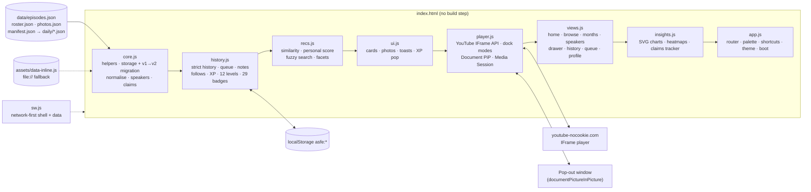
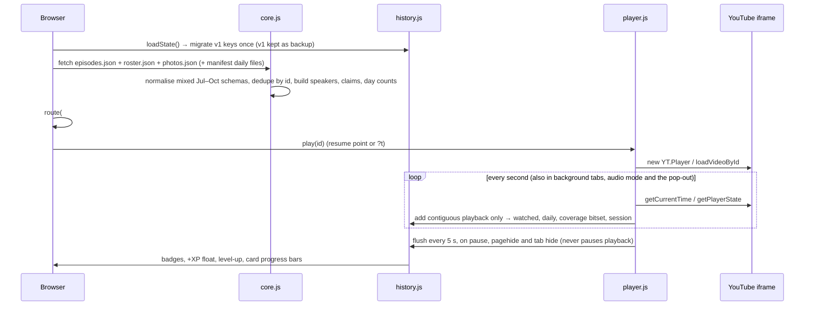
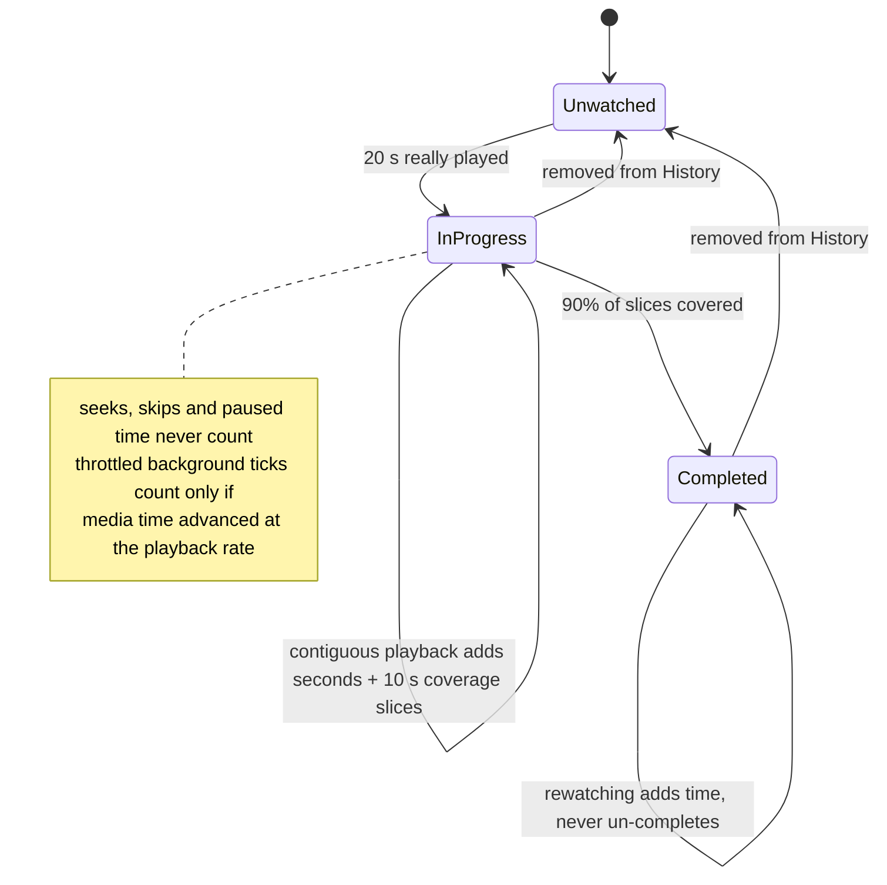
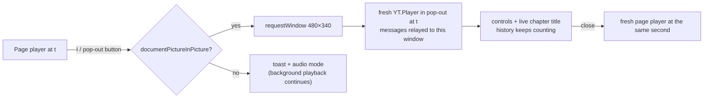

<div align="center">

<a href="https://lo3elyon.github.io/ASI/ai-safety-full-episodes/"></a>

# AI Safety Full Episodes · v2 · July–October 2026

**A streaming app for every verified full-length AI safety episode of July 1 – October 27, 2026: a pop-out player that keeps going while the browser is minimised, audio mode, full chapter reports, a P(doom) and timelines claims tracker, a speaker hub with real photos, contribution-style heatmaps, smart recommendations, insights and achievements.**

<a href="https://lo3elyon.github.io/ASI/ai-safety-full-episodes/"></a>
<br>


<br>


</div>

---

## Contents

[What's new in v2](#whats-new-in-v2) · [Features](#features) · [Videos](#a-taste-of-the-library) · [Speakers](#speaker-photo-grid) · [Months](#months) · [Architecture](#architecture) · [Keep playing when minimised](#keep-playing-when-minimised) · [Watch history](#strict-watch-history) · [Recommendations](#recommendations) · [Levels & badges](#levels-and-badges) · [Shortcuts](#keyboard-shortcuts) · [Data schema](#data-schema) · [Daily JSON](#adding-new-episodes-daily-json--manifest) · [Files](#files) · [Privacy](#privacy) · [Method](#method) · [FAQ](#faq) · [Sources](#sources) · [Changelog](#changelog)

## What's new in v2

| | v1 (Oct 27, morning) | **v2 (Oct 27, night)** |
|---|---|---|
| Episodes | 52 (October) + 8 just outside | **243 verified full episodes, July–October** (Jul 43 · Aug 64 · Sep 84 · Oct 52) |
| Player | theater + mini | theater, mini, **audio mode**, **pop-out always-on-top window**, Media Session, never pauses on tab switch |
| Speakers | text directory | **hub with real photos for everyone**, bios, follow, profile pages, "Play all", their stated numbers |
| Episode detail | chapters list | **full chapter report**, key claims, numbers, people/orgs mentioned, tags, level, why watch, evidence, deep links at the current second |
| Discovery | one heatmap, simple filters | **GitHub-style release heatmap + personal watch heatmap**, month switcher, fuzzy search over chapters and claims, 10 filter groups, 8 sorts, grid/list, saved filters, command palette |
| Recommendations | similar episodes | scored on follows, shared speakers/orgs/tags, completion, level progression; **Because you watched**, Continue, Short & complete, Deep dives, Debates |
| Insights | — | hours per day/week, by speaker, by org, by month, completion donut, streak calendar, **claims tracker** |
| Achievements | 8 levels, 17 badges | **12 levels, 29 badges**, XP float animation, level-up burst, profile card |
| Code | one 93 KB file | **8 modules**, service worker, jsdom smoke test |

## Features

| Area | What you get |
|---|---|
| **Pop-out player** | `I` or the window button moves the episode into a Document Picture-in-Picture window (Chrome/Edge 116+) with play, ±10 s, chapter skip, next episode and the live chapter title. It floats above every app and keeps playing while the browser is minimised. Closing it hands playback back to the page at the same second. Other browsers get a clear message and switch to audio mode. |
| **Audio mode** | `A` collapses the video into a slim bar with the speaker's photo as artwork, title, live chapter and full controls. Keep browsing; playback never stops on navigation or tab switches. |
| **Media Session** | Title, speakers, show and artwork go to the OS media controls (lock screen, keyboard media keys, headset buttons), with play, pause, seek ±, seek-to, next and previous-chapter handlers wired to the YouTube player. |
| **Persistent dock** | One player for the whole app: theater, mini (bottom-right), audio bar or pop-out. It survives every route change and is never re-created inside the page, so it never reloads. |
| **Months** | Switch between All, July, August, September and October with per-month stats (episodes, hours, speakers, chapters, top speakers). Default is All. |
| **Release heatmap** | A contributions-style grid of every day Jul 1 – Oct 31, 2026: colour intensity = episodes released, the number is shown in larger cells and on hover, month headers show totals and active days, a Less→More legend; click a day or a month to filter the library. |
| **Watch heatmap** | The same grid for your own minutes watched per day (strict playback only); click a day in History to see just that day. |
| **Speakers hub** | 49 curated researcher portraits with organisation and a factual one-line bio, plus every other guest and host with a real photo (see [photos](#speaker-photo-grid)). Episode count, total hours, "watched x of y", group filters, search, sort, a collapsible Hosts section. |
| **Speaker profile** | Big photo, bio, stats, first→last appearance, **Follow**, **Play all** (fills the queue), every stated number (P(doom), timelines, other figures) linked to the moment, sortable episode list, "Often appears with". |
| **Episode report** | Every chapter with time, title and detail (click to seek), key claims with timestamps and speakers, numbers, people and organisations mentioned (click to filter), tags, level, why watch, evidence, speakers with photos, your history and notes, "More like this". |
| **Deep links** | `#ep=<id>&t=<sec>` opens the episode and plays from that second. "Copy link at current time" (`C`) and Share (native share sheet when available). |
| **Notes** | Timestamped notes while watching (`N`), in the side panel, in the episode drawer and on a Notes page with search and Markdown export. |
| **Search** | Fuzzy (typo-tolerant) across title, speakers, show, tags, chapter titles and details, and claims, with highlighted snippets that jump straight to the matching moment. |
| **Filters** | Month, format, length, level, people group, organisation, speaker (searchable), watched state (unwatched, in progress, watched, favourites, with notes, queued), followed only, topic tags, release day. Live facet counts, active-filter chips, saved filters. |
| **Sorts & layouts** | Best match, newest, oldest, longest, shortest, most viewed, unwatched first, for you; grid or list; infinite "show more". |
| **Recommendations** | For you, Because you watched X, Continue watching, New from people you follow, Short & complete (< 40 min), Deep dives (2 h +), Debates, Hearings & panels, Most viewed, Latest. Every pick says why. |
| **Up Next** | Queue first, then the best-scored similar episodes with reasons; 10-second autoplay countdown. |
| **Insights** | KPIs, hours per day or week, by speaker, by organisation, by release month, by format, completion donut, streak calendar, and a **claims tracker** table of P(doom) and timeline statements by speaker with a ▶ button to the exact moment. |
| **Achievements** | 12 levels from Novice to Superalignment Sage, 29 badges (Monthly Completionist, Speaker Collector, Org Explorer, Night Owl, Binge, Chapter Jumper, Note Taker, Always on Top, Ears Only, …), floating +XP, level-up burst, editable profile card. |
| **Command palette** | `Ctrl/⌘ K`: jump to any episode, speaker or action (pop out, audio mode, copy link, theme, surprise me). `Shift+Enter` queues. |
| **Polish** | Dark / light / system theme, amber and teal accents, glass surfaces, skeleton loaders, lazy thumbnails, responsive layout with a mobile bottom nav, visible focus rings, reduced-motion support, offline-friendly service worker. |

## A taste of the library

Three of the biggest episodes from each month (click to open on YouTube; every one of the 243 plays inside the app):

<table>
<tr>
<td align="center" width="33%" valign="top"><a href="https://www.youtube.com/watch?v=l2b9UrSsz-w"></a><br><br><sub><b>Davidad on Moral Realism & p(Doom)</b><br>Cognitive Revolution · davidad · 2:23:37 · Jul 12</sub></td>
<td align="center" width="33%" valign="top"><a href="https://www.youtube.com/watch?v=8qTZLqY-cnI"></a><br><br><sub><b>Joe Rogan Experience #2525</b><br>Nick Bostrom · 2:14:42 · Jul 14</sub></td>
<td align="center" width="33%" valign="top"><a href="https://www.youtube.com/watch?v=_g4l7YkDQwA"></a><br><br><sub><b>ChatGPT Whistleblower</b><br>The Diary Of A CEO · Daniel Kokotajlo · 2:00:44 · Jul 13</sub></td>
</tr>
<tr>
<td align="center" width="33%" valign="top"><a href="https://www.youtube.com/watch?v=KFcJgTODkkQ"></a><br><br><sub><b>An AI 2027 Author Returns</b><br>80,000 Hours · Daniel Kokotajlo · 3:47:33 · Aug 27</sub></td>
<td align="center" width="33%" valign="top"><a href="https://www.youtube.com/watch?v=zOSptyQ3j9A"></a><br><br><sub><b>Where AGI timelines go wrong</b><br>80,000 Hours · Toby Ord · 2:46:03 · Aug 6</sub></td>
<td align="center" width="33%" valign="top"><a href="https://www.youtube.com/watch?v=OZAqXlGXdFY"></a><br><br><sub><b>AXRP 50: Eli Lifland on AI 2027</b><br>AXRP · Eli Lifland · 2:40:39 · Aug 2</sub></td>
</tr>
<tr>
<td align="center" width="33%" valign="top"><a href="https://www.youtube.com/watch?v=rtir6QmQQRg"></a><br><br><sub><b>Real Reason AI CEOs Are Building Bunkers</b><br>Danny Jones · Connor Leahy · 2:41:49 · Sep 18</sub></td>
<td align="center" width="33%" valign="top"><a href="https://www.youtube.com/watch?v=OhOmLqR5nN4"></a><br><br><sub><b>AI Experts Debate: Is There a 99% Chance…</b><br>Yampolskiy, Soares, Zitron · 2:24:26 · Sep 17</sub></td>
<td align="center" width="33%" valign="top"><a href="https://www.youtube.com/watch?v=X50zezLFWWI"></a><br><br><sub><b>Ajeya Cotra: the clearest warning shot</b><br>Dwarkesh Podcast · Ajeya Cotra · 2:20:33 · Sep 1</sub></td>
</tr>
<tr>
<td align="center" width="33%" valign="top"><a href="https://www.youtube.com/watch?v=lnLDjXy2kRA"></a><br><br><sub><b>Jacob Coxon: the existential threat from inside</b><br>The Daily Show · Jacob Coxon · 25:59 · Oct 5</sub></td>
<td align="center" width="33%" valign="top"><a href="https://www.youtube.com/watch?v=qDzg-xvkeXw"></a><br><br><sub><b>AI Whistleblower: They Are Hiding What Is Really Happening</b><br>The Diary Of A CEO · Jeffrey Ladish · 2:03:31 · Oct 8</sub></td>
<td align="center" width="33%" valign="top"><a href="https://www.youtube.com/watch?v=JIMXEuT_ZAU"></a><br><br><sub><b>What This OpenAI Insider Saw That Made Him Quit</b><br>The Ezra Klein Show · David Robinson · 1:14:55 · Oct 7</sub></td>
</tr>
</table>

## Speaker photo grid

Curated portraits of the researchers with bios in `data/roster.json`. Hosts get their channel avatar (`assets/speakers/<slug>.jpg`, fetched via the Piped API); anyone else is shown with a circular crop of the thumbnail from their best solo episode, so **nobody gets an initials placeholder**.

<table>
<tr>
<td align="center" width="14%" valign="top"><br><sub><b>Eliezer Yudkowsky</b><br>MIRI</sub></td>
<td align="center" width="14%" valign="top"><br><sub><b>Nate Soares</b><br>MIRI</sub></td>
<td align="center" width="14%" valign="top"><br><sub><b>Malo Bourgon</b><br>MIRI</sub></td>
<td align="center" width="14%" valign="top"><br><sub><b>Connor Leahy</b><br>ControlAI</sub></td>
<td align="center" width="14%" valign="top"><br><sub><b>Andrea Miotti</b><br>ControlAI</sub></td>
<td align="center" width="14%" valign="top"><br><sub><b>Holly Elmore</b><br>PauseAI US</sub></td>
<td align="center" width="14%" valign="top"><br><sub><b>Geoffrey Hinton</b><br>University of Toronto</sub></td>
</tr>
<tr>
<td align="center" width="14%" valign="top"><br><sub><b>Yoshua Bengio</b><br>Mila / LawZero</sub></td>
<td align="center" width="14%" valign="top"><br><sub><b>Stuart Russell</b><br>UC Berkeley</sub></td>
<td align="center" width="14%" valign="top"><br><sub><b>Roman Yampolskiy</b><br>University of Louisville</sub></td>
<td align="center" width="14%" valign="top"><br><sub><b>Nick Bostrom</b><br>Macrostrategy Research Initiative</sub></td>
<td align="center" width="14%" valign="top"><br><sub><b>Max Tegmark</b><br>MIT / FLI</sub></td>
<td align="center" width="14%" valign="top"><br><sub><b>David Krueger</b><br>Université de Montréal / Mila</sub></td>
<td align="center" width="14%" valign="top"><br><sub><b>Toby Ord</b><br>Oxford AI Governance Initiative</sub></td>
</tr>
<tr>
<td align="center" width="14%" valign="top"><br><sub><b>William MacAskill</b><br>Forethought</sub></td>
<td align="center" width="14%" valign="top"><br><sub><b>Jaan Tallinn</b><br>Future of Life Institute</sub></td>
<td align="center" width="14%" valign="top"><br><sub><b>Helen Toner</b><br>Georgetown CSET</sub></td>
<td align="center" width="14%" valign="top"><br><sub><b>Anthony Aguirre</b><br>Future of Life Institute</sub></td>
<td align="center" width="14%" valign="top"><br><sub><b>Miles Brundage</b><br>AVERI</sub></td>
<td align="center" width="14%" valign="top"><br><sub><b>Stephen Casper</b><br>Harvard</sub></td>
<td align="center" width="14%" valign="top"><br><sub><b>Dan Hendrycks</b><br>Center for AI Safety</sub></td>
</tr>
<tr>
<td align="center" width="14%" valign="top"><br><sub><b>Adam Gleave</b><br>FAR.AI</sub></td>
<td align="center" width="14%" valign="top"><br><sub><b>Jeffrey Ladish</b><br>Palisade Research</sub></td>
<td align="center" width="14%" valign="top"><br><sub><b>Chris Painter</b><br>METR</sub></td>
<td align="center" width="14%" valign="top"><br><sub><b>Marius Hobbhahn</b><br>Apollo Research</sub></td>
<td align="center" width="14%" valign="top"><br><sub><b>Ajeya Cotra</b><br>METR</sub></td>
<td align="center" width="14%" valign="top"><br><sub><b>Buck Shlegeris</b><br>Redwood Research</sub></td>
<td align="center" width="14%" valign="top"><br><sub><b>Ryan Greenblatt</b><br>Redwood Research</sub></td>
</tr>
<tr>
<td align="center" width="14%" valign="top"><br><sub><b>Paul Christiano</b><br>Alignment Research Center</sub></td>
<td align="center" width="14%" valign="top"><br><sub><b>Owain Evans</b><br>Truthful AI</sub></td>
<td align="center" width="14%" valign="top"><br><sub><b>Rosie Campbell</b><br>Eleos AI Research</sub></td>
<td align="center" width="14%" valign="top"><br><sub><b>Daniel Kokotajlo</b><br>AI Futures Project</sub></td>
<td align="center" width="14%" valign="top"><br><sub><b>Eli Lifland</b><br>AI Futures Project</sub></td>
<td align="center" width="14%" valign="top"><br><sub><b>Thomas Larsen</b><br>AI Futures Project</sub></td>
<td align="center" width="14%" valign="top"><br><sub><b>Jacob Coxon</b><br>Former Anthropic & OpenAI</sub></td>
</tr>
<tr>
<td align="center" width="14%" valign="top"><br><sub><b>Alex Turner</b><br>Former Google DeepMind</sub></td>
<td align="center" width="14%" valign="top"><br><sub><b>Steven Adler</b><br>Guidelight AI</sub></td>
<td align="center" width="14%" valign="top"><br><sub><b>Geoffrey Irving</b><br>Resolution</sub></td>
<td align="center" width="14%" valign="top"><br><sub><b>Victoria Krakovna</b><br>Google DeepMind</sub></td>
<td align="center" width="14%" valign="top"><br><sub><b>Neel Nanda</b><br>Google DeepMind</sub></td>
<td align="center" width="14%" valign="top"><br><sub><b>Mikita Balesni</b><br>Apollo Research</sub></td>
<td align="center" width="14%" valign="top"><br><sub><b>Tomek Korbak</b><br>Former OpenAI</sub></td>
</tr>
<tr>
<td align="center" width="14%" valign="top"><br><sub><b>Benjamin Weinstein-Raun</b><br>Palisade Research</sub></td>
<td align="center" width="14%" valign="top"><br><sub><b>Aengus Lynch</b><br>Theorem</sub></td>
<td align="center" width="14%" valign="top"><br><sub><b>Emmanuel Ameisen</b><br>Anthropic</sub></td>
<td align="center" width="14%" valign="top"><br><sub><b>Dylan Hadfield-Menell</b><br>MIT</sub></td>
<td align="center" width="14%" valign="top"><br><sub><b>Katja Grace</b><br>AI Impacts</sub></td>
<td align="center" width="14%" valign="top"><br><sub><b>Oliver Habryka</b><br>Lightcone Infrastructure</sub></td>
<td align="center" width="14%" valign="top"><br><sub><b>Tom McGrath</b><br>Goodfire</sub></td>
</tr>
</table>

## Months

| Month | Episodes | Hours | Notes |
|---|---:|---:|---|
| July 2026 | 43 | 41.7 | chapters parsed from timestamped topics |
| August 2026 | 64 | 76.1 | chapters parsed from timestamped topics |
| September 2026 | 84 | 79.1 | includes the Sep 27–30 items that were "just outside" in v1 |
| October 2026 | 52 | 69.8 | richest: hand-written chapters, quotes, numbers, tags, level, views |
| **Total** | **243** | **266.8** | 92 release days · 2,701 chapters |

## Architecture



### Data flow on load and while watching



### Strict history states



### Pop-out hand-over



## Keep playing when minimised

1. **Never pause on `visibilitychange`.** Hiding the tab only saves progress.
2. **Pop-out player** using the Document Picture-in-Picture API (Chrome / Edge 116+). The episode moves into an always-on-top window that survives a minimised browser. YouTube iframes cannot be moved between documents without reloading, so the app recreates the player inside the pop-out at the exact second and relays the iframe's messages back to the main window so the IFrame API (and the strict history clock) keep working.
3. **Audio mode** for every browser: video collapses to a bar with the speaker photo as artwork.
4. **Media Session** metadata and action handlers for OS media controls.
5. **Persistent dock** across every route.

## Strict watch history

Only contiguous forward playback counts. Each second the app compares how far the media advanced with how much wall time passed; a seek, skip or stall adds nothing. When a background tab or the pop-out throttles timers, a long gap counts only if the media advanced at almost exactly the playback rate over that gap. Coverage is a bitset of 10-second slices; an episode is **completed** at 90% coverage. Sessions (start, end, seconds, from→to) feed History, Insights, the streak calendar and badges such as Night Owl, Marathon and Binge.

## Recommendations

`score = 8×followed speakers + 3×affinity to speakers you watched + 1.5×org affinity + tag and keyword affinity + level fit (Intro → Intermediate → Deep-dive as you complete more) + unwatched bonus + small recency and popularity terms − completed`. "Because you watched X" uses pairwise similarity (shared speakers ×6, shared orgs, shared tags, keyword overlap, same show, same format). Up Next blends both and always serves your queue first.

## Levels and badges

12 levels: Novice · Curious Listener · Safety Apprentice · Alignment Scholar · Eval Analyst · Interpretability Initiate · Frontier Analyst · Control Researcher · Governance Strategist · Red-Team Lead · Policy Architect · Superalignment Sage.

XP: 1 per minute actually played · 50 per completed episode · 5 per note · 30 per badge · 2 per chapter jump (max 200) · 5 per followed researcher.

29 badges include First Frame, Full Episode, Ten Complete, Half Century, One Hour In … Centurion (100 h), **Monthly Completionist**, Four Months, **Speaker Collector**, Many Voices, **Org Explorer**, Org Cartographer, Every Format, The Godfathers, Three in a Row, Seven-Day Streak, **Night Owl**, Marathon, **Binge**, **Chapter Jumper**, **Note Taker**, Archivist, Following Along, Curator, Always on Top, Ears Only and Deep End.

## Keyboard shortcuts

| Key | Action | Key | Action |
|---|---|---|---|
| `Ctrl/⌘ K` | Command palette | `/` | Search |
| `Space` / `K` | Play / pause | `J` / `L` | −10 s / +10 s |
| `←` / `→` | −10 s / +10 s (Shift: 30 s) | `↑` / `↓` | Volume (theater) |
| `Shift P` | Previous chapter | `]` | Next chapter |
| `Shift N` | Next episode | `0`–`9` | Jump to 0–90% |
| `,` / `.` | Slower / faster | `M` | Mute |
| `F` | Fullscreen | `T` | Theater ↔ mini |
| `A` | Audio mode | `I` | Pop-out player |
| `N` | Note at this moment | `C` | Copy link at current time |
| `G` then `H/B/S/I/M/Q/P/N` | Go to a section | `?` | Shortcuts overlay |

## Data schema

`data/episodes.json` is an array. Field sets differ by month and are normalised at load time:

| Field | Type | Notes |
|---|---|---|
| `id` | string | YouTube video ID (dedupe key) |
| `title`, `channel`, `show` | string | |
| `date`, `month` | `YYYY-MM-DD`, `YYYY-MM` | upload date (US Pacific) |
| `duration` | `H:MM:SS` / `MM:SS` | |
| `speakers` | `[{name, affiliation}]` or `["Name (desc) — role"]` | hosts detected from role text and a host list |
| `names` | string[] | people who speak |
| `format` | string | bucketed into podcast / debate / panel / talk / hearing |
| `summary`, `why_watch`, `evidence` | string | |
| `chapters` | `[{t, seconds, title, detail}]` | October; otherwise parsed from `topics` |
| `topics` | `["0:12:34 Title", …]` | timestamps parsed when present |
| `key_claims` | strings `"0:10:26 — Name: quote"` or `{t, seconds, speaker, quote}` | |
| `numbers` | `[{speaker, value, t, seconds}]` | feeds the claims tracker |
| `people_mentioned`, `orgs_mentioned`, `tags` | string[] | clickable filters |
| `level` | Intro / Intermediate / Deep-dive | estimated for Jul–Sep ("est.") |
| `views` | number | October counts |
| `url`, `thumb` | string | |

`data/roster.json`: `[{name, photo, org, group, bio}]` for the curated researchers. `data/photos.json`: `{name: file}` for every photo in `assets/speakers/`.

## Adding new episodes (daily JSON + manifest)

Drop `data/daily/2026-10-28.json` (same shape as `episodes.json`) and list it:

```json
{ "files": ["daily/2026-10-28.json"] }
```

The app merges listed files after `episodes.json` on every load; a later copy of the same `id` replaces the earlier one. Then regenerate `assets/data-inline.js` for the `file://` fallback.

## Files

```
ai-safety-full-episodes/
├── index.html              app shell (views, dock, theater, drawer, palette, modals, bottom nav)
├── sw.js                   offline-friendly service worker
├── README.md               this file
├── assets/
│   ├── app.css             all styles (dark / light, glass, responsive)
│   ├── app.js              router, global events, command palette, shortcuts, theme, boot
│   ├── js/
│   │   ├── core.js         helpers, storage + migration, taxonomy, normalisation, speakers, claims
│   │   ├── history.js      strict history, library state, XP, levels, badges
│   │   ├── recs.js         recommendations, fuzzy search, filters
│   │   ├── ui.js           icons, cards, photo avatars, toasts, XP animation
│   │   ├── player.js       YouTube player, dock modes, pop-out, Media Session, chapters, seek bar
│   │   ├── views.js        home, browse, months, speakers, profile pages, drawer, history, queue, notes, about
│   │   └── insights.js     SVG charts, contribution heatmaps, claims tracker
│   ├── data-inline.js      inline data copy for file://
│   ├── cover.jpg
│   └── speakers/           147 photos (49 curated portraits + 98 host channel avatars)
└── data/
    ├── episodes.json       243 verified full episodes, Jul–Oct 2026
    ├── roster.json         curated researchers with bios
    ├── photos.json         name → photo file
    ├── manifest.json       daily files to merge
    └── daily/              drop daily JSON here
```

## Privacy

Everything you do stays in this browser's `localStorage` under `asfe:` keys (`history:v2`, `notes:v2`, `favs:v2`, `queue:v2`, `follows:v2`, `badges:v2`, `savedFilters:v2`, `prefs:v2`, `settings:v2`). v1 keys are migrated once and left in place as a backup. No analytics, no accounts, no server. Videos play through YouTube's privacy-enhanced embed; YouTube's terms apply to playback. Export and import a JSON backup from History.

## Method

* **Verified full episodes only:** the named researcher actually speaks; the transcript, description or chapters were checked; one copy per event; no clips, compilations or reaction videos.
* **Coverage:** uploads July 1 – October 27, 2026. **Compiled:** October 27, 2026.
* **Integrity:** de-duplicated by YouTube ID at load time; counts are shown in the app's About & method page.
* **Claims tracker:** keyword-matched P(doom) and timeline statements, attributed only to named non-host researchers. It is a navigation aid: check the moment itself.

## FAQ

<details><summary><b>Does it really keep playing when I minimise the browser?</b></summary>
<br>On Chrome and Edge 116+, yes: use the pop-out player (<code>I</code>) and it stays on top and keeps playing. Elsewhere, desktop browsers keep playing in a background tab and the app never pauses on tab switches; some mobile browsers pause embedded video in the background and a web page cannot override that.</details>
<details><summary><b>Did v2 keep my v1 history?</b></summary>
<br>Yes. On first load v2 copies your v1 history, notes, favourites, queue, settings and badges into v2 keys and leaves the v1 keys untouched.</details>
<details><summary><b>Why does a host show a channel logo?</b></summary>
<br>Hosts get the avatar of the channel their episode is on. For network channels that is the network's logo rather than the person.</details>
<details><summary><b>Why do some guests show a cropped video thumbnail?</b></summary>
<br>Guests without a curated portrait are shown with a circular crop of the thumbnail of their best solo episode, so everyone has a real photo.</details>
<details><summary><b>How do I share an exact moment?</b></summary>
<br>Press <code>C</code> (or "Copy link at current time"). The link looks like <code>…/ai-safety-full-episodes/#ep=VIDEOID&amp;t=754</code>.</details>

## Sources

Every episode links to its YouTube page; the full list with evidence is in [`data/episodes.json`](data/episodes.json). Channel avatars come from YouTube via the Piped API. Researcher portraits are curated public photos.

## Changelog

| Date | Change |
|---|---|
| 2026-10-27 | **v2.0**: 243 verified full episodes Jul–Oct 2026 (replaces the 52 + 8 set); pop-out always-on-top player (Document PiP), audio mode, Media Session, persistent dock, never pauses on tab switch; month switcher; GitHub-style release and watch heatmaps; speaker hub with a real photo for every person (49 curated portraits, 98 host channel avatars, thumbnail crops for the rest), bios, follow, profile pages, Play all and stated numbers; full episode reports with deep links at the current second; fuzzy search, 10 filter groups, 8 sorts, grid/list and saved filters; smarter recommendations with reasons; insights dashboard and claims tracker; 12 levels and 29 badges with XP animation; command palette, shortcuts overlay, dark/light/system theme, mobile bottom nav, service worker; 8 JS modules; v1→v2 storage migration; jsdom smoke test. |
| 2026-10-27 | v1: 52 episodes + 8 just outside, embedded player with theater and mini modes, chapters, strict watch history, Up Next with autoplay countdown, queue, notes, favorites, speaker directory, heatmap, levels and 17 badges, light/dark themes, manifest-based daily data. |

<div align="center">
<sub>A project by <b>Aniruddha Adak</b> · part of the <a href="https://lo3elyon.github.io/ASI/">ASI hub</a> · videos belong to their channels.</sub>
</div>
