<div align="center">

<a href="https://lo3elyon.github.io/ASI/ai-safety-full-episodes/"></a>

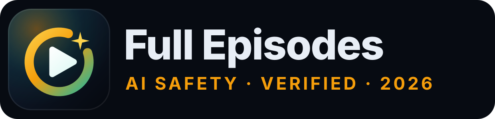

# AI Safety Full Episodes · July–October 2026

**A streaming app for every verified full-length AI safety episode of July 1 – October 27, 2026: a fullscreen cinema player with YouTube-style custom controls, a draggable mini player, headphones mode, an always-on-top float window, "I've watched these" bulk marking, a full watch-history timeline, playlists, ratings, monthly recaps, full chapter reports, a P(doom) and timelines claims tracker, a speaker hub with a real face photo for every speaker, Today's picks, Explore (learning paths, quote wall, debate mode, speaker map), 31 themes, heatmaps, insights and achievements.**

<a href="https://lo3elyon.github.io/ASI/ai-safety-full-episodes/"></a>
<br>


<br>


</div>

---

## Contents

[Library expansion](#whats-new-oct-28-2026-library-expansion-306-episodes) · [Picks & polish update](#whats-new-oct-28-2026-picks-explore-and-polish) · [Cinema update](#whats-new-oct-28-2026-cinema-update) · [The player](#the-cinema-player) · [Error 153 fix](#the-error-153-fix) · [I've watched these](#ive-watched-these) · [What came in v2](#whats-new-in-v2) · [Features](#features) · [Videos](#a-taste-of-the-library) · [Speakers](#speaker-photo-grid) · [Months](#months) · [Architecture](#architecture) · [Keep playing when minimised](#keep-playing-when-minimised) · [Watch history](#strict-watch-history) · [Recommendations](#recommendations) · [Levels & badges](#levels-and-badges) · [Shortcuts](#keyboard-shortcuts) · [SEO, security & performance](#seo-security-and-performance) · [Tests](#tests) · [Data schema](#data-schema) · [Daily JSON](#adding-new-episodes-daily-json--manifest) · [Files](#files) · [Privacy](#privacy) · [Method](#method) · [FAQ](#faq) · [Sources](#sources) · [Changelog](#changelog)

## What's new (Oct 28, 2026): library expansion, 306 episodes

A coverage sweep for July–October 2026 found **63 more verified full-length episodes** (from 66 candidates; 3 were the same event as an episode already here or a re-upload of an older one). They are merged into the same data file, so every feature works on them unchanged: picks, recommendations, search and filters, speaker hub, heatmaps, insights, the "I've watched these" checklist, JSON-LD and the sitemap.

| Month | Before | Added | **Now** | Hours now |
|---|---:|---:|---:|---:|
| July 2026 | 43 | +8 | **51** | 50.5 |
| August 2026 | 64 | +5 | **69** | 83.2 |
| September 2026 | 84 | +24 | **108** | 102.5 |
| October 2026 | 52 | +26 | **78** | 94.5 |
| **Total** | **243** | **+63** | **306** | **330.6** |

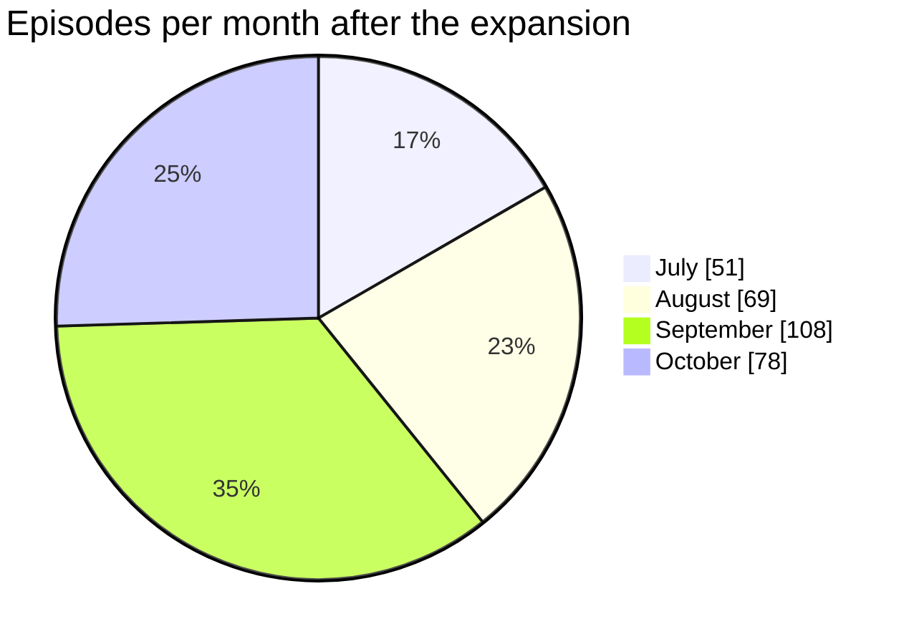

**What came in.** Research talks and lectures that the first pass under-covered: the IPAM workshop at UCLA (Christopher Potts, Jacob Steinhardt, Sam Eisenstat, Michael Winer, Dmitry Vaintrob, Jacob Tsimerman, Paul Riechers), the Schwartz Reisman Post-AGI Workshop (Anders Sandberg, Richard Ngo, Beren Millidge), MLSS 2026 (Jonas Geiping, Zhijing Jin), Boaz Barak's Harvard AI Safety course and Aaron Roth's Mathematical Foundations of AI Alignment, the Simons Institute (Jascha Sohl-Dickstein), Berkeley EECS and IASEAI (Brian Christian); plus podcasts and interviews with Scott Aaronson (4), Nick Bostrom (3), Tom Davidson, Will MacAskill, Eric Ho, Kevin Esvelt, Meia Chita-Tegmark, Nate Soares, Robert Long, Patrick Butlin and Jack Lindsey, Ajeya Cotra on Hard Fork, and German-language interviews with Connor Leahy and Jonas Freund.

**Kept out on purpose (one copy per event, inside the window).** `if-0UXc66dY` is the Alex Turner segment of the Aug 17 AI in the AM show already listed as `QroUVYVZxbE`; `l4JibLry2po` is a Spanish-language upload of the Jon Hernández interview with Stuart Russell already listed as `ewr4vwqsbzM`; `G9lL9ogZXkk` is a July re-upload of a Diary Of A CEO episode first released on Dec 4, 2025. The two Post-AGI Workshop talks on Sep 11 (`DB6uKUtOmec`, William MacAskill, 16:34; `Syap5xAvY5U`, Richard Ngo, 19:11) are different talks, so both stay.

**Speakers.** 58 new people, every one with a real face photo checked against their own episode with face detection and face matching (SFace), then by eye on a contact sheet: 27 new curated portraits with bios (the roster grows from 49 to 76), clean headshots from people's own sites and org pages for the rest, and face crops from their own episode for unnamed channel hosts. Hosts are named where the episode itself says who they are: Gus Docker (FLI Podcast), Shane Farnsworth (Escaped Sapiens, on-screen caption), Prachi Garella and Bhavay Tyagi (The Knowmads Podcast), and D. Scott Phoenix for Progress by Fifty Years (from the episode description). Two older photos were corrected (Jack Lindsey and Alan Chan had the wrong person). Name variants are merged, so "Will MacAskill" and "Chris Potts" resolve to William MacAskill and Christopher Potts.

## What's new (Oct 28, 2026): picks, Explore and polish

The second update of the day keeps everything from the cinema update below and adds a daily ritual, a second way to learn, and a lot of feel.

| Area | What changed |
|---|---|
| **Today's picks** | A stable list of **5 recommended unwatched episodes per local day** at the top of Home (at least 3 when the pool is small), mixed across formats, orgs and months, each with a reason. Mark watched, **discard** (an optional reason becomes a negative signal), **replace**, **generate more** with no limit, shuffle and steer with a guidance bar. Reorder by **drag and drop** (pointer, touch or keyboard), drag any episode card from anywhere on the site into the picks dock, drag a pick to the bin. Unfinished picks **carry over** to tomorrow if you want, and a **log** keeps every past day. |
| **Mini player** | **Free placement**: drag it anywhere on screen (not just corners) with grab / grabbing cursors, resize from the inner corner, and it remembers where you left it. Separate **Miniplayer (i)**, **Theater (t)** and **Fullscreen (f)** buttons, like YouTube. |
| **Episode page** | No more inner scrollbars: the page scrolls as one, the chapters / claims / notes tabs stay pinned, and the player **sticks as a mini player** when you scroll past it, then morphs back. |
| **Delight** | Ripples on every button, icon micro-animations (heart pop, check draw-in, bookmark flip, queue bounce), 3D tilt on thumbnails, and short bursts or **confetti** on meaningful actions (finishing an episode, clearing today's picks, level-ups). A **Celebrations** toggle turns the particles off; reduced motion and Do-not-disturb are always respected. |
| **In-place updates** | Favourite, queue, watched and rating actions update the card you clicked in place (same node, same image), so grids never jump or reload. |
| **Recently watched** | Has its own page (`#/recent`) instead of a shelf you had to scroll to. |
| **31 themes** | 18 full palettes (GitHub Dark / Light, Dracula, Nord, Solarized Dark / Light, One Dark, Tokyo Night, Catppuccin Mocha / Latte, Gruvbox, Monokai, Material Ocean, VS Code Dark+, Rosé Pine, Monochrome Graphite, Pure Black OLED, Paper White) plus 13 accent colours, every one contrast-checked to WCAG AA, with search, favourites, auto by time of day and a custom accent picker. |
| **Speaker photos** | **Every speaker now has a real face photo**: 227 of 231, including panel co-speakers, hosts and interviewers. Photos come from Wikimedia Commons, people's own sites and org team pages, or a clean face crop from their own episode, each checked with face detection and face matching against the episode, then reviewed by eye on a contact sheet. No text, logos or initials anywhere. The 4 anonymous channel hosts with no public face get a neutral silhouette drawn in the current theme accent. |
| **Avatars** | Fixed square-to-circle avatars everywhere, the command palette included (no more squashed ovals). |
| **Focus mode** | Zen mode is now called **Focus** (`Z`), with Pomodoro and Do-not-disturb as before. |
| **Honest controls** | Quality, speed and caption menus only show what YouTube reports for the current video. When YouTube keeps choosing quality automatically for embeds, the menu says so and offers to open that exact moment on YouTube. |
| **About + Explore** | A proper **About** page (how it works, shortcuts, privacy, FAQ) and an **Explore** page: 6 **learning paths** from basics to depth with progress, a **Quote wall** of key claims with jump-to-time, **Debate mode** with side-by-side stance cards, and a **Speaker map** of organisation affiliations. |

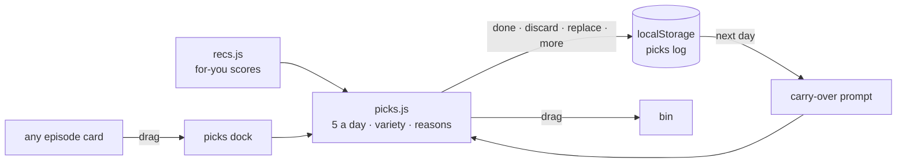

## What's new (Oct 28, 2026): cinema update

| Area | Before (Oct 27) | **Now (Oct 28)** |
|---|---|---|
| Pop-out | Re-created a YouTube player inside the Document PiP window → **"Error 153: video player configuration error"** | The one real player stays on the page; the **float window is a remote/now-playing panel** (artwork, live chapter, progress, controls). No second player, no 153. Every YouTube iframe is built by the app with `referrerpolicy="strict-origin-when-cross-origin"`, `origin` and `widget_referrer`, on `youtube.com` consistently. |
| Expand button | Opened a small pop-out window | **Toggles true fullscreen** on the player shell (Fullscreen API on the container, not the bare iframe), so the custom controls, chapter rail and menus overlay the video. Esc exits. CSS fallback where the API is missing. |
| Player controls | YouTube's own controls | **Custom cinema controls**: big play, ±10 s (and ±5/30 via keys), frame step when paused, speed 0.25–3× in 0.05 steps (clamped to YouTube's 2× embed limit), quality menu, volume slider, captions, A–B loop, chapter ticks + bookmarks on the seek bar, buffered bar, hover preview (time + chapter + nearest YouTube frame), sleep timer (15/30/60 min, end of chapter, end of episode), skip intro, auto-skip to the researcher in hearings, double-click/double-tap seek, touch swipe for seek and volume, `?` overlay. A "YouTube's own controls" switch is in Settings for ads or YouTube menus. |
| Mini player | Fixed bottom-right | **Draggable anywhere** (pointer + touch), **snaps to the nearest corner**, remembers corner and size (`asfe:mini:v3`), **corner resize handle**, double-click to expand. |
| Error handling | Message only | **Fallback card** for codes 2 / 5 / 100 / 101 / 150 / 153 and API-blocked: Open on YouTube (at your second), **Mark as watched**, Try again, Next episode. |
| Already watched on YouTube | Not possible | **Mark as watched / unwatched** on every card, drawer, theater and the error card; **"I've watched these"** checklist of all 306 grouped by month with thumbnails and speakers, select all per month / speaker / search result, bulk mark, undo, and "watched up to mm:ss" for partial viewing; CSV import. |
| History | Day list | **Timeline** grouped Today / Yesterday / This week / Earlier, per-session start–end, seconds, from→to, % reached, filters (played here vs marked, completed vs in progress), search, remove, undo marks, **export JSON + CSV, import JSON or CSV** (sanitised). |
| Home | Continue row | **Continue where you left off** banner, **Recently watched** row, **daily goal ring** + streak flame. |
| Library | Queue + favourites | **Playlists** (create, rename, reorder by drag or arrows, delete, play all, shuffle), **Watch later**, **1–5 star ratings**, **personal tags**, **context menu** (right-click or ⋯), **monthly recap** ("wrapped"), **share-card image** (canvas PNG), Focus mode with Pomodoro + do-not-disturb, headphones mode with big artwork and visualizer. |
| Design | Amber/teal glass | **Animated aurora background**, 6 accent themes (amber, teal, emerald, sky, coral, lime) + optional violet/rose, gradient-border glass cards, hover lift + thumbnail zoom + animated chapter preview + avatar fan-out, staggered entrance, view transitions, confetti, Inter + Manrope, **thin accent scrollbars**, carousels with arrow buttons, snap and edge fades. |
| Brand | Placeholder shield tile | **New logo mark + wordmark** (aperture ring with a spark and play glyph), `favicon.svg`, `favicon.ico` (16/32/48), Apple touch icon, PWA 192/512 + maskable, `manifest.webmanifest`, 1200×630 Open Graph image. |
| Delivery | 9 separate scripts, client-only render | **Pre-rendered HTML** (hero, stats, 24 cards, `<noscript>` list of all 306), critical CSS inline, one minified deferred bundle, JSON-LD (WebSite + ItemList of 306 VideoObjects), `sitemap.xml` with video entries, `robots.txt`, strict CSP, no inline handlers, splash + progress bar. |
| Storage | `:v2` keys | **Schema 3** (`:v3` keys). v1 and v2 keys stay untouched as backups. |

## The cinema player

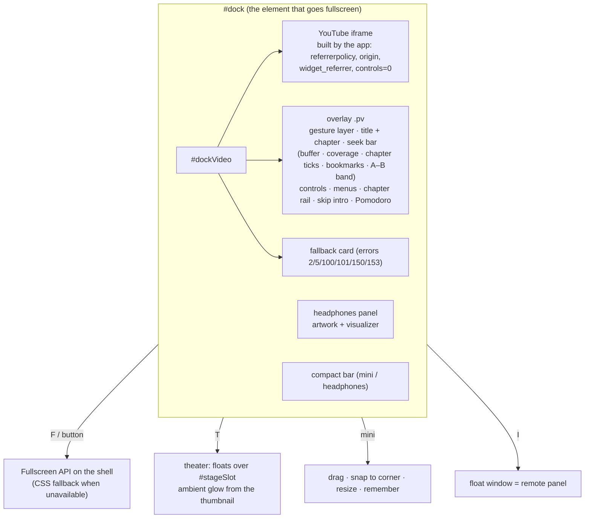

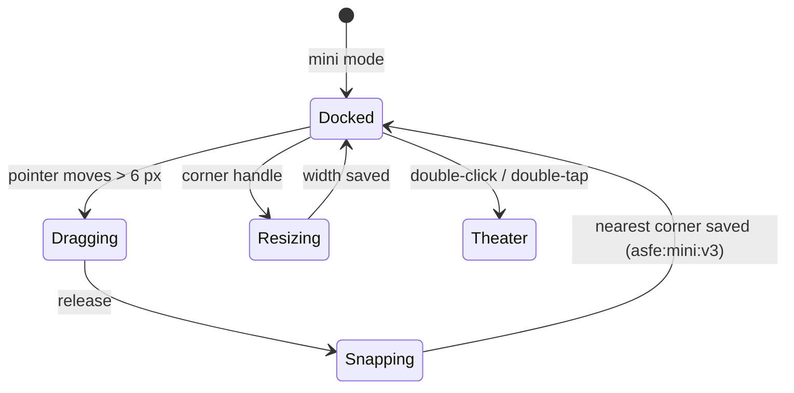

## The Error 153 fix

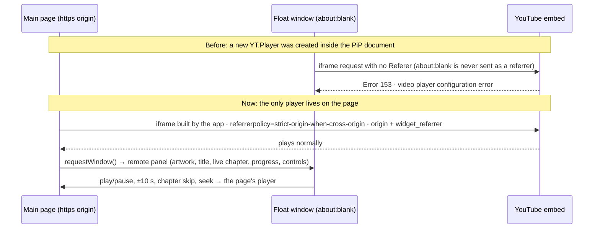

Moving the live iframe into the float window would reload it inside the about:blank document with the same missing referrer, so that route was rejected on purpose. Honest limit: the float window shows artwork and controls, not the moving picture. For a big picture use fullscreen (`F`); to keep listening with the browser minimised use the float window or headphones mode.

## I've watched these

Every card, the episode drawer, the theater and the error card have **Mark as watched** (and **Mark unwatched**). A mark writes a full-completion record (watched seconds = duration, 100 %, completed, `source: "manual"`, timestamp now) that counts toward stats, XP, badges, streaks and the watch heatmap on the day you mark it. Manual minutes are stored separately (`manualDaily`) so heatmap cells say "x played + y marked as watched" and show a dot. The record keeps a snapshot of what was there before, so unmarking restores it exactly. "Watched up to mm:ss" logs partial viewing. The checklist page (`#/watched`, `G W`) groups all 306 by month with thumbnails and speakers; tick rows, a whole month, a speaker, or every search result, then **Mark selected as watched** with **Undo**. CSV import accepts any file with an `id` or YouTube `url` column (plus optional `completed`, `percent`, `position`).

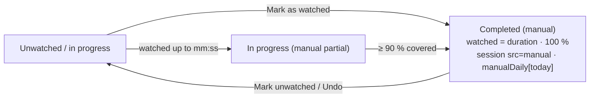

## What's new in v2

| | v1 (Oct 27, morning) | **v2 (Oct 27, night)** |
|---|---|---|
| Episodes | 52 (October) + 8 just outside | **243 verified full episodes, July–October** (Jul 43 · Aug 64 · Sep 84 · Oct 52) |
| Player | theater + mini | theater, mini, **audio mode**, **pop-out always-on-top window**, Media Session, never pauses on tab switch |
| Speakers | text directory | **hub with real photos for everyone**, bios, follow, profile pages, "Play all", their stated numbers |
| Episode detail | chapters list | **full chapter report**, key claims, numbers, people/orgs mentioned, tags, level, why watch, evidence, deep links at the current second |
| Discovery | one heatmap, simple filters | **GitHub-style release heatmap + personal watch heatmap**, month switcher, fuzzy search over chapters and claims, 10 filter groups, 8 sorts, grid/list, saved filters, command palette |
| Recommendations | similar episodes | scored on follows, shared speakers/orgs/tags, completion, level progression; **Because you watched**, Continue, Short & complete, Deep dives, Debates |
| Insights | — | hours per day/week, by speaker, by org, by month, completion donut, streak calendar, **claims tracker** |
| Achievements | 8 levels, 17 badges | **12 levels, 29 badges**, XP float animation, level-up burst, profile card |
| Code | one 93 KB file | **8 modules**, service worker, jsdom smoke test |

## Features

| Area | What you get |
|---|---|
| **Fullscreen cinema** | `F` or the expand button puts the whole player shell into fullscreen with auto-hiding overlay controls, a chapter rail and menus; Esc exits. |
| **Float window** | `I` (or More → Float window) opens a Document Picture-in-Picture remote (Chrome/Edge 116+): artwork, live chapter, progress, play/pause, ±10 s, chapter skip. The video keeps playing in the page. Other browsers switch to headphones mode. |
| **Headphones mode** | `A` hides the video and shows big speaker artwork, an animated visualizer, title, live chapter and full controls. Keep browsing; playback never stops on navigation or tab switches. |
| **Media Session** | Title, speakers, show and artwork go to the OS media controls (lock screen, keyboard media keys, headset buttons), with play, pause, seek ±, seek-to, next and previous-chapter handlers wired to the YouTube player. |
| **Persistent dock** | One player for the whole app: theater, fullscreen, draggable mini, headphones. It survives every route change and is never re-created, so it never reloads. |
| **Months** | Switch between All, July, August, September and October with per-month stats (episodes, hours, speakers, chapters, top speakers). Default is All. |
| **Release heatmap** | A contributions-style grid of every day Jul 1 – Oct 31, 2026: colour intensity = episodes released, the number is shown in larger cells and on hover, month headers show totals and active days, a Less→More legend; click a day or a month to filter the library. |
| **Watch heatmap** | The same grid for your own minutes watched per day (strict playback only); click a day in History to see just that day. |
| **Speakers hub** | 76 curated researcher portraits with organisation and a factual one-line bio, plus every other guest and host with a real photo (see [photos](#speaker-photo-grid)). Episode count, total hours, "watched x of y", group filters, search, sort, a collapsible Hosts section. |
| **Speaker profile** | Big photo, bio, stats, first→last appearance, **Follow**, **Play all** (fills the queue), every stated number (P(doom), timelines, other figures) linked to the moment, sortable episode list, "Often appears with". |
| **Episode report** | Every chapter with time, title and detail (click to seek), key claims with timestamps and speakers, numbers, people and organisations mentioned (click to filter), tags, level, why watch, evidence, speakers with photos, your history and notes, "More like this". |
| **Deep links** | `#ep=<id>&t=<sec>` opens the episode and plays from that second. "Copy link at current time" (`C`) and Share (native share sheet when available). |
| **Notes** | Timestamped notes while watching (`N`), in the side panel, in the episode drawer and on a Notes page with search and Markdown export. |
| **Search** | Fuzzy (typo-tolerant) across title, speakers, show, tags, chapter titles and details, and claims, with highlighted snippets that jump straight to the matching moment. |
| **Filters** | Month, format, length, level, people group, organisation, speaker (searchable), watched state (unwatched, in progress, watched, favourites, with notes, queued), followed only, topic tags, release day. Live facet counts, active-filter chips, saved filters. |
| **Sorts & layouts** | Best match, newest, oldest, longest, shortest, most viewed, unwatched first, for you; grid or list; infinite "show more". |
| **Recommendations** | For you, Because you watched X, Continue watching, New from people you follow, Short & complete (< 40 min), Deep dives (2 h +), Debates, Hearings & panels, Most viewed, Latest. Every pick says why. |
| **Up Next** | Queue first, then the best-scored similar episodes with reasons; 10-second autoplay countdown. |
| **Insights** | KPIs, hours per day or week, by speaker, by organisation, by release month, by format, completion donut, streak calendar, and a **claims tracker** table of P(doom) and timeline statements by speaker with a ▶ button to the exact moment. |
| **Achievements** | 12 levels from Novice to Superalignment Sage, 29 badges (Monthly Completionist, Speaker Collector, Org Explorer, Night Owl, Binge, Chapter Jumper, Note Taker, Always on Top, Ears Only, …), floating +XP, level-up burst, editable profile card. |
| **Command palette** | `Ctrl/⌘ K`: jump to any episode, speaker or action (pop out, audio mode, copy link, theme, surprise me). `Shift+Enter` queues. |
| **Polish** | Dark / light / system theme, 6 accent colours (+2 optional), aurora background, gradient-border glass, skeleton shimmer, staggered entrance, view transitions, confetti, lazy thumbnails, responsive layout with a mobile bottom nav, accessible focus rings, reduced-motion support, offline-friendly service worker. |

## A taste of the library

Three of the biggest episodes from each month (click to open on YouTube; every one of the 306 plays inside the app):

<table>
<tr>
<td align="center" width="33%" valign="top"><a href="https://www.youtube.com/watch?v=l2b9UrSsz-w"></a><br><br><sub><b>Davidad on Moral Realism & p(Doom)</b><br>Cognitive Revolution · davidad · 2:23:37 · Jul 12</sub></td>
<td align="center" width="33%" valign="top"><a href="https://www.youtube.com/watch?v=8qTZLqY-cnI"></a><br><br><sub><b>Joe Rogan Experience #2525</b><br>Nick Bostrom · 2:14:42 · Jul 14</sub></td>
<td align="center" width="33%" valign="top"><a href="https://www.youtube.com/watch?v=_g4l7YkDQwA"></a><br><br><sub><b>ChatGPT Whistleblower</b><br>The Diary Of A CEO · Daniel Kokotajlo · 2:00:44 · Jul 13</sub></td>
</tr>
<tr>
<td align="center" width="33%" valign="top"><a href="https://www.youtube.com/watch?v=KFcJgTODkkQ"></a><br><br><sub><b>An AI 2027 Author Returns</b><br>80,000 Hours · Daniel Kokotajlo · 3:47:33 · Aug 27</sub></td>
<td align="center" width="33%" valign="top"><a href="https://www.youtube.com/watch?v=zOSptyQ3j9A"></a><br><br><sub><b>Where AGI timelines go wrong</b><br>80,000 Hours · Toby Ord · 2:46:03 · Aug 6</sub></td>
<td align="center" width="33%" valign="top"><a href="https://www.youtube.com/watch?v=OZAqXlGXdFY"></a><br><br><sub><b>AXRP 50: Eli Lifland on AI 2027</b><br>AXRP · Eli Lifland · 2:40:39 · Aug 2</sub></td>
</tr>
<tr>
<td align="center" width="33%" valign="top"><a href="https://www.youtube.com/watch?v=rtir6QmQQRg"></a><br><br><sub><b>Real Reason AI CEOs Are Building Bunkers</b><br>Danny Jones · Connor Leahy · 2:41:49 · Sep 18</sub></td>
<td align="center" width="33%" valign="top"><a href="https://www.youtube.com/watch?v=OhOmLqR5nN4"></a><br><br><sub><b>AI Experts Debate: Is There a 99% Chance…</b><br>Yampolskiy, Soares, Zitron · 2:24:26 · Sep 17</sub></td>
<td align="center" width="33%" valign="top"><a href="https://www.youtube.com/watch?v=X50zezLFWWI"></a><br><br><sub><b>Ajeya Cotra: the clearest warning shot</b><br>Dwarkesh Podcast · Ajeya Cotra · 2:20:33 · Sep 1</sub></td>
</tr>
<tr>
<td align="center" width="33%" valign="top"><a href="https://www.youtube.com/watch?v=lnLDjXy2kRA"></a><br><br><sub><b>Jacob Coxon: the existential threat from inside</b><br>The Daily Show · Jacob Coxon · 25:59 · Oct 5</sub></td>
<td align="center" width="33%" valign="top"><a href="https://www.youtube.com/watch?v=qDzg-xvkeXw"></a><br><br><sub><b>AI Whistleblower: They Are Hiding What Is Really Happening</b><br>The Diary Of A CEO · Jeffrey Ladish · 2:03:31 · Oct 8</sub></td>
<td align="center" width="33%" valign="top"><a href="https://www.youtube.com/watch?v=JIMXEuT_ZAU"></a><br><br><sub><b>What This OpenAI Insider Saw That Made Him Quit</b><br>The Ezra Klein Show · David Robinson · 1:14:55 · Oct 7</sub></td>
</tr>
</table>

## Speaker photo grid

Every one of the 288 speakers has a photo in `assets/speakers/<slug>.jpg`, mapped by name in `data/photos.json`: **283 real face photos** (curated portraits for the roster, plus verified face crops for every co-speaker, host and interviewer) and a neutral accent-coloured silhouette for 5 channel hosts who never appear on camera and have no public face (Carneades, Sazzad Hossain Sumon's channel, Eleanor of *Alive to This*, Sarah, Ryan Dsouza). `ui.photoOf` never falls back to a video thumbnail, cover art or initials.

<table>
<tr>
<td align="center" width="14%" valign="top"><br><sub><b>Eliezer Yudkowsky</b><br>MIRI</sub></td>
<td align="center" width="14%" valign="top"><br><sub><b>Nate Soares</b><br>MIRI</sub></td>
<td align="center" width="14%" valign="top">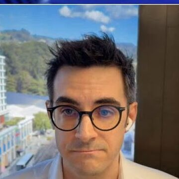<br><sub><b>Malo Bourgon</b><br>MIRI</sub></td>
<td align="center" width="14%" valign="top"><br><sub><b>Connor Leahy</b><br>ControlAI</sub></td>
<td align="center" width="14%" valign="top"><br><sub><b>Andrea Miotti</b><br>ControlAI</sub></td>
<td align="center" width="14%" valign="top"><br><sub><b>Holly Elmore</b><br>PauseAI US</sub></td>
<td align="center" width="14%" valign="top"><br><sub><b>Geoffrey Hinton</b><br>University of Toronto</sub></td>
</tr>
<tr>
<td align="center" width="14%" valign="top">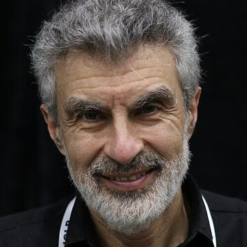<br><sub><b>Yoshua Bengio</b><br>Mila / LawZero</sub></td>
<td align="center" width="14%" valign="top">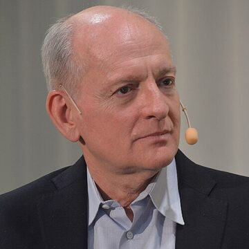<br><sub><b>Stuart Russell</b><br>UC Berkeley</sub></td>
<td align="center" width="14%" valign="top"><br><sub><b>Roman Yampolskiy</b><br>University of Louisville</sub></td>
<td align="center" width="14%" valign="top"><br><sub><b>Nick Bostrom</b><br>Macrostrategy Research Initiative</sub></td>
<td align="center" width="14%" valign="top"><br><sub><b>Max Tegmark</b><br>MIT / FLI</sub></td>
<td align="center" width="14%" valign="top"><br><sub><b>David Krueger</b><br>Université de Montréal / Mila</sub></td>
<td align="center" width="14%" valign="top"><br><sub><b>Toby Ord</b><br>Oxford AI Governance Initiative</sub></td>
</tr>
<tr>
<td align="center" width="14%" valign="top"><br><sub><b>William MacAskill</b><br>Forethought</sub></td>
<td align="center" width="14%" valign="top">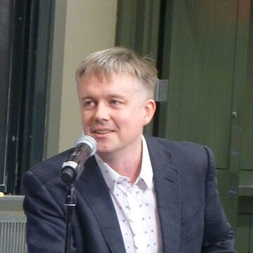<br><sub><b>Jaan Tallinn</b><br>Future of Life Institute</sub></td>
<td align="center" width="14%" valign="top"><br><sub><b>Helen Toner</b><br>Georgetown CSET</sub></td>
<td align="center" width="14%" valign="top"><br><sub><b>Anthony Aguirre</b><br>Future of Life Institute</sub></td>
<td align="center" width="14%" valign="top"><br><sub><b>Miles Brundage</b><br>AVERI</sub></td>
<td align="center" width="14%" valign="top"><br><sub><b>Stephen Casper</b><br>Harvard</sub></td>
<td align="center" width="14%" valign="top"><br><sub><b>Dan Hendrycks</b><br>Center for AI Safety</sub></td>
</tr>
<tr>
<td align="center" width="14%" valign="top"><br><sub><b>Adam Gleave</b><br>FAR.AI</sub></td>
<td align="center" width="14%" valign="top"><br><sub><b>Jeffrey Ladish</b><br>Palisade Research</sub></td>
<td align="center" width="14%" valign="top"><br><sub><b>Chris Painter</b><br>METR</sub></td>
<td align="center" width="14%" valign="top"><br><sub><b>Marius Hobbhahn</b><br>Apollo Research</sub></td>
<td align="center" width="14%" valign="top">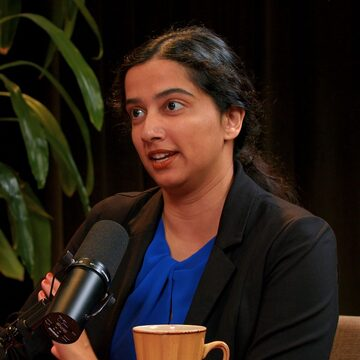<br><sub><b>Ajeya Cotra</b><br>METR</sub></td>
<td align="center" width="14%" valign="top"><br><sub><b>Buck Shlegeris</b><br>Redwood Research</sub></td>
<td align="center" width="14%" valign="top"><br><sub><b>Ryan Greenblatt</b><br>Redwood Research</sub></td>
</tr>
<tr>
<td align="center" width="14%" valign="top">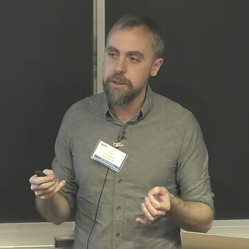<br><sub><b>Paul Christiano</b><br>Alignment Research Center</sub></td>
<td align="center" width="14%" valign="top"><br><sub><b>Owain Evans</b><br>Truthful AI</sub></td>
<td align="center" width="14%" valign="top"><br><sub><b>Rosie Campbell</b><br>Eleos AI Research</sub></td>
<td align="center" width="14%" valign="top"><br><sub><b>Daniel Kokotajlo</b><br>AI Futures Project</sub></td>
<td align="center" width="14%" valign="top"><br><sub><b>Eli Lifland</b><br>AI Futures Project</sub></td>
<td align="center" width="14%" valign="top"><br><sub><b>Thomas Larsen</b><br>AI Futures Project</sub></td>
<td align="center" width="14%" valign="top"><br><sub><b>Jacob Coxon</b><br>Former Anthropic & OpenAI</sub></td>
</tr>
<tr>
<td align="center" width="14%" valign="top"><br><sub><b>Alex Turner</b><br>Former Google DeepMind</sub></td>
<td align="center" width="14%" valign="top"><br><sub><b>Steven Adler</b><br>Guidelight AI</sub></td>
<td align="center" width="14%" valign="top">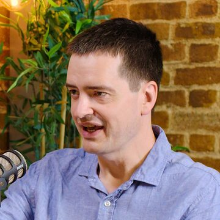<br><sub><b>Geoffrey Irving</b><br>Resolution</sub></td>
<td align="center" width="14%" valign="top"><br><sub><b>Victoria Krakovna</b><br>Google DeepMind</sub></td>
<td align="center" width="14%" valign="top"><br><sub><b>Neel Nanda</b><br>Google DeepMind</sub></td>
<td align="center" width="14%" valign="top"><br><sub><b>Mikita Balesni</b><br>Apollo Research</sub></td>
<td align="center" width="14%" valign="top">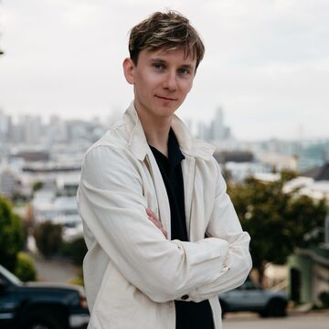<br><sub><b>Tomek Korbak</b><br>Former OpenAI</sub></td>
</tr>
<tr>
<td align="center" width="14%" valign="top">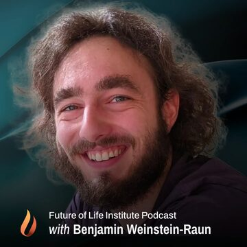<br><sub><b>Benjamin Weinstein-Raun</b><br>Palisade Research</sub></td>
<td align="center" width="14%" valign="top"><br><sub><b>Aengus Lynch</b><br>Theorem</sub></td>
<td align="center" width="14%" valign="top">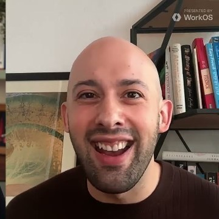<br><sub><b>Emmanuel Ameisen</b><br>Anthropic</sub></td>
<td align="center" width="14%" valign="top"><br><sub><b>Dylan Hadfield-Menell</b><br>MIT</sub></td>
<td align="center" width="14%" valign="top"><br><sub><b>Katja Grace</b><br>AI Impacts</sub></td>
<td align="center" width="14%" valign="top"><br><sub><b>Oliver Habryka</b><br>Lightcone Infrastructure</sub></td>
<td align="center" width="14%" valign="top">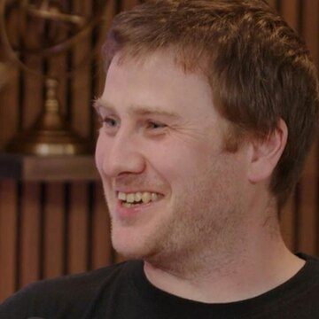<br><sub><b>Tom McGrath</b><br>Goodfire</sub></td>
</tr>
</table>

## Months

| Month | Episodes | Hours | Notes |
|---|---:|---:|---|
| July 2026 | 51 | 50.5 | chapters parsed from timestamped topics |
| August 2026 | 69 | 83.2 | chapters parsed from timestamped topics |
| September 2026 | 108 | 102.5 | includes the Sep 27–30 items that were "just outside" in v1, and the IPAM and Post-AGI workshop talks |
| October 2026 | 78 | 94.5 | richest: hand-written chapters, quotes, numbers, tags, level, views |
| **Total** | **306** | **330.6** | 100 release days · 3,317 chapters |

## Architecture

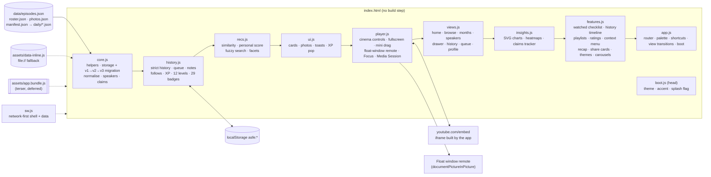

### Data flow on load and while watching

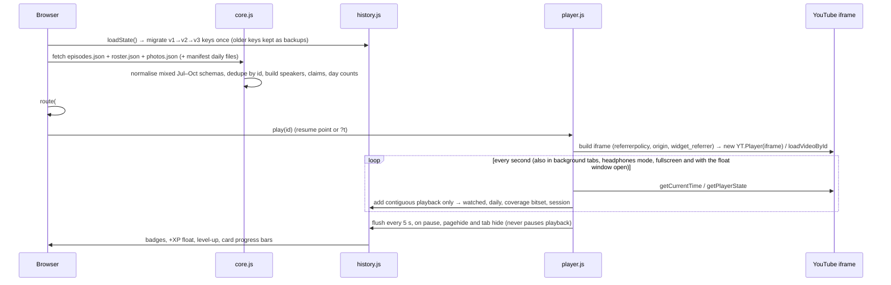

### Strict history states

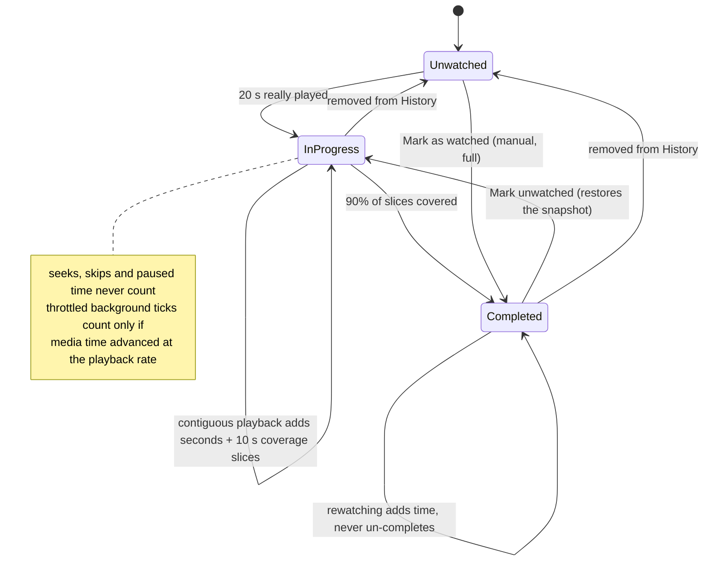

## Keep playing when minimised

1. **Never pause on `visibilitychange`.** Hiding the tab only saves progress; at the end of an episode in a hidden tab the next one starts at once (no countdown, since timers are throttled).
2. **Float window** (Chrome / Edge 116+): an always-on-top remote with artwork, chapter and controls, while the page keeps playing the video.
3. **Headphones mode** for every browser: big artwork and visualizer, video hidden.
4. **Media Session** metadata and handlers for lock-screen and hardware media keys.
5. **Persistent dock** across every route; background-friendly queue playback.

## Strict watch history

Only contiguous forward playback counts. Each second the app compares how far the media advanced with how much wall time passed; a seek, skip or stall adds nothing. When a background tab or the pop-out throttles timers, a long gap counts only if the media advanced at almost exactly the playback rate over that gap. Coverage is a bitset of 10-second slices; an episode is **completed** at 90% coverage. Sessions (start, end, seconds, from→to) feed History, Insights, the streak calendar and badges such as Night Owl, Marathon and Binge.

## Recommendations

`score = 8×followed speakers + 3×affinity to speakers you watched + 1.5×org affinity + tag and keyword affinity + level fit (Intro → Intermediate → Deep-dive as you complete more) + unwatched bonus + small recency and popularity terms − completed`. "Because you watched X" uses pairwise similarity (shared speakers ×6, shared orgs, shared tags, keyword overlap, same show, same format). Up Next blends both and always serves your queue first.

## Levels and badges

12 levels: Novice · Curious Listener · Safety Apprentice · Alignment Scholar · Eval Analyst · Interpretability Initiate · Frontier Analyst · Control Researcher · Governance Strategist · Red-Team Lead · Policy Architect · Superalignment Sage.

XP: 1 per minute actually played · 50 per completed episode · 5 per note · 30 per badge · 2 per chapter jump (max 200) · 5 per followed researcher.

29 badges include First Frame, Full Episode, Ten Complete, Half Century, One Hour In … Centurion (100 h), **Monthly Completionist**, Four Months, **Speaker Collector**, Many Voices, **Org Explorer**, Org Cartographer, Every Format, The Godfathers, Three in a Row, Seven-Day Streak, **Night Owl**, Marathon, **Binge**, **Chapter Jumper**, **Note Taker**, Archivist, Following Along, Curator, Always on Top, Ears Only and Deep End.

## Keyboard shortcuts

| Key | Action | Key | Action |
|---|---|---|---|
| `Ctrl/⌘ K` | Command palette | `/` | Search |
| `Space` / `K` | Play / pause | `J` / `L` | −10 s / +10 s |
| `←` / `→` | −10 s / +10 s (Shift: 30 s) | `↑` / `↓` | Volume (theater / fullscreen) |
| `,` / `.` | Frame step when paused (speed −/+ 0.25× while playing) | `<` / `>` | Slower / faster |
| `Shift P` / `Shift ]` | Previous / next chapter | `S` | Skip intro |
| `Shift N` | Next episode | `0`–`9` | Jump to 0–90% |
| `F` | Fullscreen cinema | `T` | Theater ↔ mini |
| `A` | Headphones mode | `I` | Float window |
| `Z` | Focus mode | `C` | Captions |
| `M` | Mute | `B` | Bookmark |
| `N` | Note at this moment | `[` / `]` / `\` | Loop start / end / clear |
| `W` | Mark watched (focused card or current episode) | `Shift F10` | Card menu (or right-click) |
| Arrow keys on a card | Move between cards | `Esc` | Close menu / exit fullscreen / leave Focus / minimise |
| `G` then `H B S I W L R Y` | Home, Browse, Speakers, Insights, Watched, Playlists, Recap, History | `?` | Shortcuts overlay |
| Double-click / double-tap video | Left/right third ±10 s · middle fullscreen · mini expands | Swipe on video (touch) | Sideways seeks · up/down on the right half = volume |

## Data schema

`data/episodes.json` is an array. Field sets differ by month and are normalised at load time:

| Field | Type | Notes |
|---|---|---|
| `id` | string | YouTube video ID (dedupe key) |
| `title`, `channel`, `show` | string | |
| `date`, `month` | `YYYY-MM-DD`, `YYYY-MM` | upload date (US Pacific) |
| `duration` | `H:MM:SS` / `MM:SS` | |
| `speakers` | `[{name, affiliation}]` or `["Name (desc) — role"]` | hosts detected from role text and a host list |
| `names` | string[] | people who speak |
| `format` | string | bucketed into podcast / debate / panel / talk / hearing |
| `summary`, `why_watch`, `evidence` | string | |
| `chapters` | `[{t, seconds, title, detail}]` | October; otherwise parsed from `topics` |
| `topics` | `["0:12:34 Title", …]` | timestamps parsed when present |
| `key_claims` | strings `"0:10:26 — Name: quote"` or `{t, seconds, speaker, quote}` | |
| `numbers` | `[{speaker, value, t, seconds}]` | feeds the claims tracker |
| `people_mentioned`, `orgs_mentioned`, `tags` | string[] | clickable filters |
| `level` | Intro / Intermediate / Deep-dive | estimated for Jul–Sep ("est.") |
| `views` | number | October counts |
| `url`, `thumb` | string | |

`data/roster.json`: `[{name, photo, org, group, bio}]` for the curated researchers. `data/photos.json`: `{name: file}` for every photo in `assets/speakers/`.

## Adding new episodes (daily JSON + manifest)

Drop `data/daily/2026-10-28.json` (same shape as `episodes.json`) and list it:

```json
{ "files": ["daily/2026-10-28.json"] }
```

The app merges listed files after `episodes.json` on every load; a later copy of the same `id` replaces the earlier one. Then regenerate `assets/data-inline.js` for the `file://` fallback.

## Files

```
ai-safety-full-episodes/
├── index.html              pre-rendered shell: SEO tags, CSP, JSON-LD, hero + 24 cards, noscript list, player shell
├── sw.js                   offline-friendly service worker (cache bumped for this update)
├── manifest.webmanifest    installable PWA (standalone, maskable icon, shortcuts)
├── favicon.svg · favicon.ico · apple-touch-icon.png
├── robots.txt · sitemap.xml   (sitemap includes video entries for all 306)
├── README.md               this file
├── assets/
│   ├── app.min.css         minified app.css + v3.css (what the page loads)
│   ├── app.css · v3.css    readable styles: base + cinema/library/design layer
│   ├── app.bundle.js       minified, deferred bundle of all modules (what the page loads)
│   ├── app.js              router, global events, command palette, shortcuts, view transitions, boot
│   ├── brand/              mark.svg · logo.svg · maskable.svg · icon-192/512 · icon-maskable-512 · og.jpg
│   ├── js/
│   │   ├── core.js         helpers, storage + migration, taxonomy, normalisation, speakers, claims
│   │   ├── history.js      strict history, library state, XP, levels, badges
│   │   ├── recs.js         recommendations, fuzzy search, filters
│   │   ├── ui.js           icons, cards, photo avatars, toasts, XP animation
│   │   ├── boot.js         runs in <head>: theme, accent, reduced motion, first-visit splash
│   │   ├── player.js       cinema controls, fullscreen, draggable mini, float-window remote, Focus, sleep, loop, Media Session
│   │   ├── features.js     watched checklist, history timeline, playlists, ratings, tags, context menu, recap, share cards, themes, carousels
│   │   ├── views.js        home, browse, months, speakers, profile pages, drawer, history, queue, notes, about
│   │   ├── insights.js     SVG charts, contribution heatmaps, claims tracker
│   │   ├── fx.js           delight layer: ripples, icon micro-animations, tilt, bursts, confetti (Celebrations toggle)
│   │   ├── themes.js       31 contrast-checked themes: palettes, accents, search, favourites, auto, custom accent
│   │   ├── picks.js        Today's picks: daily list, discard / replace / more, drag and drop, carry-over, log
│   │   └── extras.js       Explore: learning paths, quote wall, debate mode, speaker map
│   ├── data-inline.js      inline data copy for file://
│   ├── cover.jpg
│   └── speakers/           283 face photos + neutral.svg (one per speaker, verified)
└── data/
    ├── episodes.json       306 verified full episodes, Jul–Oct 2026
    ├── roster.json         curated researchers with bios
    ├── photos.json         name → photo file
    ├── manifest.json       daily files to merge
    └── daily/              drop daily JSON here
```

## Privacy

Everything you do stays in this browser's `localStorage` under `asfe:` keys (`history:v3`, `notes:v3`, `favs:v3`, `queue:v3`, `follows:v3`, `badges:v3`, `savedFilters:v3`, `prefs:v3`, `settings:v3`, `playlists:v3`, `later:v3`, `ratings:v3`, `utags:v3`, `mini:v3`, `accent`, `theme`). The `:v1` and `:v2` keys are copied forward once and left untouched as backups. No analytics, no accounts, no server. Videos play through YouTube's embedded player, loaded only when you first press play; YouTube's terms apply to playback. Export JSON or CSV from History.

## SEO, security and performance

| | What is done |
|---|---|
| **Crawlable HTML** | `index.html` is generated by `build3.py`: real `<title>`, description, canonical, Open Graph + Twitter Card (1200×630 image), `lang="en"`, landmarks, alt text, the hero, stats and the newest 24 episode cards pre-rendered, and a `<noscript>` list of all 306 with links. The app hydrates over it. |
| **Structured data** | JSON-LD `WebSite` + `ItemList` of 306 `VideoObject` (name, description, thumbnailUrl, uploadDate, ISO-8601 duration, embedUrl, contentUrl). `sitemap.xml` with video entries; `robots.txt` at the route (crawlers only read the domain-root robots.txt, so this one documents intent). |
| **CSP** | `script-src 'self' https://www.youtube.com https://s.ytimg.com` (no inline scripts), `frame-src` YouTube only, `img-src` self + ytimg, fonts from Google Fonts, `object-src 'none'`, `base-uri 'self'`. Styles allow inline because the UI sets CSS variables in `style` attributes. |
| **No inline handlers** | Image load/error handling uses capture-phase listeners; the jsdom test checks the live DOM for any `on*` attribute. |
| **Escaping & imports** | All data goes through `esc()` before `innerHTML`; imported JSON is rebuilt key by key (valid 11-char IDs, finite numbers, clipped strings, known keys only); CSV import is parsed defensively and exports neutralise spreadsheet formulas. External links use `rel="noopener noreferrer"`; referrer policy `strict-origin-when-cross-origin`. |
| **Performance** | Critical CSS inline, full CSS minified (csso), one deferred terser bundle with preload, YouTube IFrame API only on first play, preconnect to i.ytimg.com and youtube.com, lazy + async-decoded images with width/height, service worker cache. |
| **Loading polish** | Animated logo splash on the first visit, top progress bar driven by the data download, shimmer skeletons, staggered card entrance, View Transitions API between sections (CSS fallback). |

## Tests

`smoke3.js` runs the built page in jsdom with a stubbed YouTube IFrame API: 220 checks, all passing (including the merged episodes, the excluded duplicates and alias-free speaker resolution). It covers the static build (pre-render, noscript list, JSON-LD, CSP, icons, manifest, scrollbar CSS, service-worker version), v1→v3 migration with backups, the strict watch clock, the iframe attributes, overlay controls, frame step, speed clamp, menus, captions, sleep timer, A–B loop, bookmarks, fullscreen (fallback and native paths), every error code's fallback card, float window as a remote (no second player), headphones mode, mini-player drag/snap/resize/double-click via pointer events, Focus + do-not-disturb, mark watched (single, partial, bulk, undo), the history timeline and filters, CSV export/import round-trip, sanitised JSON import, theme switching, Home additions, keyboard navigation, every view, no version labels, no inline handlers and safe external links. It also checks Today's picks (daily stability, discard / replace / more, drag reorder, dock, bin, carry-over, log), free mini-player placement, sticky mini on scroll, in-place card updates, the 31 themes' contrast audit, Focus naming, About and Explore, the separate Miniplayer / Theater / Fullscreen buttons, and that every speaker has a real face photo (except 4 anonymous hosts) with no thumbnail fallback. Screenshots of home, theater, fullscreen, mini player, headphones mode, history, "I've watched these" and the recap were reviewed at 1440×900 and 390×844 in headless Firefox.

## Method

* **Verified full episodes only:** the named researcher actually speaks; the transcript, description or chapters were checked; one copy per event; no clips, compilations or reaction videos.
* **Coverage:** uploads July 1 – October 27, 2026. **Compiled:** October 27, 2026.
* **Integrity:** de-duplicated by YouTube ID at load time; counts are shown in the app's About & method page.
* **Claims tracker:** keyword-matched P(doom) and timeline statements, attributed only to named non-host researchers. It is a navigation aid: check the moment itself.

## FAQ

<details><summary><b>Why did the old pop-out say "Error 153"?</b></summary>
<br>The pop-out created a new YouTube player inside the Picture-in-Picture document. That document is <code>about:blank</code>, so the request carried no referrer and YouTube refused to start. The float window is now a remote for the player that stays on the page, and every iframe is created with an explicit referrer policy and origin.</details>
<details><summary><b>Does it really keep playing when I minimise the browser?</b></summary>
<br>Desktop browsers keep playing in a background tab and the app never pauses on tab switches. On Chrome and Edge 116+ the float window (<code>I</code>) stays on top as a remote. Some mobile browsers pause embedded video in the background, which a web page cannot override.</details>
<details><summary><b>I watched some of these on YouTube already. Can I count them?</b></summary>
<br>Yes: Mark as watched on any card, or tick them in bulk on <a href="https://lo3elyon.github.io/ASI/ai-safety-full-episodes/#/watched">I've watched these</a>. They count as completions on the day you mark them and are labelled as marked everywhere. Undo or Mark unwatched restores the earlier record.</details>
<details><summary><b>Why can't I go faster than 2×?</b></summary>
<br>The speed control goes to 3×, but YouTube's embedded player only accepts up to 2×, so the app clamps and tells you.</details>
<details><summary><b>Did the update keep my history?</b></summary>
<br>Yes. Storage moved to schema 3: every <code>:v2</code> key (and, for first-time visitors from the first release, every <code>:v1</code> key) is copied forward once and the old keys are left untouched as backups.</details>
<details><summary><b>Why does a host show a channel logo?</b></summary>
<br>Hosts get the avatar of the channel their episode is on. For network channels that is the network's logo rather than the person.</details>
<details><summary><b>Why do some guests show a cropped video thumbnail?</b></summary>
<br>Guests without a curated portrait are shown with a circular crop of the thumbnail of their best solo episode, so everyone has a real photo.</details>
<details><summary><b>How do I share an exact moment?</b></summary>
<br>Press <code>C</code> (or "Copy link at current time"). The link looks like <code>…/ai-safety-full-episodes/#ep=VIDEOID&amp;t=754</code>.</details>

## Sources

Every episode links to its YouTube page; the full list with evidence is in [`data/episodes.json`](data/episodes.json). Channel avatars come from YouTube via the Piped API. Researcher portraits are curated public photos.

## Changelog

| Date | Change |
|---|---|
| 2026-10-28 | **Library expansion**: 63 more verified full episodes (306 total: Jul 51 · Aug 69 · Sep 108 · Oct 78, about 331 hours); 3 candidates kept out as same-event copies or an old re-upload; 58 new speakers with verified face photos and 27 new curated bios (roster 76); hosts named from their own episodes (Gus Docker, Shane Farnsworth, Prachi Garella, Bhavay Tyagi, D. Scott Phoenix); Jack Lindsey and Alan Chan photos corrected; 220-check jsdom test. No feature or design changes. |
| 2026-10-28 | **Picks, Explore and polish**: Today's picks (5 a day, mark watched, discard with reason, replace, generate more without limit, shuffle, guidance bar, drag and drop from anywhere, bin, carry-over, log); free-placement draggable mini player with grab / grabbing cursors and resize; separate Miniplayer (i) / Theater (t) / Fullscreen (f) buttons; episode page without inner scrollbars and a sticky mini player on scroll; delight effects and confetti with a Celebrations toggle; in-place card updates; Recently watched on its own page; 31 contrast-checked themes; square-circle avatar fix; Zen renamed Focus; honest quality / speed / caption controls; About and Explore pages (learning paths, quote wall, debate mode, speaker map); a real face photo for every speaker (227 of 231, the rest are anonymous hosts with an accent silhouette); 218-check jsdom test. |
| 2026-10-28 | **v3 · cinema update**: fixed the pop-out "Error 153" (float window is now a remote; the only player stays on the page; iframes built with referrer policy, origin and widget_referrer on youtube.com); expand button now toggles true fullscreen on the player shell with overlay controls and chapter rail; custom cinema controls (frame step, 0.25–3× fine speed, quality, captions, A–B loop, bookmarks, buffered bar, hover previews, sleep timer, skip intro, hearing auto-skip, gestures); draggable, snapping, resizable mini player; fallback card for errors 2/5/100/101/150/153; Mark as watched + "I've watched these" bulk checklist with undo and partial; history timeline with filters, search and JSON/CSV export/import; Continue banner, Recently watched, daily goal + streak; playlists, Watch later, ratings, personal tags, context menu, monthly recap, share-card images, Focus mode (then called Zen), headphones mode; aurora design with 6 accent themes, styled scrollbars and carousels; new logo and full favicon/PWA set, OG image; pre-rendered HTML, JSON-LD, sitemap, robots, strict CSP, minified bundle; schema 3 migration keeping v1/v2 backups; 136-check jsdom test. |
| 2026-10-27 | **v2.0**: 243 verified full episodes Jul–Oct 2026 (replaces the 52 + 8 set); pop-out always-on-top player (Document PiP), audio mode, Media Session, persistent dock, never pauses on tab switch; month switcher; GitHub-style release and watch heatmaps; speaker hub with a real photo for every person (49 curated portraits, 98 host channel avatars, thumbnail crops for the rest), bios, follow, profile pages, Play all and stated numbers; full episode reports with deep links at the current second; fuzzy search, 10 filter groups, 8 sorts, grid/list and saved filters; smarter recommendations with reasons; insights dashboard and claims tracker; 12 levels and 29 badges with XP animation; command palette, shortcuts overlay, dark/light/system theme, mobile bottom nav, service worker; 8 JS modules; v1→v2 storage migration; jsdom smoke test. |
| 2026-10-27 | v1: 52 episodes + 8 just outside, embedded player with theater and mini modes, chapters, strict watch history, Up Next with autoplay countdown, queue, notes, favorites, speaker directory, heatmap, levels and 17 badges, light/dark themes, manifest-based daily data. |

<div align="center">
<sub>A project by <b>Aniruddha Adak</b> · part of the <a href="https://lo3elyon.github.io/ASI/">ASI hub</a> · videos belong to their channels.</sub>
</div>
