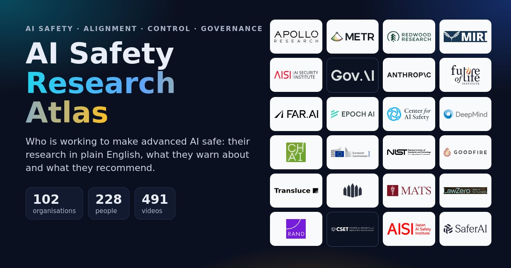
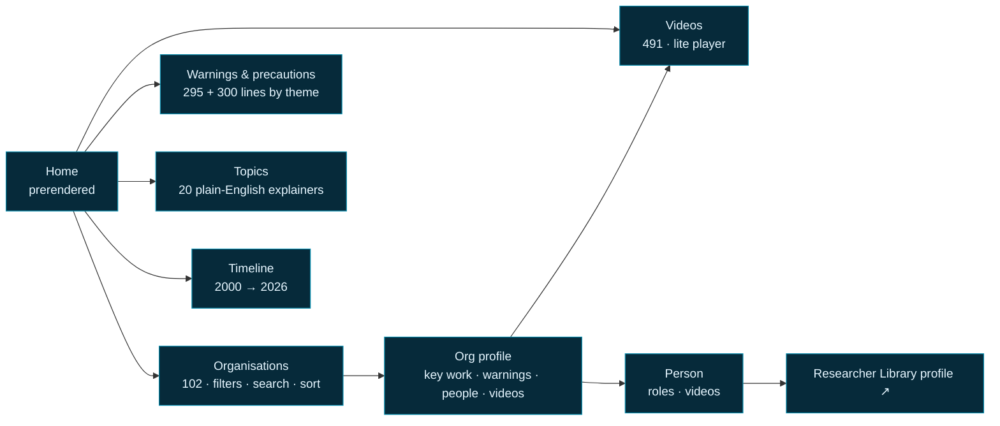

<div align="center">

<a href="https://lo3elyon.github.io/ASI/ai-safety-research-atlas/"></a>

# AI Safety Research Atlas

**A visual directory of the organisations working to make advanced AI safe: their research in plain English, what they warn about, what they recommend, their people and their talks.**

<a href="https://lo3elyon.github.io/ASI/ai-safety-research-atlas/"></a>


</div>

## What it is

AI safety is the work of making sure increasingly powerful AI systems do what people intend and do not cause catastrophic harm. This atlas maps **who does that work**: 102 organisations across AI control, alignment, interpretability, evaluations, existential-risk research, government safety institutes, governance think tanks, advocacy groups, lab safety teams, university labs, funders and training programmes.

For every organisation you get its logo, a homepage screenshot, its own tagline, a plain-English mission, its key papers and reports (each with a two-line summary), the risks it **warns** about, the precautions it **recommends**, its people (with faces) and its talks and podcasts (with a lightweight player).

## Pages

| Route | What you get |
|---|---|
| [`#/`](https://lo3elyon.github.io/ASI/ai-safety-research-atlas/) | What is AI safety in three sentences, map of the field by category with counts, featured organisations, every **closed / renamed / merged** organisation, “What they warn about” and “What they recommend” highlights, latest videos, links to the sister sites. Prerendered for instant paint and SEO. |
| [`#/orgs`](https://lo3elyon.github.io/ASI/ai-safety-research-atlas/#/orgs) | Logo grid with filters (category, type, focus tag, country, status), search and sort (A–Z, oldest, newest, most videos), paginated. |
| `#/o/<slug>` | Organisation profile: logo, tagline, status badge and status note, founded / HQ / type / size / funding, links (site, blog, research, careers, YouTube, GitHub, X), homepage screenshot, focus tags, key work, warnings, recommendations, people, videos. |
| [`#/people`](https://lo3elyon.github.io/ASI/ai-safety-research-atlas/#/people) | 228 people with faces, filter by category, search, “in the Researcher Library” toggle. Person pages link to the full profile in the [AI Safety Researcher Library](https://lo3elyon.github.io/ASI/ai-safety-researcher-library/) when one exists. |
| [`#/videos`](https://lo3elyon.github.io/ASI/ai-safety-research-atlas/#/videos) | 491 videos, filters by organisation, category, format, year and topic, search across titles, channels and summaries, sort newest/oldest/longest. |
| [`#/topics`](https://lo3elyon.github.io/ASI/ai-safety-research-atlas/#/topics) | 20 focus tags explained in plain English (AI control, interpretability, evals, scheming, scalable oversight, agent foundations, forecasting, governance, compute governance, security, x-risk, model welfare and more) with the organisations and videos for each. |
| [`#/warnings`](https://lo3elyon.github.io/ASI/ai-safety-research-atlas/#/warnings) | Every warning and recommendation from every organisation, grouped by theme: loss of control, deception and scheming, robustness, misuse (bio/chem/cyber), race dynamics, concentration of power, security, evidence gaps, governance, society, model welfare, talent and funding. Each line shows its source organisation’s logo. |
| [`#/timeline`](https://lo3elyon.github.io/ASI/ai-safety-research-atlas/#/timeline) | Foundings, renames, closures, mergers, milestones and major reports from 2000 to 2026. |
| [`#/about`](https://lo3elyon.github.io/ASI/ai-safety-research-atlas/#/about) | Method, sources, limits, last updated (2 Nov 2026), credits. |



## The field at a glance

| Category | Organisations | What they do |
|---|---:|---|
| Control, evals & interpretability | 22 | Technical labs that test, monitor and look inside AI systems. |
| X-risk & theory institutes | 18 | Institutes focused on extinction-level risk, theory and strategy. |
| Frontier lab safety teams | 6 | Safety and alignment teams inside the companies building frontier AI. |
| University labs | 10 | Academic groups researching alignment, robustness and governance. |
| Governments & international | 15 | Government AI safety/security institutes and international bodies. |
| Governance, policy & advocacy | 18 | Think tanks, watchdogs and campaigns shaping AI rules. |
| Funders & training programs | 13 | The funders, fellowships and courses that grow the field. |

### Status changes (closed, renamed, merged, pivoted)

| Organisation | Status | Change |
|---|---|---|
| AIST | Renamed | Renamed (was AI Safety Student Team) |
| ARIA Safeguarded AI programme | Pivoted | Narrowed focus 2025–26 |
| Center for AI Policy | Closed | Mostly closed mid-2025 |
| Center for Advancing Innovation and Standards for Super Intelligence (formerly US AI Safety Institute / CAISI) | Renamed | Renamed twice: US AISI → CAISI (2025) → CAISSI (2026) |
| Coefficient Giving (formerly Open Philanthropy) | Renamed | Renamed (was Open Philanthropy) |
| Conjecture | Pivoted | Pivoted to “Cognitive Emulation” |
| Encode (Encode AI, formerly Encode Justice) | Renamed | Renamed (was Encode Justice) |
| Future of Humanity Institute | Closed | Closed Apr 2024 |
| Haize Labs | Pivoted | Pivoted toward reliable enterprise agents |
| Institute for Law & AI | Renamed | Renamed (was Legal Priorities Project) |
| International Network for Advanced AI Measurement, Evaluation and Science (formerly International Network of AI Safety Institutes) | Renamed | Renamed Dec 2025 (dropped “safety”) |
| Irregular (formerly Pattern Labs) | Renamed | Renamed Sep 2025 (now Irregular) |
| Long-Term Future Fund (EA Funds) | Closed | Closed Aug 2026 → Transformative AI Fund |
| METR (Model Evaluation & Threat Research) | Renamed | Spun out & renamed Dec 2023 (was ARC Evals) |
| Machine Intelligence Research Institute | Pivoted | Pivoted 2024 to policy & communication |
| OECD.AI Policy Observatory / Global Partnership on AI (GPAI) | Merged | GPAI merged in Jul 2024 |
| Orthogonal | Quiet | Quiet: last publication Aug 2024 |
| Principles of Intelligence (formerly PIBBSS) | Renamed | Renamed (now Principles of Intelligence) |
| RAND Center on AI, Security, and Technology | Merged | Formed by merger Oct 2025 |
| Timaeus (now Resolution) | Merged | Merged Jun 2026 into Resolution |
| UK AI Security Institute | Renamed | Renamed Feb 2025 (was AI Safety Institute) |

## Performance and design

Built to stay cool on any laptop or phone:

- **No idle work**: zero `requestAnimationFrame` calls, zero timers and zero DOM mutations while idle; no infinite animations, no canvas or video backgrounds, no large `backdrop-filter`.
- **Motion that is cheap**: hover lift and glow use only `transform` and `opacity`; a one-time staggered entrance via `IntersectionObserver`; View Transitions for route changes and the sun ⇄ moon theme toggle (with fallback and `prefers-reduced-motion` respected).
- **Lite YouTube facade**: thumbnails only; one `youtube-nocookie.com` iframe (with `referrerpolicy` and `origin`) is created when you press play, and closed when you play another or leave the page.
- **Small and fast**: vanilla JS ~14 KB gzipped, prerendered home with all 102 organisations inlined for instant directory paint, lazy images with width/height, logos as SVG or WebP ≤256 px, screenshots as 800 px WebP, faces as 160/320 px WebP, paginated grids.
- **Layout safety**: chip rows always `flex-wrap`, no fixed heights on content, no `content-visibility`, so sections never overlap.
- **Safe by default**: strict Content-Security-Policy (no inline scripts or styles), every data string escaped, external links `rel="noopener noreferrer"`.
- **Accessible**: WCAG AA contrast in light and dark (checked automatically), keyboard focus styles, skip link, labelled filters.
- **SEO**: meta description, Open Graph and Twitter cards, JSON-LD `WebSite` + `ItemList` of `Organization`s, sitemap.

## Quality checks

| Check | Result |
|---|---|
| jsdom smoke test (data integrity, all 102 profiles render, filters, search, pagination, one iframe after click, theme toggle) | pass |
| Layout audit at 360 / 768 / 1366 / 1920 px, light + dark, 11 pages (no overlaps, no horizontal overflow, sections never overlap, chip rows wrap) | 88 / 88 pass |
| Perf budget (idle rAF, timers, DOM mutations, endless animations) | all 0 |
| WCAG AA text contrast, light + dark | pass |

## Data

```text
ai-safety-research-atlas/
├── index.html          prerendered home + inlined organisation index (JSON)
├── og.jpg  favicon.svg  sitemap.xml  README.md
├── assets/             app.js (vanilla, ~14 KB gz)  app.css  cats.css  t.js (theme)
├── data/
│   ├── orgs.json       slim organisation index
│   ├── people.json     228 people, roles across organisations
│   ├── videos.json     491 videos (title, channel, date, duration, format, orgs, speakers, summary, topics)
│   ├── themes.json     warnings + recommendations grouped by theme
│   ├── timeline.json   foundings, changes, milestones, reports
│   └── o/<slug>.json   full detail per organisation (loaded on demand)
└── img/
    ├── logos/          98 logos (SVG, or WebP ≤256 px)
    ├── shots/          100 homepage screenshots (WebP, 800 px, q60)
    └── faces/          217 faces × 2 sizes (WebP 160 + 320)
```

## Method and sources

Five research passes covered technical safety labs, x-risk and theory institutes, government institutes and international bodies, governance and advocacy groups, and the ecosystem of lab safety teams, university labs, funders and training programmes. Each organisation’s own website was opened; taglines are quoted from it; missions and key work are simplified into plain English with links to the original papers, reports and posts. Duplicates were merged (the Oxford Martin AI Governance Initiative appeared twice), people were merged across organisations (one person can belong to several), and videos were merged by YouTube id. Videos were confirmed against YouTube metadata or transcripts. Status changes come from the organisations’ own announcements and news reporting up to November 2026.

## Honest limits

- A map, not a ranking or an endorsement.
- Summaries simplify; read the linked work before relying on a detail.
- Warning/recommendation themes are assigned by keyword rules and can misfile a line.
- 11 people have no photo we could verify, so they show initials in their organisation’s colour instead of a guessed face. 4 organisations without a clean logo show a monogram (all have a homepage screenshot).
- Frontier labs appear only through their safety teams.

## All organisations

<details><summary>102 organisations (click to expand)</summary>

- [80,000 Hours (AI careers)](https://lo3elyon.github.io/ASI/ai-safety-research-atlas/#/o/80000-hours)
- [AI Futures Project](https://lo3elyon.github.io/ASI/ai-safety-research-atlas/#/o/ai-futures-project)
- [AI Impacts](https://lo3elyon.github.io/ASI/ai-safety-research-atlas/#/o/ai-impacts)
- [AI Policy Institute](https://lo3elyon.github.io/ASI/ai-safety-research-atlas/#/o/aipi)
- [AI Safety Asia](https://lo3elyon.github.io/ASI/ai-safety-research-atlas/#/o/aisafety-asia)
- [AI Safety Camp](https://lo3elyon.github.io/ASI/ai-safety-research-atlas/#/o/ai-safety-camp)
- [AI Safety Fund](https://lo3elyon.github.io/ASI/ai-safety-research-atlas/#/o/ai-safety-fund)
- [AIST](https://lo3elyon.github.io/ASI/ai-safety-research-atlas/#/o/harvard-aist) — **renamed**
- [Alignment Research Center](https://lo3elyon.github.io/ASI/ai-safety-research-atlas/#/o/arc)
- [Anthropic Alignment Science team](https://lo3elyon.github.io/ASI/ai-safety-research-atlas/#/o/anthropic-alignment-science)
- [Anthropic Interpretability team](https://lo3elyon.github.io/ASI/ai-safety-research-atlas/#/o/anthropic-interpretability)
- [Apart Research](https://lo3elyon.github.io/ASI/ai-safety-research-atlas/#/o/apart-research)
- [Apollo Research](https://lo3elyon.github.io/ASI/ai-safety-research-atlas/#/o/apollo-research)
- [ARENA (Alignment Research Engineer Accelerator)](https://lo3elyon.github.io/ASI/ai-safety-research-atlas/#/o/arena)
- [ARIA Safeguarded AI programme](https://lo3elyon.github.io/ASI/ai-safety-research-atlas/#/o/aria-safeguarded-ai) — **pivoted**
- [Berkeley Existential Risk Initiative](https://lo3elyon.github.io/ASI/ai-safety-research-atlas/#/o/beri)
- [BlueDot Impact](https://lo3elyon.github.io/ASI/ai-safety-research-atlas/#/o/bluedot)
- [Cadenza Labs](https://lo3elyon.github.io/ASI/ai-safety-research-atlas/#/o/cadenza-labs)
- [Canadian Artificial Intelligence Safety Institute](https://lo3elyon.github.io/ASI/ai-safety-research-atlas/#/o/canada-aisi)
- [Center for Advancing Innovation and Standards for Super Intelligence (formerly US AI Safety Institute / CAISI)](https://lo3elyon.github.io/ASI/ai-safety-research-atlas/#/o/us-caisi) — **renamed**
- [Center for AI Policy](https://lo3elyon.github.io/ASI/ai-safety-research-atlas/#/o/caip) — **closed**
- [Center for AI Safety](https://lo3elyon.github.io/ASI/ai-safety-research-atlas/#/o/cais)
- [Center for Human-Compatible Artificial Intelligence](https://lo3elyon.github.io/ASI/ai-safety-research-atlas/#/o/chai)
- [Center for Humane Technology](https://lo3elyon.github.io/ASI/ai-safety-research-atlas/#/o/cht)
- [Center for Security and Emerging Technology](https://lo3elyon.github.io/ASI/ai-safety-research-atlas/#/o/cset)
- [Centre for the Governance of AI](https://lo3elyon.github.io/ASI/ai-safety-research-atlas/#/o/govai)
- [Centre for the Study of Existential Risk](https://lo3elyon.github.io/ASI/ai-safety-research-atlas/#/o/cser)
- [Coefficient Giving (formerly Open Philanthropy)](https://lo3elyon.github.io/ASI/ai-safety-research-atlas/#/o/coefficient-giving) — **renamed**
- [Concordia AI](https://lo3elyon.github.io/ASI/ai-safety-research-atlas/#/o/concordia)
- [Conjecture](https://lo3elyon.github.io/ASI/ai-safety-research-atlas/#/o/conjecture) — **pivoted**
- [ControlAI](https://lo3elyon.github.io/ASI/ai-safety-research-atlas/#/o/controlai)
- [Convergence Analysis](https://lo3elyon.github.io/ASI/ai-safety-research-atlas/#/o/convergence-analysis)
- [Eleos AI Research](https://lo3elyon.github.io/ASI/ai-safety-research-atlas/#/o/eleos-ai)
- [EleutherAI](https://lo3elyon.github.io/ASI/ai-safety-research-atlas/#/o/eleutherai)
- [Encode (Encode AI, formerly Encode Justice)](https://lo3elyon.github.io/ASI/ai-safety-research-atlas/#/o/encode) — **renamed**
- [Epoch AI](https://lo3elyon.github.io/ASI/ai-safety-research-atlas/#/o/epoch-ai)
- [ERA (ERA:AI Fellowship), Cambridge](https://lo3elyon.github.io/ASI/ai-safety-research-atlas/#/o/era-cambridge)
- [European AI Office](https://lo3elyon.github.io/ASI/ai-safety-research-atlas/#/o/eu-ai-office)
- [Existential Risk Observatory](https://lo3elyon.github.io/ASI/ai-safety-research-atlas/#/o/existential-risk-observatory)
- [FAR.AI (Frontier Alignment Research)](https://lo3elyon.github.io/ASI/ai-safety-research-atlas/#/o/far-ai)
- [FOCAL](https://lo3elyon.github.io/ASI/ai-safety-research-atlas/#/o/cmu-focal)
- [Forethought](https://lo3elyon.github.io/ASI/ai-safety-research-atlas/#/o/forethought)
- [Frontier Model Forum](https://lo3elyon.github.io/ASI/ai-safety-research-atlas/#/o/frontier-model-forum)
- [Future of Humanity Institute](https://lo3elyon.github.io/ASI/ai-safety-research-atlas/#/o/fhi) — **closed**
- [Future of Life Institute](https://lo3elyon.github.io/ASI/ai-safety-research-atlas/#/o/fli)
- [Gladstone AI](https://lo3elyon.github.io/ASI/ai-safety-research-atlas/#/o/gladstone)
- [Global Catastrophic Risk Institute](https://lo3elyon.github.io/ASI/ai-safety-research-atlas/#/o/gcri)
- [Goodfire](https://lo3elyon.github.io/ASI/ai-safety-research-atlas/#/o/goodfire)
- [Google DeepMind AGI Safety & Alignment](https://lo3elyon.github.io/ASI/ai-safety-research-atlas/#/o/gdm-agi-safety)
- [Gray Swan AI](https://lo3elyon.github.io/ASI/ai-safety-research-atlas/#/o/gray-swan)
- [Haize Labs](https://lo3elyon.github.io/ASI/ai-safety-research-atlas/#/o/haize-labs) — **pivoted**
- [Institut national pour l'évaluation et la sécurité de l'intelligence artificielle](https://lo3elyon.github.io/ASI/ai-safety-research-atlas/#/o/france-inesia)
- [Institute for AI Policy and Strategy](https://lo3elyon.github.io/ASI/ai-safety-research-atlas/#/o/iaps)
- [Institute for Law & AI](https://lo3elyon.github.io/ASI/ai-safety-research-atlas/#/o/lawai) — **renamed**
- [International AI Safety Report](https://lo3elyon.github.io/ASI/ai-safety-research-atlas/#/o/intl-ai-safety-report)
- [International Network for Advanced AI Measurement, Evaluation and Science (formerly International Network of AI Safety Institutes)](https://lo3elyon.github.io/ASI/ai-safety-research-atlas/#/o/intl-network-aisi) — **renamed**
- [Irregular (formerly Pattern Labs)](https://lo3elyon.github.io/ASI/ai-safety-research-atlas/#/o/pattern-labs) — **renamed**
- [Jacob Steinhardt's group, UC Berkeley](https://lo3elyon.github.io/ASI/ai-safety-research-atlas/#/o/berkeley-steinhardt)
- [Japan AI Safety Institute](https://lo3elyon.github.io/ASI/ai-safety-research-atlas/#/o/japan-aisi)
- [Korea AI Safety Institute](https://lo3elyon.github.io/ASI/ai-safety-research-atlas/#/o/korea-aisi)
- [Krueger AI Safety Lab](https://lo3elyon.github.io/ASI/ai-safety-research-atlas/#/o/kasl)
- [LawZero](https://lo3elyon.github.io/ASI/ai-safety-research-atlas/#/o/lawzero)
- [Leverhulme Centre for the Future of Intelligence](https://lo3elyon.github.io/ASI/ai-safety-research-atlas/#/o/lcfi)
- [Lightcone Infrastructure (LessWrong · AI Alignment Forum · Lighthaven)](https://lo3elyon.github.io/ASI/ai-safety-research-atlas/#/o/lightcone)
- [Long-Term Future Fund (EA Funds)](https://lo3elyon.github.io/ASI/ai-safety-research-atlas/#/o/ltff) — **closed**
- [Lyptus Research](https://lo3elyon.github.io/ASI/ai-safety-research-atlas/#/o/lyptus-research)
- [Machine Intelligence Research Institute](https://lo3elyon.github.io/ASI/ai-safety-research-atlas/#/o/miri) — **pivoted**
- [MATS (ML Alignment & Theory Scholars)](https://lo3elyon.github.io/ASI/ai-safety-research-atlas/#/o/mats)
- [Meta frontier AI risk framework (Advanced AI Scaling Framework)](https://lo3elyon.github.io/ASI/ai-safety-research-atlas/#/o/meta-frontier-ai)
- [METR (Model Evaluation & Threat Research)](https://lo3elyon.github.io/ASI/ai-safety-research-atlas/#/o/metr) — **renamed**
- [MIT Algorithmic Alignment Group](https://lo3elyon.github.io/ASI/ai-safety-research-atlas/#/o/mit-aag)
- [NIST AI Risk Management Framework team (Trustworthy & Responsible AI program)](https://lo3elyon.github.io/ASI/ai-safety-research-atlas/#/o/nist-ai-rmf)
- [NYU Alignment Research Group](https://lo3elyon.github.io/ASI/ai-safety-research-atlas/#/o/nyu-arg)
- [OECD.AI Policy Observatory / Global Partnership on AI (GPAI)](https://lo3elyon.github.io/ASI/ai-safety-research-atlas/#/o/oecd-ai) — **merged**
- [OpenAI safety, alignment & preparedness teams (incl. Superalignment history)](https://lo3elyon.github.io/ASI/ai-safety-research-atlas/#/o/openai-safety)
- [Orthogonal](https://lo3elyon.github.io/ASI/ai-safety-research-atlas/#/o/orthogonal) — **quiet**
- [Oxford Martin AI Governance Initiative](https://lo3elyon.github.io/ASI/ai-safety-research-atlas/#/o/aigi)
- [Palisade Research](https://lo3elyon.github.io/ASI/ai-safety-research-atlas/#/o/palisade-research)
- [PauseAI (Global + PauseAI US)](https://lo3elyon.github.io/ASI/ai-safety-research-atlas/#/o/pauseai)
- [Princeton AI Alignment + Safety (AIAS) & POLARIS Lab](https://lo3elyon.github.io/ASI/ai-safety-research-atlas/#/o/princeton-aias)
- [Principles of Intelligence (formerly PIBBSS)](https://lo3elyon.github.io/ASI/ai-safety-research-atlas/#/o/pibbss) — **renamed**
- [RAND Center on AI, Security, and Technology](https://lo3elyon.github.io/ASI/ai-safety-research-atlas/#/o/rand-cast) — **merged**
- [Redwood Research](https://lo3elyon.github.io/ASI/ai-safety-research-atlas/#/o/redwood-research)
- [Rethink Priorities (AI governance & strategy, digital consciousness)](https://lo3elyon.github.io/ASI/ai-safety-research-atlas/#/o/rethink-priorities)
- [Safe AI Forum (International Dialogues on AI Safety)](https://lo3elyon.github.io/ASI/ai-safety-research-atlas/#/o/saif)
- [Safe Superintelligence Inc.](https://lo3elyon.github.io/ASI/ai-safety-research-atlas/#/o/ssi)
- [SaferAI](https://lo3elyon.github.io/ASI/ai-safety-research-atlas/#/o/saferai)
- [Schmidt Sciences](https://lo3elyon.github.io/ASI/ai-safety-research-atlas/#/o/schmidt-safety)
- [Secure AI Project](https://lo3elyon.github.io/ASI/ai-safety-research-atlas/#/o/secure-ai-project)
- [Simplex](https://lo3elyon.github.io/ASI/ai-safety-research-atlas/#/o/simplex)
- [Singapore AI Safety Institute (Digital Trust Centre)](https://lo3elyon.github.io/ASI/ai-safety-research-atlas/#/o/singapore-aisi)
- [SPAR (Supervised Program for Alignment Research)](https://lo3elyon.github.io/ASI/ai-safety-research-atlas/#/o/spar)
- [Stanford Center for AI Safety](https://lo3elyon.github.io/ASI/ai-safety-research-atlas/#/o/stanford-aisafety)
- [Stanford Center for Research on Foundation Models](https://lo3elyon.github.io/ASI/ai-safety-research-atlas/#/o/stanford-crfm)
- [Survival and Flourishing Fund](https://lo3elyon.github.io/ASI/ai-safety-research-atlas/#/o/sff)
- [Tegmark AI Safety Group, MIT](https://lo3elyon.github.io/ASI/ai-safety-research-atlas/#/o/tegmark-mit)
- [The Midas Project](https://lo3elyon.github.io/ASI/ai-safety-research-atlas/#/o/midas)
- [Timaeus (now Resolution)](https://lo3elyon.github.io/ASI/ai-safety-research-atlas/#/o/timaeus) — **merged**
- [Transluce](https://lo3elyon.github.io/ASI/ai-safety-research-atlas/#/o/transluce)
- [Truthful AI](https://lo3elyon.github.io/ASI/ai-safety-research-atlas/#/o/truthful-ai)
- [UK AI Security Institute](https://lo3elyon.github.io/ASI/ai-safety-research-atlas/#/o/uk-aisi) — **renamed**
- [UN Independent International Scientific Panel on AI (and predecessor High-level Advisory Body on AI)](https://lo3elyon.github.io/ASI/ai-safety-research-atlas/#/o/un-ai-panel)

</details>

## Sister sites

- [AI Safety Researcher Library](https://lo3elyon.github.io/ASI/ai-safety-researcher-library/): learn from the researchers themselves.
- [AI Safety Full Episodes](https://lo3elyon.github.io/ASI/ai-safety-full-episodes/): complete podcasts and talks in a streaming app.
- [ASI hub](https://lo3elyon.github.io/ASI/)

## Changelog

| Date | Change |
|---|---|
| 2026-11-02 | First release: 102 organisations in 7 categories, 228 people, 491 videos, 434 key works, 295 warnings and 300 recommendations, timeline, topics, prerendered home, strict CSP, lite player. |
