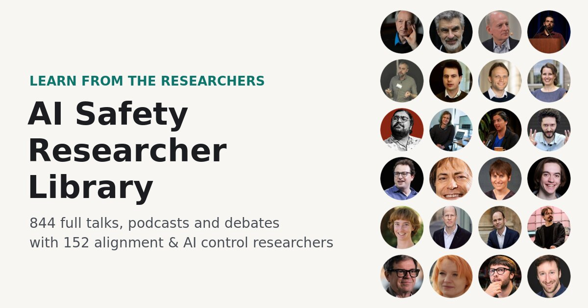
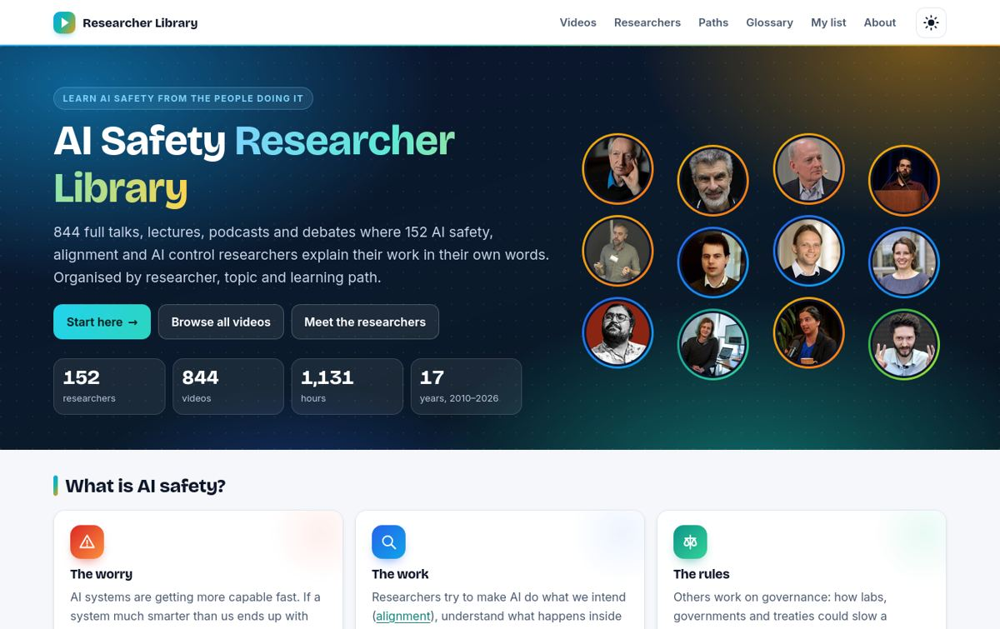
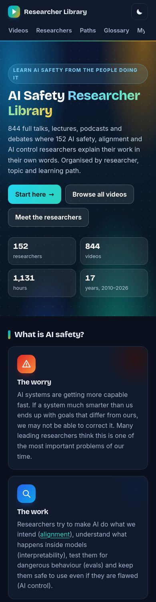
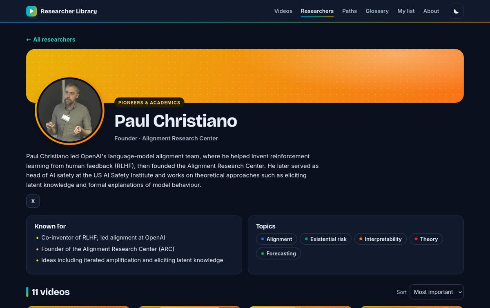
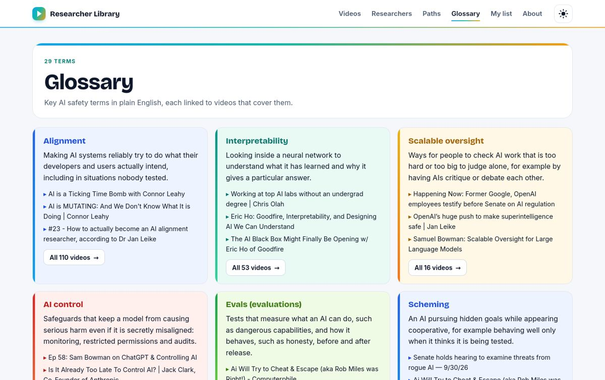
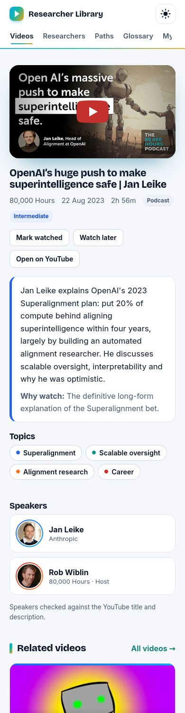
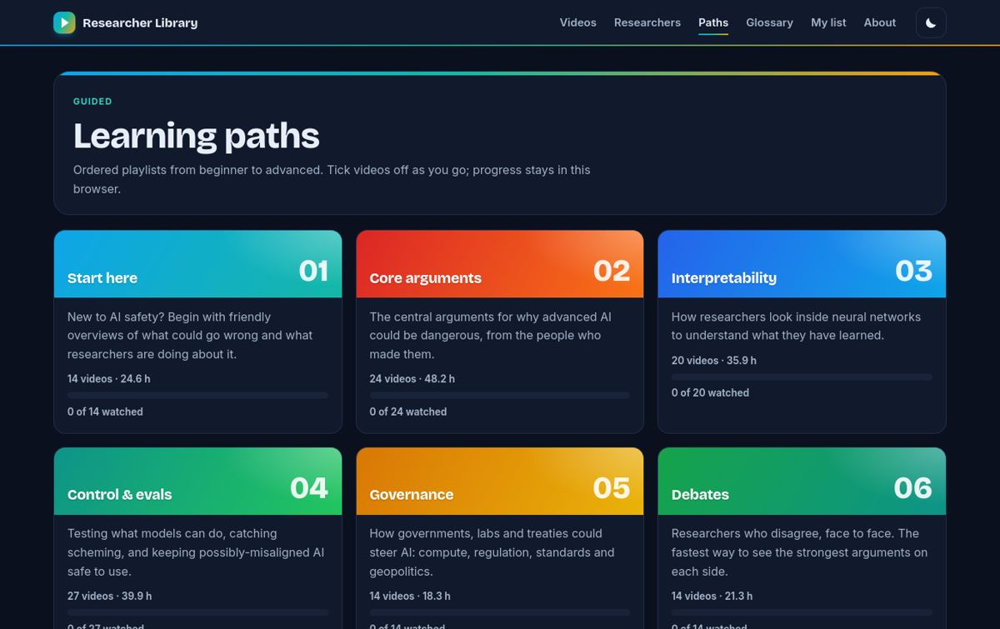
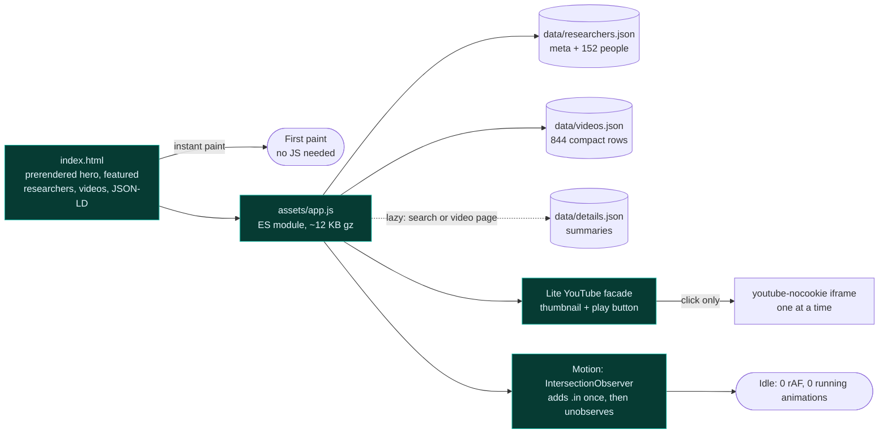

<div align="center">

<a href="https://lo3elyon.github.io/ASI/ai-safety-researcher-library/"></a>

# AI Safety Researcher Library

**Learn AI safety directly from the researchers: 844 full talks, lectures, podcasts and debates with 152 alignment and AI control researchers.**

<a href="https://lo3elyon.github.io/ASI/ai-safety-researcher-library/"></a>


         

</div>

## What it is

A YouTube-like learning library focused only on AI safety, alignment and AI control researchers. Every video is a **full appearance** (at least about 10 minutes; no clips, shorts, reaction channels or AI-narrated re-uploads) in which the listed researchers **speak in their own voice**. It is built for newcomers: plain-English labels, a "What is AI safety?" intro, a 29-term glossary and six ordered learning paths.

It is **colourful but GPU-light**: every page has its own designed look (gradient hero, group-coloured cards and rings, colour-coded glossary, timeline learning paths), and every animation is a short, one-shot transform/opacity effect. The sister app, [AI Safety Full Episodes](../ai-safety-full-episodes/), is a feature-rich cinema player; this route is the fast reference library that stays cool on laptops.

<table><tr><td width="66%"></td><td width="34%" rowspan="2"></td></tr><tr><td></td></tr><tr><td></td><td></td></tr><tr><td colspan="2"></td></tr></table>

## Pages

| Route | What you get |
|---|---|
| `#/` Home | Intro, What is AI safety?, Start-here path, featured researchers, latest additions, browse by topic chips and by group, link to the Full Episodes app (all prerendered static HTML) |
| `#/researchers` | Round-photo directory with name, org, group and video count; filter by group, organisation, topic, hosts; search; A–Z jump bar |
| `#/r/<slug>` | Group-coloured banner, ringed photo, bio, known for, links, topics, all their videos sortable by most important / newest / oldest |
| `#/videos` | Grid with 9 filters (group, topic, format, level, learning path, decade/year, length, sort, search across titles, people, topics and summaries), 48 per page + Load more |
| `#/v/<id>` | Lite YouTube player, summary, why watch, topics, speakers, verification note, related videos, Open on YouTube, Mark watched / Watch later, path prev/next |
| `#/paths`, `#/path/<k>` | Start here · Core arguments · Interpretability · Control & evals · Governance · Debates as colour cards; each path is a numbered step timeline with progress bar and tick-off checkboxes |
| `#/glossary` | Colour-coded term cards: 29 key terms (alignment, interpretability, scalable oversight, AI control, evals, scheming, corrigibility, RLHF, compute governance…) each linked to tagged videos |
| `#/me` | Watch later, watched, history; export/import JSON; clear (localStorage only) |
| `#/about` | Designed page: gradient header, stat tiles, bar charts by group and format, method, privacy, photo credits for every person |

## Numbers

<table><tr><td valign="top">

**Researchers by group**

<table><tr><td>Pioneers & academics</td><td align="right">29</td></tr><tr><td>Frontier lab safety teams</td><td align="right">42</td></tr><tr><td>Policy & communicators</td><td align="right">37</td></tr><tr><td>Control & evals orgs</td><td align="right">39</td></tr><tr><td>Teaching & explainers</td><td align="right">5</td></tr></table>

12 of them are podcast hosts who appear in conversations (flagged "Host", hideable).

</td><td valign="top">

**Videos by format**

       

**By year:** 2010: 1 · 2013: 3 · 2014: 3 · 2015: 5 · 2016: 8 · 2017: 10 · 2018: 13 · 2019: 14 · 2020: 23 · 2021: 33 · 2022: 42 · 2023: 129 · 2024: 128 · 2025: 194 · 2026: 238

**Learning paths:** Start here 14, Core arguments 24, Interpretability 20, Control & evals 27, Governance 14, Debates 14

</td></tr></table>

## A few to start with

<table><tr><td align="center" width="33%" valign="top"><a href="https://www.youtube.com/watch?v=ZP_N4q5U3eE"></a><br><sub><b>OpenAI’s huge push to make superintelligence safe &#124; Jan Leike</b><br>80,000 Hours · 2:56:23</sub></td><td align="center" width="33%" valign="top"><a href="https://www.youtube.com/watch?v=AaTRHFaaPG8"></a><br><sub><b>Eliezer Yudkowsky: Dangers of AI and the End of Human Civilization &#124; Lex Fridman Podcast #368</b><br>Lex Fridman · 3:17:51</sub></td></tr><tr><td align="center" width="33%" valign="top"><a href="https://www.youtube.com/watch?v=9eXV64O2Xp8"></a><br><sub><b>Alignment faking in large language models</b><br>Anthropic · 1:30:20</sub></td><td align="center" width="33%" valign="top"><a href="https://www.youtube.com/watch?v=144uOfr4SYA"></a><br><sub><b>Munk Debate on Artificial Intelligence &#124; Bengio & Tegmark vs. Mitchell & LeCun</b><br>Policy-Relevant Science & Technology · 1:47:20</sub></td><td align="center" width="33%" valign="top"><a href="https://www.youtube.com/watch?v=TO0J2Yw7usM"></a><br><sub><b>OpenAI CEO Sam Altman testifies at Senate artificial intelligence hearing &#124; full video</b><br>CBS News · 2:50:21</sub></td><td align="center" width="33%" valign="top"><a href="https://www.youtube.com/watch?v=rAywTFQsKGQ"></a><br><sub><b>33 - RLHF Problems with Scott Emmons</b><br>AXRP · 1:41:24</sub></td></tr></table>

## Design system

| Group | Accent gradient | Used for |
|---|---|---|
| Pioneers & academics | amber → orange | card top bars, avatar rings, profile banner, chips |
| Frontier lab safety teams | blue → sky | 〃 |
| Control & evals orgs | teal → mint | 〃 |
| Policy & communicators | red → orange | 〃 |
| Teaching & explainers | green → lime | 〃 |

- Type: **Bricolage Grotesque** (one variable display font, self-hosted woff2, `font-display: swap`) for headings, **Inter** / system UI for body text. Both SIL OFL.
- Hero: a static mesh gradient painted once in CSS (layered radial gradients) plus a researcher mosaic; no animation loop, canvas or video.
- Cards: thumbnail with gradient scrim, format + duration pills, speaker avatar stack with group rings, level pill, upload date. Dates marked `~2023` show a small **"Approximate upload year"** tooltip on hover.
- Light and dark themes, with a sun ⇄ moon morph on the theme button.

## Performance and motion budget (top requirement)



| Effect | How | Cost |
|---|---|---|
| Staggered card entrance | IntersectionObserver adds `.in` once, 380 ms `transform`/`opacity` keyframe, then `unobserve` | runs once per card |
| Hover lift, chip lift, button press | 150–250 ms `transform` transitions | only while hovering |
| Page transitions | View Transitions API (220 ms crossfade) with a 260 ms fade-up fallback | once per navigation |
| Hero counters | one 900 ms `requestAnimationFrame` count-up, then stops | once per visit |
| Skeleton shimmer | only on deep-link loading, 6 finite iterations, removed when data arrives | loading only |
| Theme toggle | sun ⇄ moon morph with `transform`/`opacity` | on click |

- **Measured budget (perf.py, every page, after load and again after hovering and scrolling):** idle `requestAnimationFrame` calls = **0**, running animations at idle = **0**, infinite animations = **0**, `will-change` / `backdrop-filter` elements = **0**, compositor-candidate elements = 8–9 per page, DOM ≤ 1,700 nodes. With `prefers-reduced-motion: reduce`, no animation or rAF runs at all.
- No animated backgrounds, canvas, WebGL, video backgrounds, infinite animations, large `backdrop-filter`, 3D tilt or autoplay.
- Images use `loading=lazy`, `decoding=async`, explicit width/height; search is debounced; lists paginate 48 at a time.
- Transfer (gzip): JS ~12 KB, CSS ~8.5 KB, HTML ~8 KB, fonts ~125 KB (cached, swap), initial data ~87 KB; summaries (~63 KB) load only on search or a video page.
- Strict CSP (self, i.ytimg.com images, youtube-nocookie.com frames, self-hosted fonts, one hashed inline boot script), all data HTML-escaped, external links `rel="noopener noreferrer"`, iframe `referrerpolicy=strict-origin-when-cross-origin` with the `origin` parameter.

## QA

- `smoke.js` (jsdom): data integrity, every route, filters, search, lite player, local lists, plus static motion/CSS rules: no infinite animations, no `backdrop-filter`/`will-change`/`content-visibility`, chips container wraps, no fixed sizes on section containers, durations ≤ 1.2 s, transitions only on transform/opacity/colours.
- `shots.py`: every page × 360 / 390 / 768 / 1024 / 1366 / 1920 px × light / dark (120 renders) with a geometry audit: no overlapping elements, no horizontal overflow, no clipped text, consecutive home sections never overlap, nothing spills out of its section, topic chips wrap greedily.
- `perf.py`: the motion budget above.

## Method and honest limits

- Built by merging five research sets (pioneers, frontier lab safety teams, control & evals orgs, policy & communicators, teaching) by researcher slug and YouTube id: speakers, topics and paths unioned, best summary kept, exact dates preferred over approximate ones, topic tags normalised.
- Who speaks was verified from YouTube metadata and descriptions for 741 videos and from transcripts for 103.
- **647 of 844 videos have approximate dates** (from YouTube's relative "n years ago"), shown as "~2023" with an "Approximate upload year" tooltip.
- One multi-speaker lightning-talk session was removed because each person spoke for under 10 minutes.
- Photos: Wikimedia Commons, researchers' own or institutional pages, or clean frames from their own videos, each face-cropped with OpenCV and checked on a contact sheet. All 152 people now have a verified photo: Lucas Perry (frame from his FLI podcast episode with Rohin Shah), Meg Tong and Benjamin Wright (frames from Anthropic research videos whose descriptions name them, identified by elimination against the other named speakers), Michaël Trazzi (photo on michaeltrazzi.com), Mark Xu (photo on markxu.com).

## Files

```
ai-safety-researcher-library/
├── index.html        prerendered home, SEO + Open Graph, JSON-LD ItemList of VideoObject, strict CSP
├── og.jpg            1200×630 social image
├── favicon.svg  sitemap.xml  README.md
├── assets/app.js     vanilla ES module: hash router, filters, lite player, paths, localStorage, one-shot reveal
├── assets/app.css    design system: light/dark themes, 5 group gradients, cards, timeline, motion budget
├── assets/fonts/     bricolage.woff2 (display, variable) · inter.woff2 (body), SIL OFL
├── screens/          README screenshots
├── data/researchers.json   meta (groups, topics, paths, glossary, credits) + researchers
├── data/videos.json        compact video rows
├── data/details.json       summaries + why-watch (lazy)
└── photos/<slug>.jpg       152 verified headshots
```

Your watched list, watch later and history live only in your browser's localStorage (key `asrl.v1`). No accounts, cookies or trackers.

## Changelog

| Date | Change |
|---|---|
| 2026-11-02 | Fixed the Home overlap bug (topic chips stacking one per line and running under “Browse by group” and the Full Episodes card, with a stray grey circle): a shared `.big` class gave the chip row a 200 px circle size; class names are now unique and the chips sit in one wrapping container. Full colourful redesign with GPU-cheap motion, five new verified photos, approximate-date tooltip, layout and perf audits. |
| 2026-11-01 | First release: 844 videos, 152 researchers. |

Built by Aniruddha Adak.
