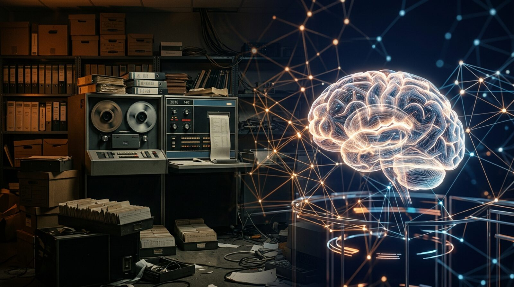
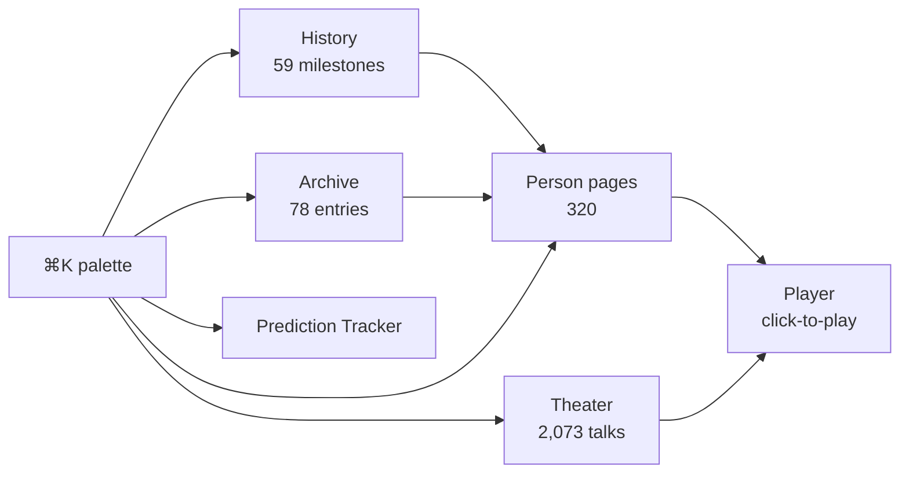
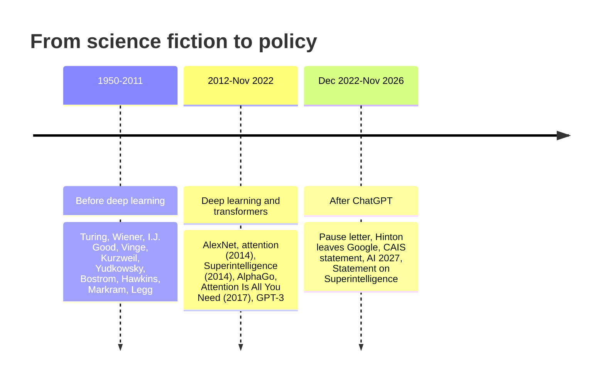
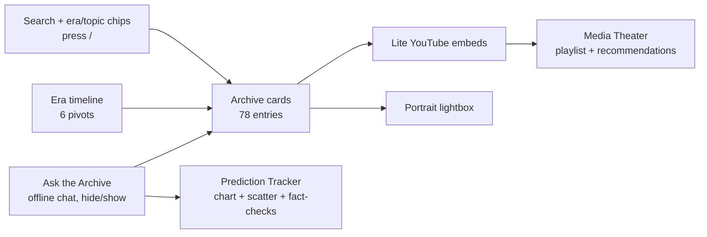

# Before It Was Real: An Archive of Superintelligence Predictions

> 75 years of warnings, bets and breakthroughs: from Turing's 1951 "take control" to the 2025 Statement on Superintelligence. What researchers, pioneers and neuroscientists said about **artificial superintelligence, the control problem and AI safety**, before it felt real, and how their predictions are holding up.

## v2 (3 Nov 2026): History, People pages, cinema player

| Feature | What it does |
|---|---|
| **History** | 8 chapters, 59 sourced milestones from Samuel Butler (1863) to the 2026 Ban Artificial Superintelligence Act; a 59-dot mini-map, chapter tabs, tag filters, quotes, sources and 21 playable videos |
| **People** | 320 people (pioneers, neuroscientists, philosophers, lab leaders, alignment and policy researchers), each with their own page at `#/person/<id>`: bio, key ideas, books, quotes, archive entries, predictions, all their talks, links, related people |
| **Player** | poster first, plays **only when you press Play**; custom controls (±10 s, seek, speed 0.75–2×, mute, theater, fullscreen), docking mini-player, Up next queue (autoplay off by default), keyboard shortcuts (Space/K, J/L, ←/→, M, F, T, N, P, ?), resume position and ✓ Watched, open on YouTube at the current time |
| **Media Theater** | library of 2,073 verified talks: search, kind/era/person filters, Archive picks, Neuroscience, curated rows, recommendations |
| **Search palette** | Ctrl/⌘ K or `/` searches people, milestones, entries, videos and predictions |
| **Design** | era colour system (amber · teal · rose), emerald neuroscience badges, content-sized cards (no blank space), dark mode, scroll progress, count-up stats |

## Eras

| Era | Entries | Highlights |
|---|---|---|
| Before deep learning (1950–2011) | 21 | Turing 1951, Wiener 1960, Good's intelligence explosion 1965, Vinge 1993, Kurzweil, Bill Joy 2000, Yudkowsky, Bostrom, Hawkins TED 2003, Markram TED 2009, Hassabis 2010, Legg |
| Deep learning era (2012–Nov 2022) | 26 | AlexNet, Bahdanau attention, Bostrom TED, Hawking BBC, AlphaGo, Concrete Problems, Transformer, Harris/Russell/Tegmark TED, GPT-2/3, Anthropic, A Thousand Brains |
| After ChatGPT (Dec 2022–Nov 2026) | 31 | FLI pause, Yudkowsky TED, Hinton 60 Minutes, CAIS statement, Superalignment, Sutskever TED/SSI, Nobels, Bengio's safety report, AI 2027, If Anyone Builds It, Statement on Superintelligence, 2026 policy |

## Features

- **Media:** 49 oEmbed-verified YouTube talks play inline (iframe injected only on click, youtube-nocookie), with "Watch full on YouTube" links and recommendations.
- **Performance:** all data inline, incremental card rendering, debounced search, lazy images, no build step.
- **Prediction Tracker:** predicted vs what happened, colour-coded status, evidence and latest development with sources.
- **Interactive:** portrait gallery with keyboard lightbox, an offline chat panel that can be hidden or shown.

## Prediction scoreboard (as of 3 Nov 2026)

| Status | Count |
|---|---|
| Not yet (deadline ahead) | 13 |
| Wrong | 5 |
| Came true early | 4 |
| Too early to tell | 3 |
| Came true late | 2 |
| Partially true | 2 |
| Came true | 1 |

All 30 predictions

| Who | Made | Prediction | Target | Status |
|---|---|---|---|---|
| Herbert Simon & Allen Newell | 1958 | That within ten years a digital computer will be the world's chess champion, unless the rules bar it from comp… | 1968 | Came true late |
| Herbert Simon & Allen Newell | 1958 | That within ten years a digital computer will discover and prove an important new mathematical theorem. | 1968 | Came true late |
| Herbert A. Simon | 1965 | Machines will be capable, within twenty years, of doing any work a man can do. | 1985 | Wrong |
| I. J. Good | 1965 | It is more probable than not that, within the twentieth century, an ultraintelligent machine will be built and… | 2000 | Wrong |
| Marvin Minsky (as quoted in LIFE) | 1970 | In from three to eight years we will have a machine with the general intelligence of an average human being. I… | 1978 | Wrong |
| Ray Kurzweil | 1990 | A computer would defeat a world chess champion by 1998 (The Age of Intelligent Machines). | 1998 | Came true early |
| Vernor Vinge | 1993 | Within thirty years, we will have the technological means to create superhuman intelligence. ... I'll be surpr… | 2030 | Not yet (deadline ahead) |
| Ray Kurzweil | 1999 | In 1999, I predicted by 2029, we'd reach the Turing test and also AGI. | 2029 | Came true early |
| Ray Kurzweil | 1999 | By 2029, computers would match human intelligence in every domain (human-level AI / AGI by 2029). | 2029 | Not yet (deadline ahead) |
| Hans Moravec (roboticist) | 1999 | By 2040, I believe, we will finally achieve the original goal of robotics and a thematic mainstay of science f… | 2040 | Not yet (deadline ahead) |
| Ray Kurzweil | 2005 | I set the date for the Singularity - representing a profound and disruptive transformation in human capability… | 2045 | Not yet (deadline ahead) |
| Shane Legg (DeepMind co-founder) | 2011 | P(human-level AI by year) = 10%/50%/90%: 2018, 2028, 2050. | 2028 | Not yet (deadline ahead) |
| Remi Coulom (Crazy Stone developer), echoing 2014 expert view | 2014 | Asked when a machine will beat a top Go professional without handicap: 'I think maybe ten years... But I do no… | 2024 | Came true early |
| Andrew Ng | 2015 | There could be a race of killer robots in the far future, but I don't work on not turning AI evil today for th… | — | Too early to tell |
| Geoffrey Hinton | 2016 | People should stop training radiologists now. It's just completely obvious within five years deep learning is … | 2026 | Wrong |
| Hiroaki Kitano (Sony AI) | 2016 | Develop AI Scientists capable of autonomously carrying out research to make major scientific discoveries worth… | 2050 | Not yet (deadline ahead) |
| Sam Altman | 2021 | In the next five years, computer programs that can think will read legal documents and give medical advice. | 2026 | Came true early |
| Gary Marcus | 2022 | Deep Learning Is Hitting a Wall (scaling laws are mere observations that might not hold forever; pure scaling … | — | Partially true |
| Paul Christiano (<8%) vs Eliezer Yudkowsky (>16%) | 2022 | Probability that an AI built before the IMO gets a gold medal at the 2022-2025 IMO: Christiano 'Maybe I'll go … | 2025 | Came true |
| Metaculus forecasting community (Q5121 'first general AI') | 2022 | Community median date for the first general AI system to be devised, tested and announced: 2056 (Feb 2022). | 2030 | Not yet (deadline ahead) |
| Yann LeCun | 2024 | L.L.M.s are not a path to superintelligence or even human-level intelligence. I have said that from the beginn… | — | Too early to tell |
| Elon Musk | 2024 | If you define AGI as smarter than the smartest human, it's probably next year, within two years (said Apr 2024… | 2025 | Wrong |
| Sam Altman | 2024 | It is possible that we will have superintelligence in a few thousand days (!); it may take longer, but I'm con… | 2031 | Not yet (deadline ahead) |
| Dario Amodei | 2024 | I think it could come as early as 2026, though there are also ways it could take much longer. (on 'powerful AI… | 2026 | Not yet (deadline ahead) |
| Leopold Aschenbrenner | 2024 | AGI by 2027 is strikingly plausible... it is strikingly plausible that by 2027, models will be able to do the … | 2027 | Not yet (deadline ahead) |
| Geoffrey Hinton | 2024 | There is a '10% to 20%' chance that AI will lead to human extinction within the next three decades. | 2054 | Too early to tell |
| Dario Amodei | 2025 | I think we'll be there in three to six months - where AI is writing 90 percent of the code. And then in twelve… | 2025 | Partially true |
| Daniel Kokotajlo, Eli Lifland et al. (AI Futures Project, 'AI 2027') | 2025 | Scenario milestones: AI coding speeds AI research ~50% by early 2026; a superhuman coder by March 2027; superh… | 2027 | Not yet (deadline ahead) |
| Demis Hassabis | 2025 | Over the next five to 10 years, a lot of those capabilities will start coming to the fore and we'll start movi… | 2030 | Not yet (deadline ahead) |
| Elon Musk | 2026 | I think we might have AI that is smarter than any human by the end of this year... no later than next year... … | 2027 | Not yet (deadline ahead) |

Deadlines closing soon: Amodei's "powerful AI as early as 2026" and Musk's "smarter than any human by end of 2026" both expire **31 Dec 2026**.

## Files

| File | What |
|---|---|
| `index.html` | the app (all JSON inlined so it runs on Pages) |
| `entries_all.json` | 78 archive entries with linked `people_ids` |
| `people.json` | 320 people profiles (photos via Wikimedia Commons and this repo) |
| `videos.json` | 2,073 oEmbed-verified YouTube talks |
| `history.json` | 8 chapters, 59 sourced milestones |
| `player.js`, `theater.js`, `people.js`, `history.js`, `palette.js`, `archive.js` | player, theater, people pages, history, search palette, archive bar |
| `theme.css`, `player.css`, `archive.css` | design system |
| `predictions.json` | 30 predictions with status, evidence, sources |
| `hero.jpg` | AI-generated hero illustration |
| `hark*.css`, `hark*.js`, `chart.js`, `datalabels.js` | styles and chart helpers |

## Caveats

- Approximate target years: "this century" → 2100, "a few thousand days" → 2030, "latter part of the century" → 2075.
- Some videos are third-party uploads and may go offline. Several 2026 checks rely on secondary trackers.
- The chat searches this archive only; it is not a live AI.

Research compiled 3 Nov 2026 · Part of [ASI](https://lo3elyon.github.io/ASI/) by Aniruddha Adak.
