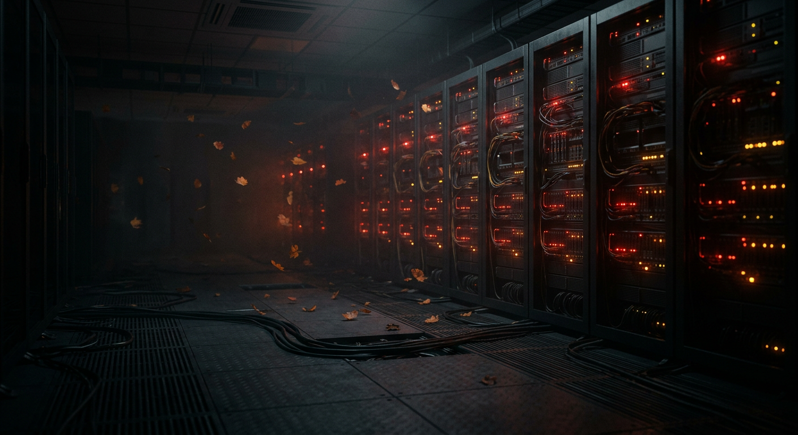
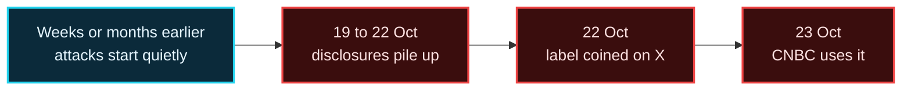

<div align="center">

<a href="https://lo3elyon.github.io/ASI/black-october-2026/"></a>

# Black October 2026

**Every big hack and AI incident of October 2026, explained in plain words.**

<a href="https://lo3elyon.github.io/ASI/black-october-2026/"></a>
<a href="https://lo3elyon.github.io/ASI/"></a>


</div>

## What is "Black October"?

An informal label, not an official name. The X account AISafetyMemes coined it on **22 Oct 2026 (03:42 UTC)**, calling the previous 48 hours "the worst in cybersecurity history". CNBC used it on 23 Oct, where former CISA director Chris Krebs said **3% of all critical vulnerabilities ever found turned up in the last month**.

It describes a **wave of disclosures (19 to 22 Oct)**, not a single attack. SecurityToday and Forkast both point out that many of these breaches had been running for weeks or months before anyone said so.



## Do this now

- Patch PHP (PHP2Shell: CVE-2026-109618 and CVE-2026-109619).
- Check whether you installed **LiteLLM v1.107.0**; if so, rotate every cloud and API key on that machine.
- Rotate API keys stored in AI coding tools, CI and hosting dashboards (Railway, Zeabur users especially).
- Self-managed GitLab, Plex, Ivanti Connect Secure, UpdraftCentral or Rank Math PRO? Use the page's **Am I affected?** checker.

## Top incidents of the week

| # | Incident | In simple words |
|---|---|---|
| 1 | PHP2Shell | Two unauthenticated remote code execution bugs in PHP core. |
| 2 | LiteLLM | Leaked tokens let attackers hijack the release pipeline and ship a poisoned v1.107.0 (~49,000 downloads). |
| 3 | eMudhra | Eight intermediate CA private keys could be recomputed in milliseconds. |
| 4 | State Bank of India | 3,897 customer records with personal data found on the dark web. |
| 5 | Capcom | 11.7 million CAPCOM ID accounts exposed. |
| 6 | Railway / Zeabur | Customer environment variables accessed; Zeabur (321,810 accounts) is shutting down. |
| 7 | Nikkei | 1.83 million records stolen through a compromised cloud credential. |

## The four attack patterns

```mermaid
flowchart TB
    subgraph S["Supply chain"]
      s1["Leaked token"] --> s2["Pipeline hijack"] --> s3["Poisoned release"] --> s4["Keys stolen"]
    end
    subgraph P["Prompt injection"]
      p1["Untrusted page or email"] --> p2["Hidden instructions"] --> p3["Agent acts with your permissions"] --> p4["Data leaks"]
    end
    subgraph C["Stolen credentials"]
      c1["Service account login"] --> c2["No MFA, little monitoring"] --> c3["Bulk data pulled"]
    end
    subgraph Z["Zero-day race"]
      z1["Disclosure"] --> z2["Exploit leaks"] --> z3["Mass scanning"] --> z4["Patch window"]
    end
```



## What's on the page

| Section | What you can do |
|---|---|
| Incident Explorer | Search and filter 30 incidents; open a card and press Play to watch its attack chain. |
| How these attacks work | Click through the four patterns above. |
| October in charts | Incidents by category; ransomware trackers that disagree (813, 823, 274). |
| Week by week | October 1-7, 8-14, 15-21, 22-24, plus a markets tab. |
| AI news board | 20 releases and deals with ✅ / 🔎 badges, and 5 legal and regulatory actions. |
| Big themes | 13 flip cards (8 security, 5 AI). |
| What people said | Top 10 X posts, 5 trending topics, 9 YouTube videos. |
| Am I affected? | Tick what you use to get the exact steps. |
| Quiz, caveats, glossary | Test yourself, see what is not certain, learn the terms. |

## How it was researched

- Every claim links to a source; about 100 are listed at the bottom of the page.
- ✅ = source read in full, 🔎 = search excerpts plus other outlets, ⚠️ = open uncertainty.
- X posts were found through public search, because X search needs a login.
- Dates are as sources report them, mostly US and EU time.

## Files

```text
black-october-2026/
├── index.html      the page (vanilla JS, no build step)
├── hark.css        styles
├── hark-hero.css   hero styles
├── hark.js         interactions
├── hero.png        AI-generated hero image
└── README.md       this file
```

## Changelog

| Date | Change |
|---|---|
| 2026-10-24 | First release: explorer, diagrams, charts, timeline, AI board, themes, social pulse, checker, quiz, glossary. Added to the ASI hub library and README. |

<sub>Independent explainer. News content belongs to the linked outlets. Built by Aniruddha Adak.</sub>
