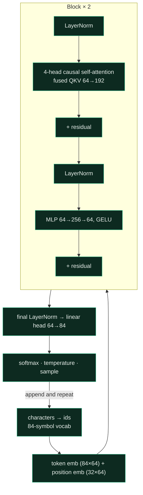
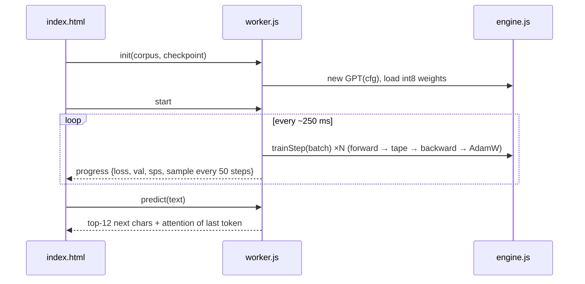

<div align="center">

<a href="https://lo3elyon.github.io/ASI/chhotto-gpt/"></a>

# ছোট্ট-GPT · Chhotto-GPT
### A tiny Bengali GPT that learns Tagore in your browser, written from scratch

<a href="https://lo3elyon.github.io/ASI/chhotto-gpt/"></a>


</div>

> “আমার মাথা নত করে দাও হে তোমার চরণ-ধূলার তলে।” — রবীন্দ্রনাথ ঠাকুর, গীতাঞ্জলি

The best way to understand how an LLM works is to build one and watch it learn. This route is exactly that: a GPT written from first principles in plain JavaScript, with its **own automatic differentiation engine**, that trains on **91 poems from Rabindranath Tagore's Gitanjali** right inside your browser. No PyTorch, no TensorFlow, no WebGPU library, no server, no API key.

## What you can do

| Section | What happens |
|---|---|
| **১. Training lab** | ▶ trains the model in a Web Worker. Live loss + validation curve, steps/sec, grad-norm, learning-rate and batch controls, fresh random model or ⚡ pretrained checkpoint. |
| **Watch it learn to write** | Every 50 steps the model writes a new line from your seed text, so you see noise turn into letters, then কার-চিহ্ন and হসন্ত in the right places, then words, line breaks and rhyme. |
| **২. Inside its head** | Type any Bengali: bars show the 12 most likely next characters (click one to append it), and a heatmap shows what each of the 8 attention heads (2 layers × 4) looked at. |
| **৩. Make it write** | Prompt + length + temperature → a Tagore-flavoured continuation on a palm-leaf card. |
| **৪. Train on your own text** | Paste anything (DEV posts, Nazrul, code, English). Vocabulary is rebuilt, weights re-initialised, training starts from zero. 💾 downloads the weights as JSON. Nothing leaves the browser. |
| **৫. How it works** | Architecture diagram, what is hand-written, why characters, how big vs real LLMs. |

## Sample from the pretrained checkpoint (2,770 steps, temperature 0.75)

```
আমার প্রাণ কর হে আসন তারা গতরে,
এই কথাটি কোথায় আমার প্রাণে
দিনের সব কান্তে কূজার লে
কেহ মুখের হাতে জাগিছে আমার
...
আনন্দ গানে, যে আমার
কতই প্রেমে যখন কত কবোনার সুরে।
```

Not real Tagore, and often not real words, but it has learned Bengali spelling, line-length rhythm, the poet's favourite words (আমার, প্রাণ, তোমার, আনন্দ, গানে) and his closing `।`, all from 39k characters and ~9 minutes of CPU.

## Architecture





## Files

| File | Lines | What it is |
|---|---|---|
| `index.html` | ~325 | The whole lab UI: canvas chart, timeline, probe, attention heatmap, writer, BYO text. |
| `engine.js` | 219 | Tensor + tape autograd; matmul, bias, add, embedding, LayerNorm, GELU, fused causal attention, cross-entropy (each with hand-derived backward); GPT; AdamW with warmup-free core, clipping and weight decay; char tokenizer; export/load. Works in Node and in a Worker. |
| `worker.js` | 56 | Training loop (250 ms slices, 100-step warmup), sampling, validation, prediction API. |
| `corpus.txt` | 39k chars | 91 Gitanjali poems cleaned from Bengali Wikisource. |
| `checkpoint.json` | 152 KB | Pretrained weights, int8 per-tensor quantised (base64). |
| `pretrain.js` / `pretrain-log.json` | | Node script that made the checkpoint (batch 16, cosine LR, 540 s) and its loss log. |
| `gradcheck.js` | | Finite-difference check of every tensor's gradient. |
| `train.py` | 65 | NumPy twin: a 1-block GPT with hand-written backprop, `python train.py corpus.txt`. |

## Training log (pretrain.js)

| step | train loss (EMA) | val loss |
|---:|---:|---:|
| 250 | 2.557 | 2.372 |
| 500 | 2.282 | 2.308 |
| 1000 | 2.004 | 2.163 |
| 1500 | 1.802 | 2.214 |
| 2000 | 1.663 | 2.193 |
| 2750 | 1.536 | 2.067 |

Random guessing over 84 symbols is ln 84 ≈ 4.43 nats. The gap between train and val shows a tiny corpus starting to be memorised: try a smaller learning rate or your own bigger text.

## Run locally

```bash
cd ASI && python3 -m http.server 8000      # open http://localhost:8000/chhotto-gpt/
node chhotto-gpt/gradcheck.js              # verify gradients
node chhotto-gpt/pretrain.js chhotto-gpt/corpus.txt 600   # make your own checkpoint
python chhotto-gpt/train.py chhotto-gpt/corpus.txt        # NumPy twin (pip install numpy)
```

(A Web Worker needs `http://`, so double-clicking `index.html` from disk won't train.)

## Ideas to extend

- BPE / grapheme-cluster tokenizer for যুক্তাক্ষর (conjuncts) as single tokens
- WebGPU matmul kernels for 10× speed
- Train on Nazrul or Jibanananda and compare styles side by side
- Share a trained model as a URL

## Credits

Corpus: Rabindranath Tagore, *Gitanjali* (1913), public domain, via [Bengali Wikisource](https://bn.wikisource.org/wiki/%E0%A6%97%E0%A7%80%E0%A6%A4%E0%A6%BE%E0%A6%9E%E0%A7%8D%E0%A6%9C%E0%A6%B2%E0%A6%BF_(%E0%A7%A7%E0%A7%AF%E0%A7%A7%E0%A7%A9)). Ideas: [Attention Is All You Need](https://arxiv.org/abs/1706.03762), Karpathy's [micrograd](https://github.com/karpathy/micrograd) and [nanoGPT](https://github.com/karpathy/nanoGPT), [AdamW](https://arxiv.org/abs/1711.05101). Built for the ASI hub by [Aniruddha Adak](https://github.com/aniruddhaadak80). MIT.

| Date | Change |
|---|---|
| 2026-11-06 | First release: engine, lab, probe, writer, BYO text, pretrained checkpoint, NumPy twin. |
