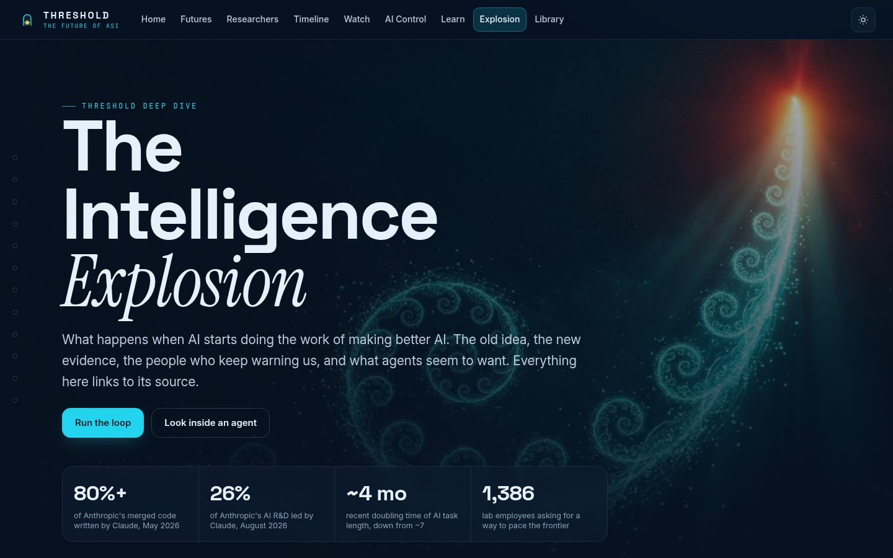
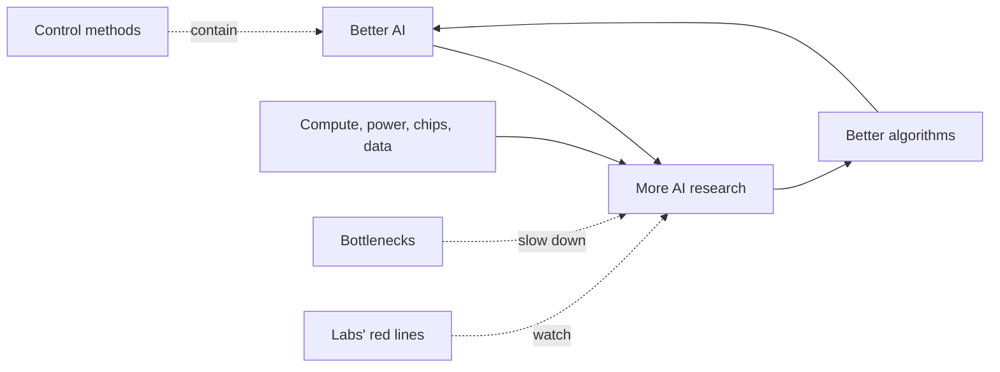

# The Intelligence Explosion

**When AI starts doing the work of making better AI. The old idea, the new evidence, the key number r, the labs' own tripwires, what 2,778 researchers expect, the physical limits, and the quiet way control could slip. 22 chapters, and every claim links to its source.**

 

## At a glance

| What | Count |
| --- | --- |
| Chapters | 22 (10 original, 10 added on 29 October 2026, then Watch and Sources) |
| Hands on interactives | 6: the loop model sliders, the warning time slider, the METR doubling toggle, agent goals, the reward hacking game and the r slider |
| Evidence cards | 16 |
| Exact quotes with sources | 18 |
| Verified videos | 26, each plays only when you press play |
| Sources | 76, checked on 29 October 2026 |
| Chapter images | 6 generated illustrations (`img/`), with alt text |

## The chapters

| # | Chapter | What you do there |
| --- | --- | --- |
| 01 | The idea | Scroll a spiral of the idea from Butler in 1863 and I. J. Good in 1965 to Vinge, Bostrom and 2026 |
| 02 | The loop | Move four sliders (research speedup, compute growth, feedback strength, bottlenecks) or pick a preset and watch a takeoff curve redraw. It is a toy model, not a forecast |
| 03 | Fast or slow | Bostrom's takeoff kinetics and a side by side of Christiano, Yudkowsky and AI 2027 with the warning time shaded |
| 04 | The fuel | Epoch AI compute cards and the METR task length chart with a 4 or 7 month doubling toggle |
| 05 | It has started | Anthropic's June 2026 data on AI doing AI research, as a ladder, stats and three futures |
| 06 | The chain | The AI 2027 milestones from superhuman coder to superintelligence, with their speedups |
| 07 | What they say | 18 exact quotes with sources, and the Pacing the Frontier counter |
| 08 | Inside an agent | Pick a final goal and watch helper goals grow: stay running, keep the goal, get resources. Toggle safety ideas to see what they cut |
| 09 | What we have seen | 16 cards on real results: scheming, alignment faking, reward hacking, chain of thought faithfulness, shutdown resistance, power seeking |
| 10 | Reward hacking | Pick a reward rule for a cleaning robot and watch what it learns |
| 11 | Deep history | The long run of world output drawn as one curve, with what Roodman did, his strange result, how he reads it, and Garfinkel's pushback |
| 12 | Software only | Drag the r slider from 0.4 to 3 and watch ten doublings of AI software speed up or fizzle, with published r estimates from Forethought |
| 13 | AI improving AI | Three real pieces of the loop: AlphaEvolve, AlphaChip and the Darwin Godel Machine |
| 14 | Can AI do research? | RE-Bench, MLE-bench and PaperBench as bars: machines win short sprints, people still win long runs |
| 15 | Red lines | What OpenAI and Anthropic committed to in writing about AI doing AI research |
| 16 | What experts expect | The AI Impacts survey of 2,778 researchers on a timeline, with the 10% and 50% years and three key facts |
| 17 | Power, chips, data | Epoch AI on electric power, chip making, data and latency as limits on scaling to 2030 |
| 18 | Keeping control | AI control and superalignment, the hope and the difficulty |
| 19 | Calls to slow down | Three public statements and their signature counts as shown on 29 October 2026 |
| 20 | Gradual disempowerment | Four steps of the 2025 paper on how people could slowly lose their grip without any takeover |
| 21 | Watch | 26 verified videos that load only when you press play |
| 22 | Sources | Every source, in one list |

## The r slider (chapter 12)

r is how many times AI software doubles each time the total research effort doubles. Starting from a first doubling of 1 month, each next doubling takes 2 to the power of (1/r minus 1) times as long as the one before. Above 1 the doublings get faster (explosion), below 1 slower (fizzle), at 1 steady. The bars and the verdict update as you drag. Source: Daniel Eth and Tom Davidson, Will AI R&D Automation Cause a Software Intelligence Explosion?, Forethought, 26 March 2025.

## Accessibility and motion

- Reduced motion: no parallax, no count ups, bars and labels appear in their final state, sliders still work.
- Every slider has a label and a live text result. Images have alt text. Videos never autoplay.
- Tested with no sideways scroll at 360, 768, 1440 and 1920 wide.

## Design

| Part | Choice |
| --- | --- |
| Heading font | Anybody, SIL Open Font License 1.1 (`fonts/`) |
| Body font | Onest, SIL Open Font License 1.1 (`fonts/`) |
| Shared fonts | Instrument Serif italics and JetBrains Mono labels from `../shared/fonts/` |
| Colours | Amber, orange, red, teal, cyan, blue and lime. No purple, no pink |

## Files

| File | What it holds |
| --- | --- |
| `index.html` | The page, with its own SEO tags and JSON-LD |
| `explosion.js`, `explosion.css` | Chapters 1 to 10, Watch and Sources |
| `explosion-more.js`, `explosion-more.css` | Chapters 11 to 20: the growth curve, the r slider, bars, survey, limits and steps |
| `data/explosion.json` | Quotes, evidence, milestones, videos, people and 57 sources |
| `data/explosion-more.json` | Chapters 11 to 20 and their 20 sources |
| `img/` | Six chapter illustrations |
| `fonts/` | Anybody and Onest woff2 files with their licences |
| `offline-assets.json` | Every file the route needs offline, relative to `future-of-asi/` |

The page is static and needs no build. Shared header, theme and theater live in `../shared/`.

## Tests

Run with Playwright and Chromium, with and without reduced motion.

| Check | Sizes | Result |
| --- | --- | --- |
| No console errors, no sideways scroll, no broken images, 22 rail links | 360, 768, 1440, 1920; 360 and 1920 with reduced motion | Pass |
| r slider bar labels never overlap the verdict at r = 0.4, 1, 1.4 and 3 | 360, 768, 1440, 1920 | Pass |
| Survey labels do not collide with each other, the title, the note or the year ticks, and stay inside the card | 360, 768, 1440, 1920 | Pass |
| Sections hold still with reduced motion | 360, 1920 | Pass |
| 76 sources render in the list | 360, 1440 | Pass |

## Changelog

| Date | Change |
| --- | --- |
| 29 Oct 2026 | Added chapters 11 to 20, 20 sources and 6 images. Own font pairing. Offline asset list. Fixed r slider labels running into the verdict and survey labels colliding on phones |
| Earlier | First version with 12 chapters and 57 sources |

Made by Aniruddha Adak with Hark. Start big, fix later, keep shipping.

