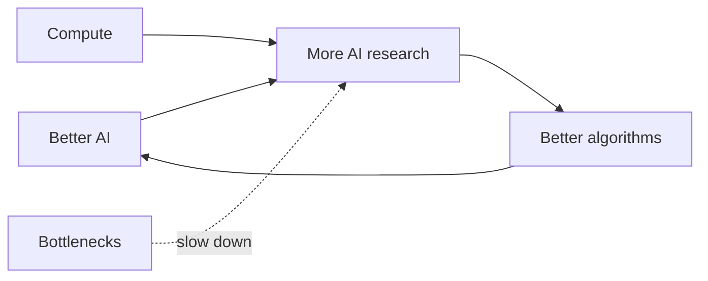

# The Intelligence Explosion

**When AI starts doing the work of making better AI. The old idea, the new evidence, the people who keep warning us, and what agents seem to want. Everything links to its source.**

 

## The chapters

| # | Chapter | What you do there |
| --- | --- | --- |
| 01 | The idea | Scroll a spiral of the idea from Butler in 1863 and I. J. Good in 1965 to Vinge, Bostrom and 2026 |
| 02 | The loop | Move four sliders (research speedup, compute growth, feedback strength, bottlenecks) or pick one of six presets and watch a takeoff curve redraw live. It is a toy model, not a forecast |
| 03 | Fast or slow | Bostrom's takeoff kinetics and a side by side of Christiano, Yudkowsky and AI 2027 with the warning time shaded |
| 04 | The fuel | Epoch AI compute cards and the METR task length chart with a 4 or 7 month doubling toggle |
| 05 | It has started | Anthropic's June 2026 data on AI doing AI research, as a ladder, stats and three futures |
| 06 | The chain | The AI 2027 milestones from superhuman coder to superintelligence, with their speedups |
| 07 | What they say | 18 exact quotes with sources, and the Pacing the Frontier counter |
| 08 | Inside an agent | Pick a final goal and watch helper goals grow: stay running, keep the goal, get resources. Toggle safety ideas to see what they cut |
| 09 | What we have seen | 16 cards on real results: scheming, alignment faking, reward hacking, chain of thought faithfulness, shutdown resistance, power seeking |
| 10 | Reward hacking | Pick a reward rule for a cleaning robot and watch what it learns |
| 11 | Watch | 26 verified videos that play only when you press play |
| 12 | Sources | 57 sources, checked on 29 October 2026 |

## Files

| File | What it holds |
| --- | --- |
| `index.html` | The page, with its own SEO tags and JSON-LD |
| `explosion.js` | Every interactive, rendered from the data file |
| `explosion.css` | Page styles on top of `../shared/threshold.css` |
| `data/explosion.json` | Chapters, quotes, evidence, milestones, sources and video IDs |

The page is static and needs no build. Shared fonts, header and theater live in `../shared/`.

Made by Aniruddha Adak with Hark. Start big, fix later, keep shipping.

