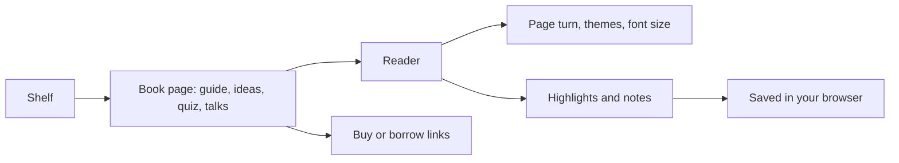

# The Threshold Library

**A reading room for the future of AI: 30 books and 6 essays on superintelligence, alignment, the intelligence explosion and AI risk, with chapter guides in plain words, the best arguments both ways, quizzes, talks and a flip book reader.**

 

## How text is handled

Copyrighted book text is never reproduced here. Each book gets its published chapter titles and a guide, key ideas, arguments, questions and a quiz written in my own words, plus a few short quotes with their source. Full text appears only when the licence allows it, and then with its notice. Every decision is in [LICENSES.md](LICENSES.md).

| Full text in the reader | Why it is allowed |
| --- | --- |
| Dan Hendrycks, Introduction to AI Safety, Ethics, and Society | CC BY-NC-ND 4.0, shared unchanged with attribution, figures left out |
| Vernor Vinge, The Coming Technological Singularity (1993) | The author's own notice allows verbatim copying with the notice kept |
| Samuel Butler, Darwin among the Machines (1863) | Public domain |

## Some of the shelf

| Book | Authors | Year |
| --- | --- | --- |
| Superintelligence | Nick Bostrom | 2014 |
| If Anyone Builds It, Everyone Dies | Eliezer Yudkowsky and Nate Soares | 2025 |
| AI: Unexplainable, Unpredictable, Uncontrollable | Roman Yampolskiy | 2024 |
| Human Compatible | Stuart Russell | 2019 |
| Life 3.0 | Max Tegmark | 2017 |
| The Alignment Problem | Brian Christian | 2020 |
| The Precipice | Toby Ord | 2020 |
| The Coming Wave | Mustafa Suleyman | 2023 |
| Deep Utopia | Nick Bostrom | 2024 |
| Empire of AI | Karen Hao | 2025 |

The full list of 36 titles is in `data/books.json`.

## The reader

Shelves, search, sort and a free to read filter. 3D covers that tilt. The reader pages in columns with a page turn animation, dark, sepia and light themes, serif or sans, swipe and keys, a contents panel, highlights, notes, reading position and a continue reading row. Nothing leaves your browser.

## Files

| Path | What it holds |
| --- | --- |
| `index.html`, `library.js`, `library.css` | The page and reader |
| `data/books.json`, `data/books/<id>.json` | Catalogue and one file per book |
| `covers/<id>.jpg` | Covers from Open Library or the publisher, checked by eye |
| `texts/` | The three full texts allowed by their licences |
| `LICENSES.md` | Every text and cover decision with its evidence |

Made by Aniruddha Adak with Hark. Start big, fix later, keep shipping.

