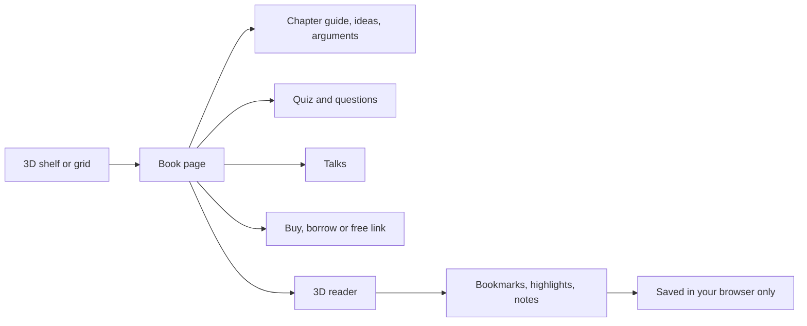

# The Threshold Library

**A reading room for the future of AI: 79 books, essays and reports on superintelligence, alignment, the intelligence explosion and AI risk. Every title has a chapter guide in plain words, key ideas, the best arguments both ways, questions and a quiz. Eleven open texts can be read in full in a 3D book you turn by hand.**

 

## At a glance

| What | Count |
| --- | --- |
| Titles | 79 (62 books, 17 essays and reports) |
| Shelves | 11 |
| Real covers, checked by eye | 60 (the rest are Threshold cover designs, labelled as such) |
| Chapters with a plain words guide | 787 |
| Key arguments for and against | 136 |
| Quiz questions | 212 |
| Talks and interviews linked | 203 |
| Full texts in the reader | 11, each allowed by its licence |
| Free official versions linked | 17 more |

## What you can do

- **Walk a 3D shelf.** Books stand face out on lit shelves. Point at one and it leans out and glows in its shelf colour. Click to open it. Drag sideways to browse. The shelf follows your search and filters.
- **Search, sort and filter.** Search by title, author or idea. Sort by newest, oldest or title. Show only what you can read for free.
- **Open a book page.** Published chapter titles with a one line guide for each, key ideas, the best arguments both ways, discussion questions, a quiz, talks by the author, and links to buy or borrow.
- **Read in a 3D book.** The eleven open texts and every chapter guide open in a WebGL book on a desk under a lamp. You turn each page by dragging its corner.
- **Keep your place.** Bookmarks, highlights in five colours, notes, reading time and a continue reading row. Download your notes as a Markdown file. Nothing leaves your browser.
- **Read offline.** Every file the library needs is listed in `offline-assets.json` for the site's service worker.

## The 3D reader

The reader is built on three.js. It draws every page as a canvas texture and bends the page as you drag it. If WebGL is missing, or reduced motion is on, it switches to flat pages that turn instantly. You can force either one in the settings.

| Control | Mouse or keyboard | Touch |
| --- | --- | --- |
| Next page | Drag the right page corner to the left, click the right edge, or press Right arrow, Page Down or Space | Swipe left or tap the right edge |
| Previous page | Drag the left corner, click the left edge, or press Left arrow or Page Up | Swipe right or tap the left edge |
| First or last page | Home or End | Go to page in the footer |
| Zoom | + and -, Ctrl and the mouse wheel, or the zoom buttons | Pinch |
| Contents | T | Contents button |
| Search inside | / | Search button |
| Bookmark this page | B | Ribbon button |
| Highlight or note | Click a paragraph | Tap a paragraph |
| Focus mode | F | Focus button |
| Close a panel, leave focus, close the reader | Escape | Close button |
| Read aloud | Read aloud button, with pause and stop | Same |

Reading settings: four themes (Paper, Sepia, Night, Contrast), five fonts (Classic serif, Instrument Serif, Inter, Space Grotesk, Mono), text size 18 to 36, line height 1.25 to 2, justify, page turn sound, dust in the lamp light, and book style (Auto, 3D book, Flat pages).

Reduced motion: the shelf stays still, covers do not tilt, the reader uses flat pages, and turns are instant. A drag or swipe still turns the page.

## How text is handled

Copyrighted book text is never reproduced here. Each title gets its published chapter titles and a guide, key ideas, arguments, questions and a quiz written in my own words, plus a very few short quotes with their source. Full text appears only when the licence allows it, and then with its notice. Every decision is in [LICENSES.md](LICENSES.md).

| Full text in the reader | Licence or status | What is shown |
| --- | --- | --- |
| Dan Hendrycks, Introduction to AI Safety, Ethics, and Society (2024) | CC BY-NC-ND 4.0 | Introduction and all ten chapters, unchanged, figures left out |
| Vernor Vinge, The Coming Technological Singularity (1993) | The author's notice allows verbatim copying | The whole article with the notice |
| Samuel Butler, Darwin among the Machines (1863) | Public domain | The full letter |
| Mary Shelley, Frankenstein (1818) | Public domain | The full novel |
| Samuel Butler, Erewhon, The Book of the Machines (1872) | Public domain | Chapters XXIII to XXV |
| E. M. Forster, The Machine Stops (1909) | Public domain in the United States | All three parts |
| Karel Capek, R.U.R., English version (1923) | Public domain in the United States | The full play |
| Charles Stross, Accelerando (2005) | CC BY-NC-ND 2.5 | Front matter with the licence and all nine chapters |
| Bengio, Hinton, Yao and others, Managing extreme AI risks amid rapid progress (2024) | CC BY 4.0 | Main text, figures and references left out |
| International AI Safety Report (2025), Key findings | CC BY 4.0 and OGL v3.0 | Key findings section only |
| The Bletchley Declaration (2023) | Open Government Licence v3.0 | The full declaration |

## The whole catalogue

Grouped by shelf. "Free link" means the author or publisher offers it free online and the library links there.

<b>Risk and control</b> (10)

| Title | Authors | Year | Kind | Chapters in the guide | Talks | Text |
| --- | --- | --- | --- | --- | --- | --- |
| Global Catastrophic Risks | Nick Bostrom, Milan M. Cirkovic | 2008 | book | 6 | 4 | Guide only |
| Superintelligence | Nick Bostrom | 2014 | book | 15 | 8 | Guide only |
| Surviving AI | Calum Chace | 2015 | book | 9 | 0 | Guide only |
| Army of None | Paul Scharre | 2018 | book | 8 | 0 | Guide only |
| The Precipice | Toby Ord | 2020 | book | 9 | 8 | Guide only |
| Is Power-Seeking AI an Existential Risk? | Joe Carlsmith | 2022 | essay | 8 | 4 | Free link |
| Uncontrollable | Darren McKee | 2023 | book | 3 | 1 | Guide only |
| An Overview of Catastrophic AI Risks | Dan Hendrycks, Mantas Mazeika, Thomas Woodside | 2023 | essay | 8 | 4 | Free link |
| AI: Unexplainable, Unpredictable, Uncontrollable | Roman V. Yampolskiy | 2024 | book | 13 | 8 | Guide only |
| If Anyone Builds It, Everyone Dies | Eliezer Yudkowsky, Nate Soares | 2025 | book | 17 | 4 | Guide only |

<b>Alignment</b> (6)

| Title | Authors | Year | Kind | Chapters in the guide | Talks | Text |
| --- | --- | --- | --- | --- | --- | --- |
| Smarter Than Us | Stuart Armstrong | 2014 | book | 11 | 0 | Free link |
| Rationality: From AI to Zombies | Eliezer Yudkowsky | 2015 | book | 26 | 8 | Free link |
| Concrete Problems in AI Safety | Dario Amodei, Chris Olah, Jacob Steinhardt, Paul Christiano, John Schulman, Dan Mane | 2016 | essay | 9 | 4 | Free link |
| Human Compatible | Stuart Russell | 2019 | book | 14 | 5 | Guide only |
| Risks from Learned Optimization in Advanced Machine Learning Systems | Evan Hubinger, Chris van Merwijk, Vladimir Mikulik, Joar Skalse, Scott Garrabrant | 2019 | essay | 7 | 4 | Free link |
| The Alignment Problem | Brian Christian | 2020 | book | 12 | 8 | Guide only |

<b>Intelligence explosion</b> (6)

| Title | Authors | Year | Kind | Chapters in the guide | Talks | Text |
| --- | --- | --- | --- | --- | --- | --- |
| The Age of Spiritual Machines | Ray Kurzweil | 1999 | book | 14 | 0 | Guide only |
| The Basic AI Drives | Stephen M. Omohundro | 2008 | essay | 7 | 0 | Free link |
| Our Final Invention | James Barrat | 2013 | book | 16 | 1 | Guide only |
| The Technological Singularity | Murray Shanahan | 2015 | book | 7 | 0 | Guide only |
| Artificial Superintelligence | Roman V. Yampolskiy | 2015 | book | 10 | 8 | Guide only |
| Situational Awareness | Leopold Aschenbrenner | 2024 | book | 9 | 8 | Free link |

<b>Futures</b> (10)

| Title | Authors | Year | Kind | Chapters in the guide | Talks | Text |
| --- | --- | --- | --- | --- | --- | --- |
| The Singularity Is Near | Ray Kurzweil | 2005 | book | 10 | 0 | Guide only |
| The Age of Em | Robin Hanson | 2016 | book | 30 | 3 | Guide only |
| Homo Deus | Yuval Noah Harari | 2016 | book | 6 | 4 | Guide only |
| Life 3.0 | Max Tegmark | 2017 | book | 10 | 8 | Guide only |
| Brief Answers to the Big Questions | Stephen Hawking | 2018 | book | 11 | 0 | Guide only |
| Possible Minds | John Brockman | 2019 | book | 5 | 0 | Guide only |
| What We Owe the Future | William MacAskill | 2022 | book | 11 | 8 | Guide only |
| The Singularity Is Nearer | Ray Kurzweil | 2024 | book | 9 | 0 | Guide only |
| Deep Utopia | Nick Bostrom | 2024 | book | 7 | 8 | Guide only |
| Machines of Loving Grace | Dario Amodei | 2024 | essay | 7 | 4 | Free link |

<b>Inside the industry</b> (9)

| Title | Authors | Year | Kind | Chapters in the guide | Talks | Text |
| --- | --- | --- | --- | --- | --- | --- |
| Rise of the Robots | Martin Ford | 2015 | book | 9 | 0 | Guide only |
| AI Superpowers | Kai-Fu Lee | 2018 | book | 9 | 0 | Guide only |
| Prediction Machines | Ajay Agrawal, Joshua Gans, Avi Goldfarb | 2018 | book | 17 | 0 | Guide only |
| The Age of AI | Henry A. Kissinger, Eric Schmidt, Daniel Huttenlocher | 2021 | book | 7 | 8 | Guide only |
| The Coming Wave | Mustafa Suleyman, Michael Bhaskar | 2023 | book | 16 | 8 | Guide only |
| Supremacy | Parmy Olson | 2024 | book | 17 | 0 | Guide only |
| Co-Intelligence | Ethan Mollick | 2024 | book | 5 | 0 | Guide only |
| Empire of AI | Karen Hao | 2025 | book | 19 | 1 | Guide only |
| The Optimist | Keach Hagey | 2025 | book | 19 | 0 | Guide only |

<b>Governance and policy</b> (4)

| Title | Authors | Year | Kind | Chapters in the guide | Talks | Text |
| --- | --- | --- | --- | --- | --- | --- |
| Four Battlegrounds | Paul Scharre | 2023 | book | 6 | 0 | Guide only |
| The Bletchley Declaration | Governments at the AI Safety Summit | 2023 | essay | 5 | 0 | Full text |
| Managing extreme AI risks amid rapid progress | Yoshua Bengio, Geoffrey Hinton, Andrew Yao, Dawn Song, Stuart Russell, Daniel Kahneman, and 19 others | 2024 | essay | 5 | 4 | Full text |
| International AI Safety Report | Yoshua Bengio (Chair), and an international writing group | 2025 | essay | 5 | 4 | Full text |

<b>History</b> (5)

| Title | Authors | Year | Kind | Chapters in the guide | Talks | Text |
| --- | --- | --- | --- | --- | --- | --- |
| The Human Use of Human Beings | Norbert Wiener | 1950 | book | 12 | 0 | Guide only |
| The Master Algorithm | Pedro Domingos | 2015 | book | 10 | 0 | Guide only |
| Genius Makers | Cade Metz | 2021 | book | 21 | 0 | Guide only |
| Power and Progress | Daron Acemoglu, Simon Johnson | 2023 | book | 6 | 0 | Guide only |
| Nexus | Yuval Noah Harari | 2024 | book | 6 | 4 | Guide only |

<b>Skeptics</b> (10)

| Title | Authors | Year | Kind | Chapters in the guide | Talks | Text |
| --- | --- | --- | --- | --- | --- | --- |
| Computer Power and Human Reason | Joseph Weizenbaum | 1976 | book | 6 | 0 | Guide only |
| What Computers Still Can't Do | Hubert L. Dreyfus | 1992 | book | 5 | 0 | Guide only |
| Weapons of Math Destruction | Cathy O'Neil | 2016 | book | 10 | 0 | Guide only |
| Artificial Intelligence | Melanie Mitchell | 2019 | book | 17 | 7 | Guide only |
| Rebooting AI | Gary Marcus, Ernest Davis | 2019 | book | 8 | 8 | Guide only |
| Atlas of AI | Kate Crawford | 2021 | book | 9 | 0 | Guide only |
| The Myth of Artificial Intelligence | Erik J. Larson | 2021 | book | 5 | 0 | Guide only |
| Unmasking AI | Joy Buolamwini | 2023 | book | 5 | 0 | Guide only |
| AI Snake Oil | Arvind Narayanan, Sayash Kapoor | 2024 | book | 8 | 6 | Free link |
| AI as Normal Technology | Arvind Narayanan, Sayash Kapoor | 2025 | essay | 5 | 4 | Free link |

<b>Textbook</b> (4)

| Title | Authors | Year | Kind | Chapters in the guide | Talks | Text |
| --- | --- | --- | --- | --- | --- | --- |
| Deep Learning | Ian Goodfellow, Yoshua Bengio, Aaron Courville | 2016 | book | 20 | 4 | Free link |
| Artificial Intelligence: A Modern Approach | Stuart Russell, Peter Norvig | 2020 | book | 28 | 4 | Guide only |
| Dive into Deep Learning | Aston Zhang, Zachary C. Lipton, Mu Li, Alexander J. Smola | 2023 | book | 23 | 0 | Free link |
| Introduction to AI Safety, Ethics, and Society | Dan Hendrycks | 2024 | book | 11 | 8 | Full text |

<b>Fiction about AI</b> (9)

| Title | Authors | Year | Kind | Chapters in the guide | Talks | Text |
| --- | --- | --- | --- | --- | --- | --- |
| Frankenstein | Mary Shelley | 1818 | book | 5 | 0 | Full text |
| Erewhon | Samuel Butler | 1872 | book | 3 | 0 | Full text |
| The Machine Stops | E. M. Forster | 1909 | essay | 3 | 0 | Full text |
| R.U.R. | Karel Capek | 1920 | book | 4 | 0 | Full text |
| I, Robot | Isaac Asimov | 1950 | book | 9 | 0 | Guide only |
| Do Androids Dream of Electric Sheep? | Philip K. Dick | 1968 | book | 5 | 0 | Guide only |
| Accelerando | Charles Stross | 2005 | book | 9 | 0 | Full text |
| The Lifecycle of Software Objects | Ted Chiang | 2010 | book | 5 | 0 | Guide only |
| Klara and the Sun | Kazuo Ishiguro | 2021 | book | 6 | 0 | Guide only |

<b>Essays and reports</b> (6)

| Title | Authors | Year | Kind | Chapters in the guide | Talks | Text |
| --- | --- | --- | --- | --- | --- | --- |
| Darwin among the Machines | Samuel Butler | 1863 | essay | 3 | 0 | Full text |
| Computing Machinery and Intelligence | Alan Turing | 1950 | essay | 7 | 0 | Free link |
| Speculations Concerning the First Ultraintelligent Machine | I. J. Good | 1965 | essay | 4 | 0 | Free link |
| The Coming Technological Singularity | Vernor Vinge | 1993 | essay | 6 | 3 | Full text |
| Intelligence Explosion Microeconomics | Eliezer Yudkowsky | 2013 | essay | 4 | 0 | Free link |
| AI 2027 | Daniel Kokotajlo, Scott Alexander, Thomas Larsen, Eli Lifland, Romeo Dean | 2025 | essay | 16 | 8 | Free link |

## Design

| Part | Choice |
| --- | --- |
| Heading and title font | EB Garamond, SIL Open Font License 1.1 (`fonts/`) |
| Body font | Mulish, SIL Open Font License 1.1 (`fonts/`) |
| Shared fonts | JetBrains Mono for labels, from `../shared/fonts/` |
| Colours | Shelf colours from the Threshold palette. No purple, no pink |
| Motion | Respects reduced motion everywhere |

## Files

| Path | What it holds |
| --- | --- |
| `index.html`, `library.js`, `library.css` | The page, the grid, the book pages and the filters |
| `shelf3d.js` | The WebGL bookshelf |
| `reader/reader.js` | Reader shell: panels, settings, highlights, notes, read aloud, keys |
| `reader/book3d.js` | The three.js book: page curl, lamp, desk, zoom and pinch |
| `reader/flat2d.js` | Flat page fallback for no WebGL or reduced motion |
| `reader/paginate.js` | Lays text out into pages, themes and fonts |
| `reader.css` | Reader, shelf and loader styles |
| `data/books.json`, `data/books/<id>.json` | Catalogue and one file per title |
| `texts/` | The eleven full texts allowed by their licences |
| `covers/<id>.jpg` | Covers from Open Library or the publisher, checked by eye |
| `fonts/` | EB Garamond and Mulish woff2 files with their licences |
| `offline-assets.json` | Every file the route needs offline, relative to `future-of-asi/` |
| `LICENSES.md` | Every text and cover decision with its evidence |

## Tests

Run with Playwright and Chromium. WebGL tests use SwiftShader (`--use-gl=angle --use-angle=swiftshader --enable-unsafe-swiftshader`).

| Check | Sizes | Result |
| --- | --- | --- |
| Shelf and grid load with no console errors, no sideways scroll, no missing images, EB Garamond and Mulish loaded | 360, 768, 1920 with WebGL; 360 with reduced motion; 1440 checked by eye | Pass |
| 3D shelf canvas starts with WebGL and stays off with reduced motion | 360, 768, 1920; 360 reduced motion | Pass |
| A book opens from the grid | 360, 768, 1920 | Pass |
| 3D reader opens and turns by corner drag | 360, 768, 1920 | Pass |
| 3D reader turns by Right arrow and updates the link | 360, 768 | Pass |
| Flat reader turns by drag and by key with reduced motion on (after the pointer capture fix) | 360, 390, 1440 | Pass |

## Changelog

| Date | Change |
| --- | --- |
| 29 Oct 2026 | Grew to 79 titles and 11 full texts. Added the WebGL 3D reader and shelf, a unique font pairing, the offline asset list and this README. Fixed drag to turn in the flat reader |
| Earlier | First version with 36 titles and a flip book reader |

Made by Aniruddha Adak with Hark. Start big, fix later, keep shipping.

