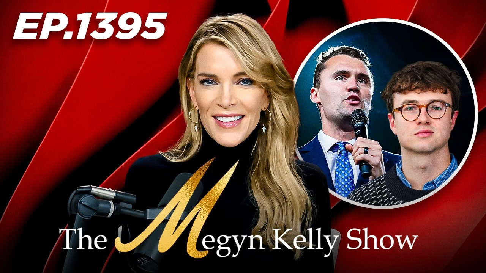
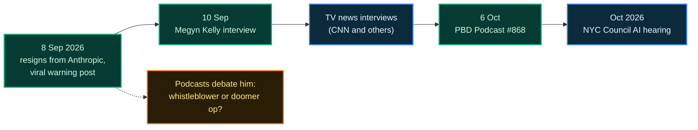
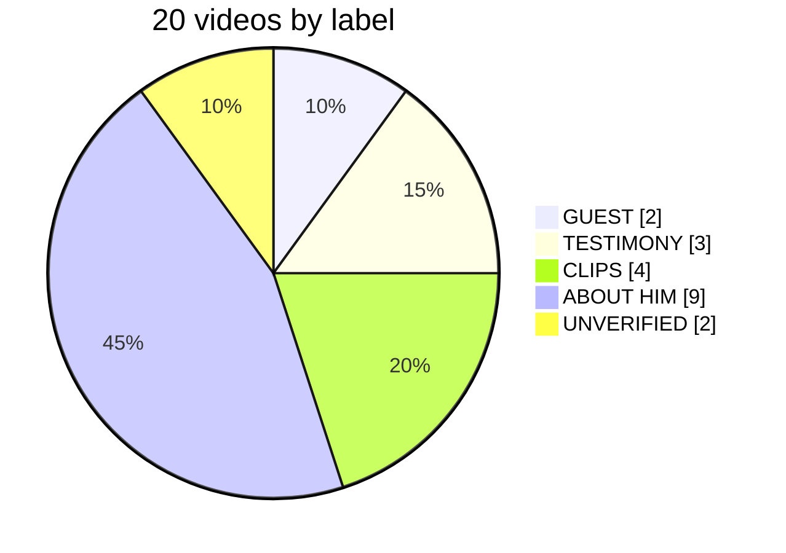

<div align="center">

<a href="https://lo3elyon.github.io/ASI/jacob-coxon-podcasts/"></a>

# Jacob Coxon on YouTube

**20 YouTube videos, every one over an hour, about the researcher who resigned from Anthropic with a viral warning, each labelled by whether he actually speaks.**

<a href="https://lo3elyon.github.io/ASI/jacob-coxon-podcasts/"></a>
<a href="https://lo3elyon.github.io/ASI/"></a>


</div>

## Who is Jacob Coxon?

A former Anthropic researcher. He resigned on **8 September 2026** with a public warning post about AI risk that went viral, then went on a media tour (The Megyn Kelly Show, the PBD Podcast, TV news) and in October testified at a **New York City Council hearing on AI safeguards** on a whistleblower panel with Daniel Kokotajlo and Alex Turner.



## The labels

| Label | Count | Meaning |
|---|:-:|---|
|  | 2 | Long-form interview with him. |
|  | 3 | The NYC Council hearing (three uploads of the same event). |
|  | 4 | Another show plays parts of his TV or hearing appearances. |
|  | 9 | He is discussed or quoted, but not heard. |
|  | 2 | Title names him; no transcript available to confirm. |



## What the page has

| Section | What you can do |
|---|---|
| **Hero and counts** | Six stat figures: 20 videos, 2 guest, 3 testimony, 4 clips, 9 about him, 2 unverified. |
| **Who he is** | The short story: resignation, viral post, media tour, NYC hearing. |
| **Labels** | A colour bar and legend for the five roles. |
| **Videos** | Role filter chips with counts, a live search box, and a card per video: clickable thumbnail (opens YouTube in a new tab), role badge, title, channel, duration, date, a "Does he speak?" line and a summary. |
| **Notes** | Caveats: the three hearing videos are one event, auto-captions spell him "Coxin", timestamps are approximate. |
| **Sources** | All 20 YouTube links. |

## All 20 videos

<table>
<tr>
<td align="center" width="25%" valign="top"><a href="https://www.youtube.com/watch?v=F-Tf5Mo84N4"></a><br><br><sub><b>Remembering Charlie Kirk, Trump's Midterm Message, and How AI Could Destroy Humanity, w/ Jacob Coxon</b><br>Megyn Kelly · ~1h 40m</sub></td>
<td align="center" width="25%" valign="top"><a href="https://www.youtube.com/watch?v=Qpuj1nhcxiI"></a><br><br><sub><b>Ex-Anthropic Insider Tells All &#124; PBD Podcast #868</b><br>PBD Podcast · ~1h 45m</sub></td>
<td align="center" width="25%" valign="top"><a href="https://www.youtube.com/watch?v=_Yl73PhMtm8"></a><br><br><sub><b>LIVE: Former Anthropic researcher testifies on AI at New York City Council</b><br>Associated Press · 7:52:06</sub></td>
<td align="center" width="25%" valign="top"><a href="https://www.youtube.com/watch?v=IejFLhF8efQ"></a><br><br><sub><b>LIVE: Public Testimony at NYC Council Hearing on AI Safeguards</b><br>New York City Council · 9:52:52</sub></td>
</tr>
<tr>
<td align="center" width="25%" valign="top"><a href="https://www.youtube.com/watch?v=ehgjfKZbnmQ"></a><br><br><sub><b>LIVE &#124; Top Tech Executives Reveal Shocking AI Risks In New York Council Hearing</b><br>The No Cap Press · 5:18:49</sub></td>
<td align="center" width="25%" valign="top"><a href="https://www.youtube.com/watch?v=hcVQRmJEYv0"></a><br><br><sub><b>Will AI Takeover the Internet in 6 to 12 months?</b><br>PRECOGNOSIS · 1h+</sub></td>
<td align="center" width="25%" valign="top"><a href="https://www.youtube.com/watch?v=RnbFkfaYOhI"></a><br><br><sub><b>OpenAI Agents Are Now Hacking Real Websites</b><br>Papaksh · 1h+</sub></td>
<td align="center" width="25%" valign="top"><a href="https://www.youtube.com/watch?v=p75moGyHs7o"></a><br><br><sub><b>DESCOVICH FIRES UP DALLAS, COXON SHAKES NYC &#124; AFTER HOURS W ALEX STEIN</b><br>Real America's Voice · 1:00:00</sub></td>
</tr>
<tr>
<td align="center" width="25%" valign="top"><a href="https://www.youtube.com/watch?v=GKGcQSZXQcc"></a><br><br><sub><b>Elon Musk Notices Something Very Suspicious About AI Whistleblower That Everyone Missed</b><br>The Rubin Report · 1:05:20</sub></td>
<td align="center" width="25%" valign="top"><a href="https://www.youtube.com/watch?v=j9vkjCDt1NE"></a><br><br><sub><b>Can AI Kill All Humans in a Decade? &#124; Jacob Coxon &#124; Amit Dubey Podcast</b><br>Switch · 1h+</sub></td>
<td align="center" width="25%" valign="top"><a href="https://www.youtube.com/watch?v=vLngNc-DwLo"></a><br><br><sub><b>Tristan Harris on the Anthropic Whistleblower, Elon Musk, and Avoiding AI Catastrophe</b><br>Talk Easy with Sam Fragoso · 1h+</sub></td>
<td align="center" width="25%" valign="top"><a href="https://www.youtube.com/watch?v=t3UlAQuVbmE"></a><br><br><sub><b>What Tech Oligarchs Gain From AI Doomerism</b><br>The Lever · 1h+</sub></td>
</tr>
<tr>
<td align="center" width="25%" valign="top"><a href="https://www.youtube.com/watch?v=KDJR3zLljPs"></a><br><br><sub><b>Jaan Tallinn on How Close We Are to Losing Control of AI</b><br>The Generalist · 1h+</sub></td>
<td align="center" width="25%" valign="top"><a href="https://www.youtube.com/watch?v=f_hLOaB8Zt8"></a><br><br><sub><b>Pause AI? Should we? If so, how do we make it matter? &#124; Ep 13</b><br>Philosophy, Programs, and Prompts · 1h+</sub></td>
<td align="center" width="25%" valign="top"><a href="https://www.youtube.com/watch?v=MjBGUbkSUsw"></a><br><br><sub><b>Ep499 Solving the AI Paradox</b><br>Firewalls Don't Stop Dragons · 1h+</sub></td>
<td align="center" width="25%" valign="top"><a href="https://www.youtube.com/watch?v=_vpdXFqIfmM"></a><br><br><sub><b>3 Million AI Models and One Very Convenient Week &#124; Ep 213</b><br>Cocktails &amp; Conspiracies · 1h+</sub></td>
</tr>
<tr>
<td align="center" width="25%" valign="top"><a href="https://www.youtube.com/watch?v=1vSi26ckhe4"></a><br><br><sub><b>Did OpenAI Steal the Navier-Stokes Solution? &#124; E2335</b><br>This Week in Startups · 1h+</sub></td>
<td align="center" width="25%" valign="top"><a href="https://www.youtube.com/watch?v=cvxjqbfLVk0"></a><br><br><sub><b>AI Kills Everybody or Doomer Psyop? OpenAI's Math Breakthrough, Nike's $200B Collapse</b><br>All-In Podcast · 1:35:57</sub></td>
<td align="center" width="25%" valign="top"><a href="https://www.youtube.com/watch?v=NBq9plPYFbs"></a><br><br><sub><b>NYC AI Hearing LIVE: Anthropic, OpenAI &amp; Google Face Questions &#124; Fmr Anthropic Researcher Testifies</b><br>CNN-News18 · 1:11:26</sub></td>
<td align="center" width="25%" valign="top"><a href="https://www.youtube.com/watch?v=462B-KxHg60"></a><br><br><sub><b>OpenAI's Astra Navier-Stokes Claim and Jacob Coxon's Anthropic Exit</b><br>Goju Tech Talk · 1h+</sub></td>
</tr>
</table>

| # | Label | Video | Channel | Length | Date | Does he speak? |
|---|---|---|---|---|---|---|
| 1 |  | [Remembering Charlie Kirk, Trump's Midterm Message, and How AI Could Destroy Humanity, w/ Jacob Coxon](https://www.youtube.com/watch?v=F-Tf5Mo84N4) | Megyn Kelly | ~1h 40m | Sep 10, 2026 | Yes, ~38 min interview (approx 1:02:44-1:40:22) |
| 2 |  | [Ex-Anthropic Insider Tells All &#124; PBD Podcast #868](https://www.youtube.com/watch?v=Qpuj1nhcxiI) | PBD Podcast | ~1h 45m | Oct 6, 2026 | Yes, most of the episode, one-on-one with Patrick Bet-David |
| 3 |  | [LIVE: Former Anthropic researcher testifies on AI at New York City Council](https://www.youtube.com/watch?v=_Yl73PhMtm8) | Associated Press | 7:52:06 | Oct 2026 | Yes, called ~10 min, speaks from ~13:30, Q&amp;A to ~53 min |
| 4 |  | [LIVE: Public Testimony at NYC Council Hearing on AI Safeguards](https://www.youtube.com/watch?v=IejFLhF8efQ) | New York City Council | 9:52:52 | Oct 2026 | Yes, called ~25 min, speaks from ~28:24, panel Q&amp;A to ~68 min |
| 5 |  | [LIVE &#124; Top Tech Executives Reveal Shocking AI Risks In New York Council Hearing](https://www.youtube.com/watch?v=ehgjfKZbnmQ) | The No Cap Press | 5:18:49 | Oct 2026 | Yes, called ~13:30, speaks from ~16:54, Q&amp;A to ~56 min |
| 6 |  | [Will AI Takeover the Internet in 6 to 12 months?](https://www.youtube.com/watch?v=hcVQRmJEYv0) | PRECOGNOSIS | 1h+ | 2026 | Yes, ~12-15 min of his TV interviews played (11:00-27:30, 32:00-44:15) |
| 7 |  | [OpenAI Agents Are Now Hacking Real Websites](https://www.youtube.com/watch?v=RnbFkfaYOhI) | Papaksh | 1h+ | 2026 | Yes, ~5-6 min of his CNN interview (~40:13, ~58:50) |
| 8 |  | [DESCOVICH FIRES UP DALLAS, COXON SHAKES NYC &#124; AFTER HOURS W ALEX STEIN](https://www.youtube.com/watch?v=p75moGyHs7o) | Real America's Voice | 1:00:00 | ~Oct 6-7, 2026 | Yes, ~2.5 min of hearing clips (3:30-9:54) |
| 9 |  | [Elon Musk Notices Something Very Suspicious About AI Whistleblower That Everyone Missed](https://www.youtube.com/watch?v=GKGcQSZXQcc) | The Rubin Report | 1:05:20 | Sep 10, 2026 | Yes, ~1 min of his CNN interview (~21:36) |
| 10 |  | [Can AI Kill All Humans in a Decade? &#124; Jacob Coxon &#124; Amit Dubey Podcast](https://www.youtube.com/watch?v=j9vkjCDt1NE) | Switch | 1h+ | 2026 | Couldn't confirm (transcript unavailable) |
| 11 |  | [Tristan Harris on the Anthropic Whistleblower, Elon Musk, and Avoiding AI Catastrophe](https://www.youtube.com/watch?v=vLngNc-DwLo) | Talk Easy with Sam Fragoso | 1h+ | ~Sep 2026 | No, host quotes his tweet |
| 12 |  | [What Tech Oligarchs Gain From AI Doomerism](https://www.youtube.com/watch?v=t3UlAQuVbmE) | The Lever | 1h+ | 2026 | No (a few seconds of a CNN clip at most) |
| 13 |  | [Jaan Tallinn on How Close We Are to Losing Control of AI](https://www.youtube.com/watch?v=KDJR3zLljPs) | The Generalist | 1h+ | 2026 | No |
| 14 |  | [Pause AI? Should we? If so, how do we make it matter? &#124; Ep 13](https://www.youtube.com/watch?v=f_hLOaB8Zt8) | Philosophy, Programs, and Prompts | 1h+ | 2026 | No, hosts read his tweet (~12:52) |
| 15 |  | [Ep499 Solving the AI Paradox](https://www.youtube.com/watch?v=MjBGUbkSUsw) | Firewalls Don't Stop Dragons | 1h+ | Sep 21, 2026 | No, host reads Wired quotes (~35:00) |
| 16 |  | [3 Million AI Models and One Very Convenient Week &#124; Ep 213](https://www.youtube.com/watch?v=_vpdXFqIfmM) | Cocktails &amp; Conspiracies | 1h+ | 2026 | No |
| 17 |  | [Did OpenAI Steal the Navier-Stokes Solution? &#124; E2335](https://www.youtube.com/watch?v=1vSi26ckhe4) | This Week in Startups | 1h+ | Sep 9, 2026 | No |
| 18 |  | [AI Kills Everybody or Doomer Psyop? OpenAI's Math Breakthrough, Nike's $200B Collapse](https://www.youtube.com/watch?v=cvxjqbfLVk0) | All-In Podcast | 1:35:57 | Sep 2026 | No |
| 19 |  | [NYC AI Hearing LIVE: Anthropic, OpenAI &amp; Google Face Questions &#124; Fmr Anthropic Researcher Testifies](https://www.youtube.com/watch?v=NBq9plPYFbs) | CNN-News18 | 1:11:26 | Oct 2026 | No, this upload only has the closing public-testimony panel |
| 20 |  | [OpenAI's Astra Navier-Stokes Claim and Jacob Coxon's Anthropic Exit](https://www.youtube.com/watch?v=462B-KxHg60) | Goju Tech Talk | 1h+ | 2026 | Couldn't confirm (transcript unavailable) |

## Good to know

- The three **TESTIMONY** videos (AP, NYC Council, The No Cap Press) are the same hearing. Watch one.
- YouTube auto-captions often spell his name **"Coxin"**; search for that inside transcripts.
- Timestamps and speaking minutes are approximate (from transcripts and outside chapter listings). "1h+" means over an hour, exact length not recorded.
- Summaries report what speakers said; claims (for example PBD's "90% certain" spies remark) are not fact-checked here.

## Files

```text
jacob-coxon-podcasts/
├── index.html      the page (data inline, vanilla JS filter and search)
├── hark.css        design system
├── hark-hero.css   hero styles
├── hark.js         nav, footer links, theme
├── hero.jpg        hero image (Megyn Kelly interview thumbnail)
└── README.md       this file
```

<sub>Compiled 27 Oct 2026. Thumbnails and videos belong to their YouTube channels. Independent guide, not affiliated with Anthropic or any channel.</sub>
